# 3D-пресеты: каталог

Готовые «кирпичики» картинки для 3D-сцен (движок `node/scene3d`): стиль, свет, камера, атмосфера, окружение,
игра персонажа, переходы. Пресеты складываются по именам в блоке `presets` сцены или плана эпизода — движок сам
разворачивает их в лампы, материалы, постобработку, ключи камеры и клипы героя. Всё процедурное, без платной
генерации и чужих моделей.

```json
"presets": {
  "look": "anime_soft",
  "light": "golden_hour",
  "room": "cozy_desk",
  "mood": "night_rain",
  "fx": ["film_grain", {"name": "rain", "amount": 0.6}],
  "camera": [{"move": "slow_push", "t0": 0, "t1": 4, "target": "hero"},
             {"move": "crash_zoom", "t0": 4, "t1": 6, "target": "hero", "at": 0.2}],
  "transitions": [{"kind": "whip", "t": 4}],
  "performance": [{"who": "hero", "preset": "shocked", "t": 4.1}],
  "subject": "hero"
}
```

- Любое значение — имя пресета или объект `{"name": ..., ...параметры}` (у камеры — `move`, у перехода — `kind`,
  у игры — `preset`). Параметры и их пределы — в таблицах ниже и в `list_3d_presets`.
- `mood` — готовая связка «свет + эффекты + подтон»; `light` и `fx` рядом с ней уточняют её.
- `room` ставит окружение; персонаж с `"at": "hero"` встаёт (или садится) на место героя. `hide` убирает вещи
  окружения, `colors` меняет палитру: `{"name": "cozy_desk", "colors": {"wall": "#3a4060"}, "hide": ["lamp"]}`.
- `camera` — список движений, каждое — новый план (склейка); `target` — id персонажа (`hero` — лицо,
  `hero:chest` — грудь, `hero:full` — во весь рост), якорь окружения (`desk`, `window`, …) или `[x, y, z]`.
- `transitions` — переходы в момент склейки `t`; для склейки отдельно отрисованных роликов —
  `"half": "out"` в конце первого и `"half": "in"` в начале второго.
- Явные поля сцены сильнее пресетов: свои лампы и вещи добавляются, `environment` перекрывает пресетное.

**Где работает.** Сцены движка `node/scene3d` (`app/scene3d.py`, `render_scene`), планы историй Витубики
(поле плана `presets3d` — стиль, свет, настроение, эффекты, переходы поверх истории). Игра персонажа — и для
героя из примитивов (`style: "voxel"`), и для VRM-героя (`node/vrm`, ключи `timeline`).

**Агент и MCP.** `list_3d_presets` — список с русскими описаниями (`category`, `q` — с параметрами);
`check_3d_plan` — проверка блока `presets` до рендера (опечатки — с подсказкой ближайших имён).

**Каталог картинками.** `python tools/presets3d_catalog.py --category all` — по кадру на пресет и листы
`catalog_<категория>.jpg`; `python tools/presets3d_showcase.py` — шоурил ~36 с; `python tools/presets3d_docs.py` —
этот файл. Реестр — `node/scene3d/src/presets/*.ts` (одна правда), снимок для бэкенда —
`node/scene3d/presets/catalog.json` (`node node/scene3d/presets_dump.mjs`).

**toon_ink / toon_sketch / toon_comic** — слоты под шейдер мем-пилота (`environment.toon`, ветка мем-пилота).
Пока он не слит, движок рисует запасной cel-вид и пишет предупреждение; после слияния имена те же.

## Содержание

- [Стиль картинки](#look) — поле `look`, 14 шт.
- [Свет](#light) — поле `light`, 12 шт.
- [Движение камеры](#camera) — поле `camera`, 15 шт.
- [Пост и атмосфера](#fx) — поле `fx`, 13 шт.
- [Настроение (связка свет + атмосфера)](#mood) — поле `mood`, 10 шт.
- [Окружение](#room) — поле `room`, 9 шт.
- [Эмоция персонажа](#emotion) — поле `performance`, 9 шт.
- [Жест персонажа](#gesture) — поле `performance`, 10 шт.
- [Переход между кадрами](#transition) — поле `transitions`, 8 шт.

<a id="look"></a>
## Стиль картинки — `look`

| Кадр | Имя для плана | Что это | Параметры |
|---|---|---|---|
|  | `anime_soft` | **Мягкое аниме**. Как у Витубики (MToon): две ступени света с мягким краем, цветные тени, тонкая тёплая линия, лёгкое свечение. Главный стиль для VRM-героев. |  |
| 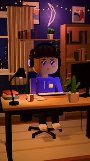 | `toon_ink` | **Тушь и бумага (toon)**. Мультик «нарисованный от руки»: три тона, тёплая обводка тушью, живая «кипящая» линия, фактура бумаги. Шейдер мем-пилота.<br>**слот мем-пилота** |  |
| 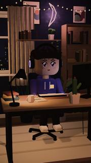 | `toon_sketch` | **Карандашный набросок**. Как раскадровка карандашом: тонкая серая линия, штриховка в тенях, приглушённый цвет. Шейдер мем-пилота.<br>**слот мем-пилота** |  |
| 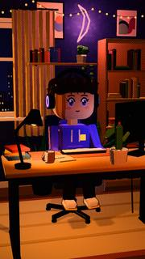 | `toon_comic` | **Комикс**. Два тона, жирная чёрная обводка, растровые точки в тенях — как страница комикса. Шейдер мем-пилота.<br>**слот мем-пилота** |  |
| 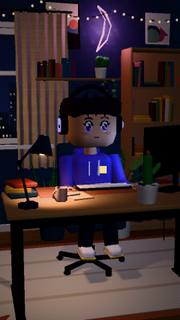 | `psx` | **Ретро PS1**. Как игра 1998 года: низкое разрешение, «дрожащие» вершины, 15-битный цвет с дизерингом, близкий туман. Ностальгия, лиминальные пространства, хоррор. |  |
| 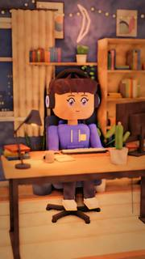 | `clay` | **Пластилин**. Тёплая матовая лепка: бугры и отпечатки пальцев, неровный тон, свет как сквозь массу (тени не чёрные), мягкие скруглённые края, малая глубина резкости — как кукольная анимация. |  |
| 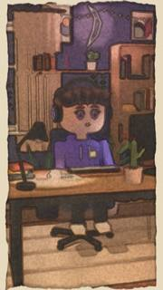 | `watercolor` | **Акварель**. Прозрачные разбавленные заливки слоями на зернистой бумаге, пигмент темнеет у краёв и растекается, контуры «дышат», рамка неокрашенной бумаги. Сказка, воспоминание, детская книга. |  |
| 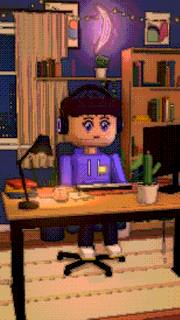 | `pixel_voxel` | **Пиксель / воксель**. Крупные пиксели, ограниченная палитра, плоские грани — как воксельная инди-игра. Для историй стримеров и «кубического» мира. |  |
| 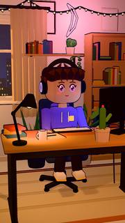 | `flat_vector` | **Плоский вектор**. Плоские заливки в два тона, без бликов и фактуры, ровная тёмная обводка — как моушн-дизайн и инфографика. |  |
| 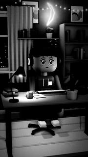 | `noir` | **Нуар**. Чёрно-белое кино: жёсткий свет, глубокие тени, зерно плёнки, тёмные углы. Детектив, драма, мрачный юмор. |  |
| 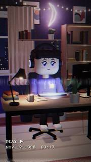 | `vhs_found` | **VHS-кассета (found footage)**. Запись со старой камеры: расплывшийся цвет, строки развёртки, полоса трекинга, дата в углу. Найденная плёнка, крипи, «90-е». |  |
| 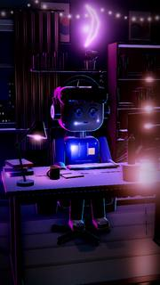 | `neon_cyber` | **Неоновый киберпанк**. Почти чёрные глянцевые поверхности, неоновая обводка — бирюза с одной стороны, маджента с другой, глубокие холодные тени, сильное свечение. |  |
| 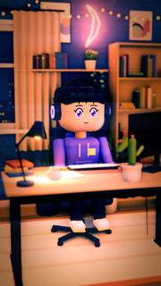 | `cinematic` | **Кино (PBR)**. Плёночная тональная кривая, сильный тил-оранж грейд (бирюзовые тени, тёплая кожа), малая глубина резкости, голубые полосы анаморфота от огней, зерно; по желанию — кинополя. | `letterbox` = 0 [0…0.4] — чёрные кинополя сверху и снизу, доля высоты кадра (0 — нет, 0.12 — заметно)<br>`anamorphic` = 0.8 [0…2] — сила голубых полос анаморфота от ярких мест |
| 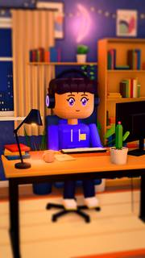 | `lowpoly_toy` | **Лоу-поли игрушка**. Гранёные формы с плоским затенением, яркие насыщенные «пластиковые» цвета, мягкие тени и тилт-шифт: верх и низ кадра размыты — мир как игрушечная миниатюра (стиль 3D-серий про лифт). | `tiltShift` = 1.4 [0…2] — сила тилт-шифта (размытие выше и ниже героя) |

<a id="light"></a>
## Свет — `light`

| Кадр | Имя для плана | Что это | Параметры |
|---|---|---|---|
|  | `golden_hour` | **Золотой час**. Низкое тёплое солнце сбоку-сзади, длинные тени, медовый контровой ободок на волосах. Тепло, ностальгия. | `intensity` = 1 [0…4] — общая яркость схемы (1 — как задумано)<br>`side` = 1 [-1…1] — с какой стороны ключевой свет: 1 — справа от героя, −1 — слева |
| 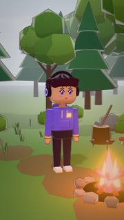 | `overcast_soft` | **Пасмурно, мягко**. Ровный мягкий свет облачного дня без резких теней. Спокойно, честно, «как в жизни». | `intensity` = 1 [0…4] — общая яркость схемы (1 — как задумано) |
| 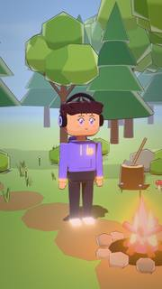 | `noon_sun` | **Полдень**. Высокое белое солнце, короткие резкие тени, голубое небо. Лето, жара, бодрость. | `intensity` = 1 [0…4] — общая яркость схемы (1 — как задумано) |
| 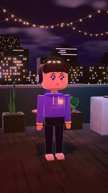 | `night_neon` | **Ночная улица, неон**. Тёмная ночь, малиновый неон с одной стороны, бирюзовый — с другой, оранжевый фонарь сверху. Город, киберпанк. | `intensity` = 1 [0…4] — общая яркость схемы (1 — как задумано)<br>`side` = 1 [-1…1] — с какой стороны ключевой свет: 1 — справа от героя, −1 — слева |
| 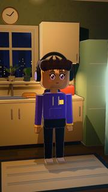 | `horror_lamp` | **Одна лампа (хоррор)**. Голая лампочка над героем и чернота вокруг; свет иногда вздрагивает. Хоррор, допрос, тревога. | `intensity` = 1 [0…4] — общая яркость схемы (1 — как задумано)<br>`flicker` = 1 [0…1] — сила мерцания |
| 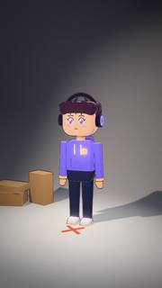 | `studio_3pt` | **Студия, три точки**. Классика интервью и продукта: мягкий ключ, слабая заливка, яркий контровой ободок. Чисто и дорого. | `intensity` = 1 [0…4] — общая яркость схемы (1 — как задумано)<br>`side` = 1 [-1…1] — с какой стороны ключевой свет: 1 — справа от героя, −1 — слева |
|  | `monitor_glow` | **Свет монитора ночью**. Тёмная комната, лицо подсвечено холодным экраном снизу-спереди, вдали тёплая лампа. Стример, ночной геймер. | `intensity` = 1 [0…4] — общая яркость схемы (1 — как задумано)<br>`screen` = #8fb8ff — цвет экрана |
|  | `sunrise_window` | **Рассвет в окне**. Розово-золотой утренний луч из окна, видимые лучи в воздухе, холодные тени. Утро, надежда, новый день. | `intensity` = 1 [0…4] — общая яркость схемы (1 — как задумано)<br>`side` = 1 [-1…1] — с какой стороны ключевой свет: 1 — справа от героя, −1 — слева |
| 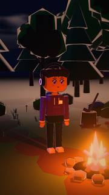 | `campfire` | **Костёр**. Тёплый живой свет снизу, дрожащий как пламя, и холодная луна в спину. Лагерь, страшилки у огня, уют. | `intensity` = 1 [0…4] — общая яркость схемы (1 — как задумано) |
| 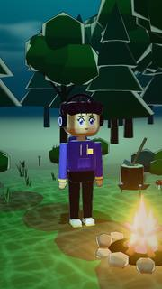 | `underwater` | **Под водой**. Сине-зелёная толща, сверху бегут блики каустики, даль тонет в мути. Сон, глубина, тишина. | `intensity` = 1 [0…4] — общая яркость схемы (1 — как задумано) |
| 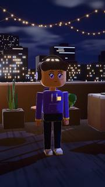 | `moonlight` | **Лунная ночь**. Холодный голубой свет луны из окна или с неба, глубокие синие тени, тёплая искра где-то вдали. Тишина, тайна. | `intensity` = 1 [0…4] — общая яркость схемы (1 — как задумано)<br>`side` = 1 [-1…1] — с какой стороны ключевой свет: 1 — справа от героя, −1 — слева |
|  | `stage_spot` | **Луч прожектора**. Один жёсткий луч сверху на героя, видимый конус в дымке, вокруг — темнота. Сцена, признание, стендап. | `intensity` = 1 [0…4] — общая яркость схемы (1 — как задумано)<br>`color` = #fff1d8 — цвет луча |

<a id="camera"></a>
## Движение камеры — `camera`

| Кадр | Имя для плана | Что это | Параметры |
|---|---|---|---|
| 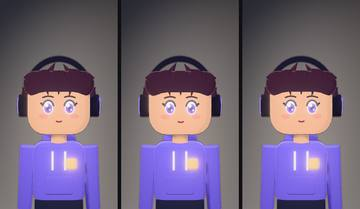 | `static` | **Статика**. Камера стоит на штативе. Для диалога и спокойного кадра. | `target` — куда смотрим: id персонажа, якорь комнаты или [x, y, z]<br>`distance` = 2.2 [0.3…20] — дистанция до цели, м<br>`yaw` = 0 [-180…180] — азимут камеры от «напротив», °<br>`height` = 0.15 [-2…12] — подъём камеры над целью, м<br>`fov` = 35 [8…100] — угол обзора по вертикали, ° |
| 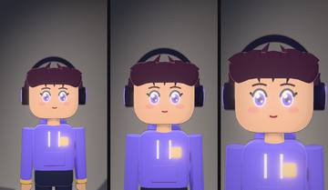 | `slow_push` | **Медленный наезд**. Плавно подъезжаем к герою — нарастает внимание, эмоция, «сейчас что-то будет». | `target` — куда смотрим: id персонажа, якорь комнаты или [x, y, z]<br>`distance` = 2.2 [0.3…20] — дистанция до цели, м<br>`yaw` = 0 [-180…180] — азимут камеры от «напротив», °<br>`height` = 0.12 [-2…12] — подъём камеры над целью, м<br>`fov` = 35 [8…100] — угол обзора по вертикали, °<br>`strength` = 1 [0…3] — насколько подъехать (1 — на треть) |
| 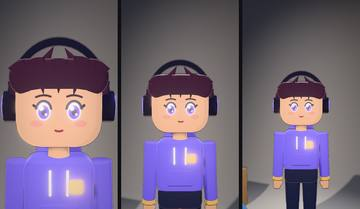 | `pull_out` | **Отъезд**. Камера медленно отъезжает: герой остаётся один в большом пространстве, финал сцены. | `target` — куда смотрим: id персонажа, якорь комнаты или [x, y, z]<br>`distance` = 1.6 [0.3…20] — дистанция до цели, м<br>`yaw` = 0 [-180…180] — азимут камеры от «напротив», °<br>`height` = 0.2 [-2…12] — подъём камеры над целью, м<br>`fov` = 35 [8…100] — угол обзора по вертикали, °<br>`strength` = 1 [0…3] — насколько отъехать (1 — вдвое) |
| 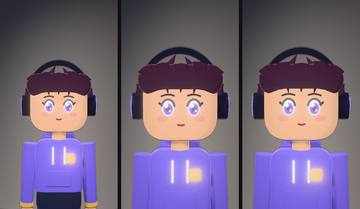 | `punch_in` | **Рывок вперёд**. Резкий короткий наезд с лёгким перелётом — акцент на реакции или фразе. Сила по умолчанию — по крупности плана: на общем заметнее, на крупном лице — мягко. | `target` — куда смотрим: id персонажа, якорь комнаты или [x, y, z]<br>`distance` = 2.4 [0.3…20] — дистанция до цели, м<br>`yaw` = 0 [-180…180] — азимут камеры от «напротив», °<br>`height` = 0.1 [-2…12] — подъём камеры над целью, м<br>`fov` = 35 [8…100] — угол обзора по вертикали, °<br>`at` = 0.15 [0…1] — когда случается рывок: доля длины плана<br>`speed` = 0.3 [0.08…1] — длина рывка, с<br>`strength` [0…3] — насколько ближе (1 — почти вдвое); не задано — по крупности плана: ~0.5 на среднем, 0.3 на крупном лице, до 0.7 на общем |
| 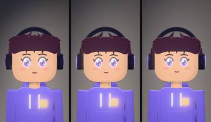 | `dolly_zoom` | **Вертиго (dolly zoom)**. Камера едет назад, объектив приближает: герой того же размера, а мир за ним «растягивается». Шок, осознание. | `target` — куда смотрим: id персонажа, якорь комнаты или [x, y, z]<br>`distance` = 1.5 [0.3…20] — дистанция до цели, м<br>`yaw` = 0 [-180…180] — азимут камеры от «напротив», °<br>`height` = 0.05 [-2…12] — подъём камеры над целью, м<br>`fov` = 42 [8…100] — угол обзора по вертикали, °<br>`dir` = out (out / in) — out — фон растёт, in — фон сжимается<br>`strength` = 1 [0…3] — насколько сильно (1 — дистанция ×2.3) |
| 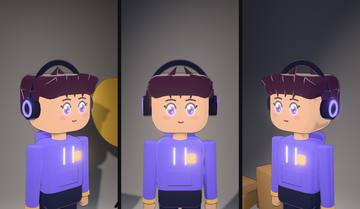 | `orbit` | **Облёт**. Камера плавно обходит героя по дуге — показать человека и пространство вокруг. | `target` — куда смотрим: id персонажа, якорь комнаты или [x, y, z]<br>`distance` = 2.4 [0.3…20] — дистанция до цели, м<br>`yaw` = 0 [-180…180] — азимут камеры от «напротив», °<br>`height` = 0.35 [-2…12] — подъём камеры над целью, м<br>`fov` = 35 [8…100] — угол обзора по вертикали, °<br>`arc` = 70 [-360…360] — дуга облёта, ° (минус — в другую сторону) |
| 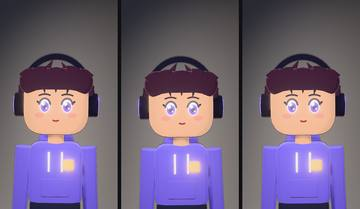 | `handheld` | **С рук (документалка)**. Живая ручная камера: лёгкое покачивание и подруливание, как у оператора-документалиста. | `target` — куда смотрим: id персонажа, якорь комнаты или [x, y, z]<br>`distance` = 1.9 [0.3…20] — дистанция до цели, м<br>`yaw` = 0 [-180…180] — азимут камеры от «напротив», °<br>`height` = 0.1 [-2…12] — подъём камеры над целью, м<br>`fov` = 38 [8…100] — угол обзора по вертикали, °<br>`strength` = 1 [0…3] — сила тряски (1 — 2.5 см) |
| 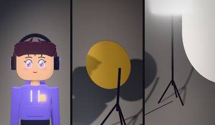 | `whip_pan` | **Хлёсткая панорама**. Камера резко «хлещет» в сторону на другую цель — склейка без склейки (лучше с переходом whip). | `target` — куда смотрим: id персонажа, якорь комнаты или [x, y, z]<br>`to` — куда хлестнуть (вторая цель)<br>`distance` = 2.2 [0.3…20] — дистанция до цели, м<br>`yaw` = 0 [-180…180] — азимут камеры от «напротив», °<br>`height` = 0.1 [-2…12] — подъём камеры над целью, м<br>`fov` = 35 [8…100] — угол обзора по вертикали, °<br>`at` = 0.5 [0…1] — середина рывка: доля плана<br>`speed` = 0.32 [0.12…1.5] — длина рывка, с |
| 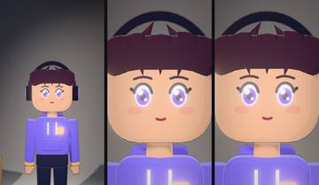 | `crash_zoom` | **Краш-зум**. Резкий зум объективом в лицо на панчлайне, с толчком. Мемный акцент. | `target` — куда смотрим: id персонажа, якорь комнаты или [x, y, z]<br>`distance` = 2.6 [0.3…20] — дистанция до цели, м<br>`yaw` = 0 [-180…180] — азимут камеры от «напротив», °<br>`height` = 0.05 [-2…12] — подъём камеры над целью, м<br>`fov` = 40 [8…100] — угол обзора по вертикали, °<br>`at` = 0.15 [0…1] — когда случается рывок: доля длины плана<br>`zoom` = 2.6 [1.2…6] — во сколько раз приблизить<br>`speed` = 0.14 [0.05…0.6] — длина зума, с |
| 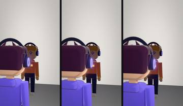 | `over_shoulder` | **Через плечо**. Камера за плечом героя смотрит туда же, куда он: на собеседника, экран, предмет. | `target` — куда смотрим: id персонажа, якорь комнаты или [x, y, z]<br>`who` — чьё плечо: id персонажа<br>`side` = 1 [-1…1] — плечо: 1 — правое, −1 — левое<br>`fov` = 38 [8…100] — угол обзора по вертикали, °<br>`strength` = 1 [0…3] — медленный наезд за план (0 — статично) |
| 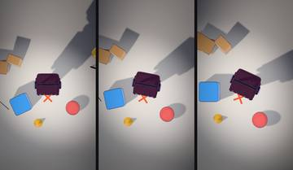 | `top_down` | **Сверху (god view)**. Камера строго сверху, медленно поворачивается: схема места, одиночество, «вид бога». | `target` — куда смотрим: id персонажа, якорь комнаты или [x, y, z]<br>`distance` = 4.5 [0.3…20] — дистанция до цели, м<br>`fov` = 40 [8…100] — угол обзора по вертикали, °<br>`spin` = 25 [-180…180] — поворот кадра за план, ° |
| 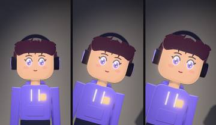 | `dutch_tilt` | **Голландский угол**. Кадр заваливается набок — тревога, что-то не так, «крыша едет». | `target` — куда смотрим: id персонажа, якорь комнаты или [x, y, z]<br>`distance` = 2 [0.3…20] — дистанция до цели, м<br>`yaw` = 0 [-180…180] — азимут камеры от «напротив», °<br>`height` = -0.1 [-2…12] — подъём камеры над целью, м<br>`fov` = 36 [8…100] — угол обзора по вертикали, °<br>`roll` = 16 [-40…40] — завал, ° |
| 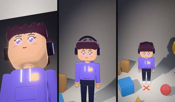 | `crane_reveal` | **Подъём крана**. Камера поднимается снизу вверх и назад, открывая место действия — эффектное начало сцены. | `target` — куда смотрим: id персонажа, якорь комнаты или [x, y, z]<br>`distance` = 1.6 [0.3…20] — дистанция до цели, м<br>`yaw` = 0 [-180…180] — азимут камеры от «напротив», °<br>`fov` = 38 [8…100] — угол обзора по вертикали, °<br>`rise` = 2.4 [0.5…10] — насколько подняться, м |
| 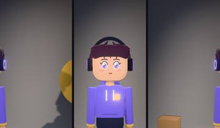 | `truck` | **Проезд вбок**. Камера едет параллельно герою — параллакс: передний план бежит быстрее заднего. | `target` — куда смотрим: id персонажа, якорь комнаты или [x, y, z]<br>`distance` = 2.4 [0.3…20] — дистанция до цели, м<br>`yaw` = 0 [-180…180] — азимут камеры от «напротив», °<br>`height` = 0.1 [-2…12] — подъём камеры над целью, м<br>`fov` = 35 [8…100] — угол обзора по вертикали, °<br>`travel` = 1.6 [-8…8] — сколько проехать вбок, м |
| 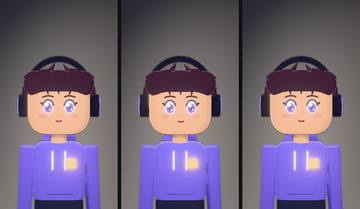 | `match_cut` | **Монтаж по форме (match cut)**. Новый план с той же композицией, что прошлый: цель встаёт в то же место кадра. Склейка по форме/движению. | `target` — куда смотрим: id персонажа, якорь комнаты или [x, y, z]<br>`distance` = 2.2 [0.3…20] — дистанция до цели, м<br>`yaw` = 0 [-180…180] — азимут камеры от «напротив», °<br>`height` = 0.12 [-2…12] — подъём камеры над целью, м<br>`fov` = 35 [8…100] — угол обзора по вертикали, ° |

<a id="fx"></a>
## Пост и атмосфера — `fx`

| Кадр | Имя для плана | Что это | Параметры |
|---|---|---|---|
| 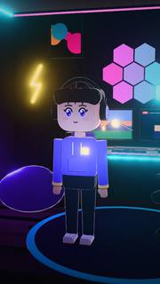 | `bloom` | **Свечение**. Яркие места мягко светятся ореолом: лампы, экраны, неон, блики. | `amount` = 1 [0…3] — сила (1 — как задумано) |
|  | `film_grain` | **Зерно плёнки**. Живое зерно, сильнее в средних тонах, — картинка «дышит», не выглядит пластиковой. | `amount` = 1 [0…3] — сила (1 — как задумано) |
| 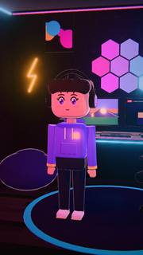 | `chromatic` | **Хроматическая аберрация**. Цветная кайма по краям кадра, как у дешёвого объектива. Тревога, сон, ретро. | `amount` = 1 [0…3] — сила (1 — как задумано) |
| 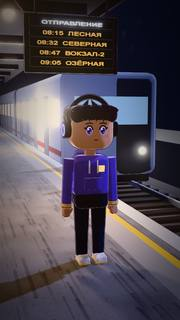 | `vignette` | **Виньетка**. Затемнённые углы — взгляд сам идёт в центр кадра. | `amount` = 1 [0…3] — сила (1 — как задумано) |
| 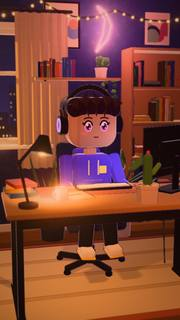 | `depth_of_field` | **Глубина резкости**. Резко только то, на что смотрит камера, фон и передний план мягко размыты. Фокус всегда на цели кадра. | `amount` = 1 [0…3] — сила (1 — как задумано) |
| 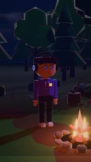 | `fog_layers` | **Слои тумана**. Медленно плывущие полосы тумана у пола и в глубине — объём и тайна. | `amount` = 1 [0…3] — сила (1 — как задумано)<br>`color` — цвет тумана (по умолчанию — от схемы света) |
|  | `rain` | **Дождь**. Косые струи дождя с размытием движения, ближние капли крупнее. Тоска, драма, ночной город. | `amount` = 1 [0…3] — сила (1 — как задумано)<br>`wind` = 0.25 [-2…2] — ветер: наклон струй |
| 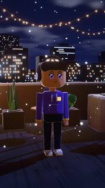 | `snow` | **Снег**. Пушистые хлопья медленно кружатся и падают, вдали — мельче. Зима, Новый год, тишина. | `amount` = 1 [0…3] — сила (1 — как задумано)<br>`wind` = 0.15 [-2…2] — ветер |
|  | `dust_motes` | **Пылинки в свете**. Пылинки медленно парят и вспыхивают в луче света. Чердак, утро, старая квартира. | `amount` = 1 [0…3] — сила (1 — как задумано) |
| 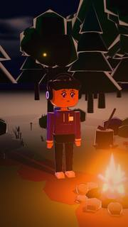 | `fireflies` | **Светлячки**. Тёплые огоньки плавают и мерцают в сумерках. Лес, сказка, романтика. | `amount` = 1 [0…3] — сила (1 — как задумано)<br>`color` = #ffe27a — цвет огоньков |
| 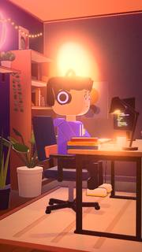 | `god_rays` | **Божественные лучи**. Видимые лучи света от солнца/окна/лампы, расходящиеся в воздухе. | `amount` = 1 [0…3] — сила (1 — как задумано)<br>`from` = auto — откуда: id лампы, sun или auto (самая яркая) |
| 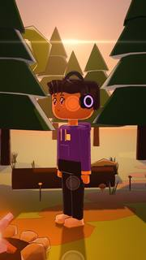 | `lens_flare` | **Блики объектива**. Кольца и полоса блика, когда в кадре яркая лампа или солнце. Летнее, «киношное». | `amount` = 1 [0…3] — сила (1 — как задумано)<br>`from` = auto — от какой лампы: id, sun или auto |
| 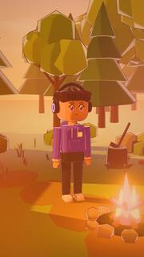 | `light_leak` | **Засветка плёнки**. Тёплые пятна засвеченной плёнки медленно плывут по краю кадра. Воспоминание, лето, винтаж. | `amount` = 1 [0…3] — сила (1 — как задумано)<br>`color` = #ff9a4a — цвет засветки |

<a id="mood"></a>
## Настроение (связка свет + атмосфера) — `mood`

| Кадр | Имя для плана | Что это | Параметры |
|---|---|---|---|
| 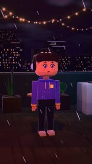 | `night_rain` | **Ночной дождь**. Мокрая неоновая ночь: дождь, туман в глубине, свечение вывесок, холодный раскол цвета.<br>свет `night_neon`, эффекты `rain`, `fog_layers`, `bloom`, `chromatic` |  |
| 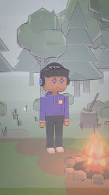 | `foggy_morning` | **Туманное утро**. Молочный рассеянный свет, слои тумана, пылинки. Тихо, сонно, немного грустно.<br>свет `overcast_soft`, эффекты `fog_layers`, `dust_motes`, `film_grain` |  |
| 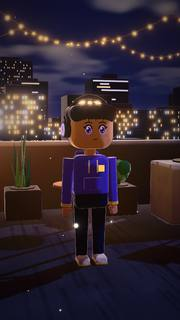 | `snowy_evening` | **Снежный вечер**. Синий зимний вечер, медленный снег, тёплые огни вдали. Новогоднее, уютное.<br>свет `moonlight`, эффекты `snow`, `bloom`, `vignette` |  |
| 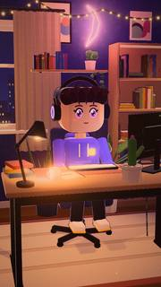 | `dusty_attic` | **Пыльный чердак**. Утренний луч из окна, видимые лучи, пылинки в свете. Находка, воспоминание.<br>свет `sunrise_window`, эффекты `god_rays`, `dust_motes`, `film_grain` |  |
|  | `horror_flicker` | **Хоррор-мерцание**. Одна мигающая лампа, темнота, туман, тяжёлое зерно и тёмные углы.<br>свет `horror_lamp`, эффекты `fog_layers`, `film_grain`, `vignette`, `chromatic` |  |
|  | `dreamy_pastel` | **Пастельный сон**. Мягкий свет, засветки плёнки, свечение, приподнятые пастельные тени. Мечта, флешбэк.<br>свет `golden_hour`, эффекты `light_leak`, `bloom`, `depth_of_field` |  |
|  | `summer_noon` | **Летний полдень**. Яркое солнце, блики объектива, тёплые засветки. Каникулы, жара.<br>свет `noon_sun`, эффекты `lens_flare`, `light_leak`, `bloom` |  |
|  | `cyber_night` | **Кибер-ночь**. Неон, сильное свечение, блики, аберрация и лёгкий дождь. Будущее, хакеры, клубы.<br>свет `night_neon`, эффекты `bloom`, `lens_flare`, `chromatic`, `rain` |  |
|  | `cozy_evening` | **Уютный вечер**. Тёплый закатный свет, пылинки, лёгкая засветка, мягкая виньетка. Дом, чай, плед.<br>свет `golden_hour`, эффекты `dust_motes`, `light_leak`, `vignette` |  |
|  | `campfire_tales` | **Страшилки у костра**. Живой огонь снизу, светлячки, ночная дымка — сказка или страшилка.<br>свет `campfire`, эффекты `fireflies`, `fog_layers`, `film_grain` |  |

<a id="room"></a>
## Окружение — `room`

| Кадр | Имя для плана | Что это | Параметры |
|---|---|---|---|
|  | `void_stage` | **Пустая сцена с лучом**. Чёрная пустота, двухъярусный круглый подиум со светящейся кромкой, рампа, бархатный занавес в дымке, позади — стойка микрофона и барный стул. Монолог, признание, стендап, «герой наедине с мыслью». Чистый подиум — hide: mic, stool.<br>к нему: свет `stage_spot`, стиль `anime_soft`; якоря `hero`, `focus`, `mic`, `stool`; палитра `floor`, `stage`, `rim`, `glow`, `bulb`, `curtain`, `curtain2`, `stool`, `haze` |  |
|  | `studio_cyclorama` | **Студийная циклорама**. Бесшовный белый (или цветной) фон-«бесконечность» студии: пол плавно переходит в стену; по бокам — софтбоксы на треногах, золотой рефлектор, ящики, метка на полу. Продукт, интервью, чистый показ героя.<br>к нему: свет `studio_3pt`, стиль `anime_soft`; якоря `hero`, `focus`, `mark`, `softbox`; палитра `sweep`, `floor`, `stand`, `gold`, `wood`, `tape` |  |
|  | `cozy_desk` | **Уютный стол стримера**. Тёплый угол вечером: стол с монитором, лампой и кружкой, за спиной — окно с ночным городом, стеллаж с книгами, полка с плющом, рамки, гирлянда, торшер. Герой сидит лицом к зрителю. Стрим, разговор, «что я понял».<br>к нему: свет `golden_hour`, стиль `anime_soft`; якоря `hero`, `focus`, `desk`, `screen`, `window`, `bookcase`, `lamp`; палитра `wall`, `accent`, `floor`, `wood`, `frame`, `chair`, `accent2`, `curtain`, `rug`, `rug2`, `screen`, `warm`, `bulbs`, `lamp`, `shade`, `plant`, `pot`, `mug`, `neon` |  |
|  | `gamer_rgb` | **Игровая комната в RGB**. Тёмная комната геймера: стол с двумя мониторами (игра и эфир), системник со светящимися вентиляторами, соты светопанелей, неон-молния, LED под потолком, игровое кресло, кресло-мешок. Герой стоит перед сетапом. Гейминг, стрим, техно-обзор.<br>к нему: свет `monitor_glow`, стиль `anime_soft`; якоря `hero`, `focus`, `seat`, `desk_seat`, `desk`, `screen`, `wall`; палитра `wall`, `accent`, `floor`, `desk`, `frame`, `chair`, `screen`, `screen2`, `neon`, `neon2`, `neon3`, `beanbag`, `rug` |  |
|  | `kitchen_night` | **Ночная кухня**. Кухня ночью: шкафы с подсветкой столешницы, плита с вытяжкой и тёплой лампой, окно с луной над мойкой, приоткрытый холодильник льёт холодный свет, обеденный столик с подвесной лампой. «Ночной перекус», разговор по душам, бытовая комедия.<br>к нему: свет `moonlight`, стиль `anime_soft`; якоря `hero`, `focus`, `counter`, `stove`, `fridge`, `window`, `table`; палитра `wall`, `cabinet`, `stone`, `metal`, `tile`, `floor`, `wood`, `fridge`, `cold`, `warm`, `stove`, `kettle`, `mug`, `bowl`, `pendant`, `rug` |  |
|  | `office_openspace` | **Опенспейс днём**. Светлый офис: ряды столов с мониторами и перегородками, подвесные световые панели, большие окна с небом, кадки с растениями, диванная зона, доска со стикерами. Работа, корпоративная комедия, «мой первый день».<br>к нему: свет `overcast_soft`, стиль `anime_soft`; якоря `hero`, `focus`, `seat`, `desk`, `window`, `sofa`, `whiteboard`; палитра `wall`, `floor`, `desk`, `leg`, `panel`, `chair`, `screen`, `sofa`, `planter` |  |
|  | `train_station` | **Платформа вокзала**. Платформа под навесом вечером: жёлтая линия у края, рельсы уходят вдаль, ряды колонн, скамейки, фонари, табло отправлений с жёлтыми строками, часы, за путями — город. Ожидание, расставание, «уезжаю».<br>к нему: свет `moonlight`, стиль `anime_soft`; якоря `hero`, `focus`, `edge`, `bench`, `board`, `track`, `clock`; палитра `concrete`, `line`, `ballast`, `sleeper`, `wall`, `metal`, `pillar`, `roof`, `lamp`, `wood`, `board`, `hall`, `town`, `train`, `trainStripe`, `trainDoor`, `trainWin` |  |
|  | `city_rooftop` | **Крыша с видом на город**. Ночная крыша: парапет, за ним — город с горящими окнами до горизонта, водонапорный бак, антенна с красным огоньком, кондиционеры, гирлянды на шестах над столиком, неон. Признание, мечты, разговор под звёздами.<br>к нему: свет `moonlight`, стиль `anime_soft`; якоря `hero`, `focus`, `parapet`, `seat`, `seat2`, `table`, `skyline`, `tower`; палитра `floor`, `wall`, `cap`, `metal`, `wood`, `unit`, `chair`, `planter`, `bulbs`, `neon`, `city`, `city2` |  |
|  | `forest_clearing` | **Лесная поляна**. Поляна в лоу-поли лесу: ели и лиственные деревья кольцом, тропинка в чащу, камни со мхом, бревно-скамья, пень с топориком, грибы, цветы, костёр в кольце камней с живым огнём. Поход, сказка, страшилки у костра.<br>к нему: свет `golden_hour`, стиль `anime_soft`; якоря `hero`, `focus`, `fire`, `log`, `stump`, `path`, `forest`; палитра `grass`, `grass2`, `moss`, `path`, `pine`, `pine2`, `leaf`, `leaf2`, `bark`, `cut`, `stone`, `cap`, `flower`, `flower2`, `fire`, `fire2` |  |

<a id="emotion"></a>
## Эмоция персонажа — `performance`

| Кадр | Имя для плана | Что это | Параметры |
|---|---|---|---|
|  | `happy` | **Радость**. Сияет: глаза-дужки, кулачки к груди «ура», пара подскоков и покачивание головой. Хорошая новость, донат, победа.<br>длина 2.4 с; движки: voxel, vrm, deskbot | `intensity` = 1 [0.3…1.6] — сила игры: 1 — как задумано, 0.5 — сдержанно, 1.5 — через край |
|  | `sad` | **Грусть**. Медленно оседает: брови домиком, слёзы на глазах, плечи опускаются, голова клонится; два тихих всхлипа.<br>длина 3 с; движки: voxel, vrm, deskbot | `intensity` = 1 [0.3…1.6] — сила игры: 1 — как задумано, 0.5 — сдержанно, 1.5 — через край |
|  | `angry` | **Злость**. Взгляд исподлобья, стиснутые зубы, кулаки сжаты и дрожат, плечи вверх; стоя — топает ногой. Чат опять спойлерит.<br>длина 2.4 с; движки: voxel, vrm, deskbot | `intensity` = 1 [0.3…1.6] — сила игры: 1 — как задумано, 0.5 — сдержанно, 1.5 — через край |
|  | `offended` | **Обиделась**. «Хмф!»: резко отворачивается с подбородком вверх, руки скрещены, глаза закрыты, щёки красные.<br>длина 2.6 с; движки: voxel, vrm, deskbot | `intensity` = 1 [0.3…1.6] — сила игры: 1 — как задумано, 0.5 — сдержанно, 1.5 — через край<br>`side` = left (left / right) — куда отвернуться (left / right — сторона персонажа) |
|  | `shocked` | **Шок**. Дёрнулся назад, глаза-плошки, рот «О», ладони перед грудью — и замер. Неожиданный поворот, огромный донат.<br>длина 2 с; движки: voxel, vrm, deskbot | `intensity` = 1 [0.3…1.6] — сила игры: 1 — как задумано, 0.5 — сдержанно, 1.5 — через край |
|  | `smug` | **Самодовольство**. Руки в боки (сидя — скрещены), корпус откинут, подбородок вверх, ухмылка уголком и «хе-хе» плечами.<br>длина 2.6 с; движки: voxel, vrm, deskbot | `intensity` = 1 [0.3…1.6] — сила игры: 1 — как задумано, 0.5 — сдержанно, 1.5 — через край<br>`side` = left (left / right) — куда наклонить голову |
|  | `tired` | **Усталость**. Сутулится, веки тяжёлые; зевает, прикрыв рот, потом клюёт носом и вздрагивает. Ночной стрим.<br>длина 3.4 с; движки: voxel, vrm, deskbot | `intensity` = 1 [0.3…1.6] — сила игры: 1 — как задумано, 0.5 — сдержанно, 1.5 — через край |
|  | `thinking` | **Задумалась**. Кулак под подбородком, другая рука держит локоть, взгляд вверх, голова набок, постукивает пальцем.<br>длина 3 с; движки: voxel, vrm, deskbot | `intensity` = 1 [0.3…1.6] — сила игры: 1 — как задумано, 0.5 — сдержанно, 1.5 — через край<br>`side` = right (left / right) — какой рукой (left / right — рука персонажа) |
|  | `panic` | **Паника**. Машет руками, потом хватается за голову и мотает ею; зрачки-точки, рот волной, капли пота. Сломался стрим, горит дедлайн.<br>длина 2.6 с; движки: voxel, vrm, deskbot | `intensity` = 1 [0.3…1.6] — сила игры: 1 — как задумано, 0.5 — сдержанно, 1.5 — через край |

<a id="gesture"></a>
## Жест персонажа — `performance`

| Кадр | Имя для плана | Что это | Параметры |
|---|---|---|---|
|  | `sigh` | **Вздох**. Глубокий вдох — плечи вверх, и долгий выдох — плечи падают, голова вниз, глаза закрыты.<br>длина 2.2 с; движки: voxel, vrm, deskbot | `intensity` = 1 [0.3…1.6] — сила игры: 1 — как задумано, 0.5 — сдержанно, 1.5 — через край<br>`face` = sigh (neutral / happy / laugh / wide / frown / talk / tired / yawn / angry / sad / smug / pout / think / panic / shock / eyeroll / sigh / wince / meh / none) — лицо на время жеста (none — не менять) |
|  | `eye_roll` | **Закатывает глаза**. Зрачки под веко, голова откидывается дугой — «ну конечно». Реакция на глупый вопрос.<br>длина 1.8 с; движки: voxel, vrm, deskbot | `intensity` = 1 [0.3…1.6] — сила игры: 1 — как задумано, 0.5 — сдержанно, 1.5 — через край<br>`face` = eyeroll (neutral / happy / laugh / wide / frown / talk / tired / yawn / angry / sad / smug / pout / think / panic / shock / eyeroll / sigh / wince / meh / none) — лицо на время жеста (none — не менять) |
|  | `facepalm` | **Рука-лицо**. Ладонь к лицу, голова клонится в ладонь и медленно качается. Когда нет слов.<br>длина 2.6 с; движки: voxel, vrm, deskbot | `intensity` = 1 [0.3…1.6] — сила игры: 1 — как задумано, 0.5 — сдержанно, 1.5 — через край<br>`side` = right (left / right) — какой рукой (left / right — рука персонажа)<br>`face` = wince (neutral / happy / laugh / wide / frown / talk / tired / yawn / angry / sad / smug / pout / think / panic / shock / eyeroll / sigh / wince / meh / none) — лицо на время жеста (none — не менять) |
|  | `shrug` | **Пожимает плечами**. Плечи вверх, локти у боков, ладони вверх, голова набок — «ну не знаю».<br>длина 1.8 с; движки: voxel, vrm, deskbot | `intensity` = 1 [0.3…1.6] — сила игры: 1 — как задумано, 0.5 — сдержанно, 1.5 — через край<br>`face` = meh (neutral / happy / laugh / wide / frown / talk / tired / yawn / angry / sad / smug / pout / think / panic / shock / eyeroll / sigh / wince / meh / none) — лицо на время жеста (none — не менять) |
|  | `point` | **Показывает**. Прямая рука с лёгким тычком туда, куда смотрит; голова и корпус — следом. «Смотри!»<br>длина 2 с; движки: voxel, vrm, deskbot | `intensity` = 1 [0.3…1.6] — сила игры: 1 — как задумано, 0.5 — сдержанно, 1.5 — через край<br>`side` = right (left / right) — какой рукой (left / right — рука персонажа)<br>`dir` = forward (forward / camera / side / up / down / across) — куда показать: вперёд/в камеру, в сторону руки, вверх, вниз, через себя<br>`face` = talk (neutral / happy / laugh / wide / frown / talk / tired / yawn / angry / sad / smug / pout / think / panic / shock / eyeroll / sigh / wince / meh / none) — лицо на время жеста (none — не менять) |
|  | `wave` | **Машет рукой**. Рука у головы, кисть качается от локтя, улыбка, голова к руке. Привет зрителям, пока-пока.<br>длина 2.2 с; движки: voxel, vrm, deskbot | `intensity` = 1 [0.3…1.6] — сила игры: 1 — как задумано, 0.5 — сдержанно, 1.5 — через край<br>`hand` (left / right) — какой рукой махать (left / right — рука персонажа); то же, что side<br>`side` = right (left / right) — какой рукой (left / right — рука персонажа)<br>`face` = happy (neutral / happy / laugh / wide / frown / talk / tired / yawn / angry / sad / smug / pout / think / panic / shock / eyeroll / sigh / wince / meh / none) — лицо на время жеста (none — не менять) |
|  | `typing` | **Печатает**. Сидя — пальцы по клавиатуре, голова к монитору; стоя — набирает сообщение в телефоне большими пальцами.<br>длина 3 с; движки: voxel, vrm, deskbot | `intensity` = 1 [0.3…1.6] — сила игры: 1 — как задумано, 0.5 — сдержанно, 1.5 — через край<br>`face` = none (neutral / happy / laugh / wide / frown / talk / tired / yawn / angry / sad / smug / pout / think / panic / shock / eyeroll / sigh / wince / meh / none) — лицо на время жеста (none — не менять) |
|  | `nod` | **Кивает**. Пара коротких кивков «да-да» и обратно.<br>длина 1.2 с; движки: voxel, vrm, deskbot | `intensity` = 1 [0.3…1.6] — сила игры: 1 — как задумано, 0.5 — сдержанно, 1.5 — через край<br>`n` = 2 [1…5] — сколько кивков<br>`face` = none (neutral / happy / laugh / wide / frown / talk / tired / yawn / angry / sad / smug / pout / think / panic / shock / eyeroll / sigh / wince / meh / none) — лицо на время жеста (none — не менять) |
|  | `head_shake` | **Мотает головой**. «Нет-нет-нет»: голова из стороны в сторону, к концу тише.<br>длина 1.4 с; движки: voxel, vrm, deskbot | `intensity` = 1 [0.3…1.6] — сила игры: 1 — как задумано, 0.5 — сдержанно, 1.5 — через край<br>`n` = 3 [1…6] — сколько поворотов<br>`face` = frown (neutral / happy / laugh / wide / frown / talk / tired / yawn / angry / sad / smug / pout / think / panic / shock / eyeroll / sigh / wince / meh / none) — лицо на время жеста (none — не менять) |
|  | `flinch` | **Вздрогнул (скример)**. Рывком назад, плечи к ушам, руки закрывают лицо, голова в сторону, зажмурился; потом медленно отходит.<br>длина 1.8 с; движки: voxel, vrm, deskbot | `intensity` = 1 [0.3…1.6] — сила игры: 1 — как задумано, 0.5 — сдержанно, 1.5 — через край<br>`side` = left (left / right) — куда отвернуть голову<br>`face` = wince (neutral / happy / laugh / wide / frown / talk / tired / yawn / angry / sad / smug / pout / think / panic / shock / eyeroll / sigh / wince / meh / none) — лицо на время жеста (none — не менять) |

<a id="transition"></a>
## Переход между кадрами — `transitions`

| Кадр | Имя для плана | Что это | Параметры |
|---|---|---|---|
|  | `smash` | **Смэш-кат**. Жёсткая склейка с коротким толчком и вспышкой на 2 кадра: громко → тихо или тихо → громко. Мемный акцент.<br>окно 0.2 с |  |
|  | `whip` | **Хлёст (whip)**. Кадр смазывается в сторону и «приезжает» новым планом. Ставь вместе с камерой whip_pan.<br>окно 0.45 с | `dir` = 1 [-1…1] — направление смаза: 1 — вправо, −1 — влево |
|  | `glitch` | **Глитч**. Цифровой сбой: разъезд RGB, рваные блоки, мерцание строк. Техника, взлом, «реальность сломалась».<br>окно 0.5 с |  |
|  | `iris` | **Ирис (диафрагма)**. Круг сжимается в точку на герое и раскрывается новым кадром — как в старых мультфильмах.<br>окно 0.9 с | `center` — центр круга на экране [x, y] в долях кадра (по умолчанию — центр) |
|  | `film_burn` | **Прожиг плёнки**. Плёнка «прогорает» оранжево-белыми пятнами до вспышки и открывает новый план. Флешбэк, винтаж.<br>окно 0.8 с |  |
|  | `dip_black` | **Через чёрное**. Плавное затемнение и выход из чёрного — прошло время, новая глава.<br>окно 0.8 с |  |
|  | `dip_white` | **Через белое**. Вспышка в белое и обратно — сон, воспоминание, удар.<br>окно 0.6 с |  |
|  | `match` | **Монтаж по форме**. Обычная склейка, но новый план с той же композицией (камера match_cut): форма/движение продолжаются.<br>окно 0 с |  |
