# Аниме в 3D: как студии подделывают 2D (видео 21–33)

13 роликов (GDC, BCON, Guilty Gear, Hi-Fi RUSH, Orange, Spider-Verse, смазы). Владелец одобрил «вписывай и внедряй»: здесь только то, что делаем скриптом и проверяем числом.
Приём из ролика, под ним «у нас»: что сделать и чем мерить. Где не записано, что на кадре, дан только таймкод.

## Что внедрять, по порядку

0. **Сначала AOV `npr_lit` и стенд «облёт света»** (72 угла × 8 выражений): компоненты тени, вложенность, IoU, отношение периметров. «До» снять на Мио и ГГ, без этого остальное не проверить.
1. **Карта порога (SDF) для тени лица, испечённая скриптом.** Цели: 1 компонента, вложенность 100%, IoU по выражениям ≥ 0.98.
2. **Data Transfer нормалей с прокси на кости головы, последним модификатором;** для рук и ног — нормали от осей костей.
3. **Свет dot(N, L) от пустышки на персонажа плюс light linking.** Проверка: сила лампы ×2 → IoU = 1.
4. **Сдвиг порога атрибутом:** запечённый AO, скриптовые зоны «всегда тень», пустышки-тени на костях.
5. **Корпусный контур на силуэт (на лице — с толчком от камеры), Freestyle или Line Art — только внутренние линии и пересечения.** Время кадра должно упасть на 30% и больше.
6. **Шаг:** камера на единицах, персонаж на 2–3 по скорости, по группам костей, пружины на шаг, погрешность на рисунок. Проверки: утечка удержания = 0, ключи 100%, ≤ 60 px за смену.
7. **Копии по кривой easing; смаз по задней стороне с отступом по нормали.**
8. **Корректоры от угла камеры и фокусного** (рот, нос, решётка на лицо).
9. **Постоянная толщина линии в кадре плюс группа `line_w`.**
10. **Декорации:** полутон по осям мира, ступенчатое затухание ламп, свет декораций не трогает персонажей.

**Что у нас уже есть (сверено с кодом):**
- `D:\vvf-offload\anime3d\npr`: `NPR_Light` = Diffuse(N) − Diffuse(−N) через Shader-to-RGB от ламп сцены; нормали лица и волос один раз подогнуты к сфере (`npr_mesh.smooth_normals`, sphere_k 0.8/0.75); Freestyle по маркам граней только на персонаже, Outline VRoid выключен; экранный скринтон с якорем на персонаже (`NPR_Coords`); AOV `npr_w_<образ>`; Standard вместо AgX.
- `anim_fx.py`: `smear_limb` (смаз по дуге костей), `multiples` (копии в долях 0.35/0.65), `fist_to_camera`, `squash`; `auto_fx.py` — эффекты по скорости конечности в px; `anime_timing.display_map` — двойки с обязательными ключами и касаниями; model_check — мерцание θ/θ+0.5°, протыкание, z-fight.

**Главное расхождение с ними:** свет от ламп сцены; нормали не переносятся после позы и мимики; нет сдвига порога атрибутом; один шаг на всё тело и камеру.

---

## 21. [GuiltyGearXrd's Art Style: The X Factor Between 2D and 3D](https://youtu.be/yhGjCzxJV3E) (GDC 2015)

- **Тень задают порог, вектор света и нормаль.** Порог сдвигают каналом цвета вершин (0 = всегда тень), самотени нет.
  У нас: запечь AO в атрибут цвета, канал R — сдвиг порога; скриптом зоны «всегда тень» (под подбородком, в воротнике, подмышки, под чёлкой); солнцу персонажа `use_shadow=False`.
  Мерить: облёт света 0–360° шагом 5°; под подбородком освещено < 5% пикселей, на щеке и лбу ≤ 2 пятна тени.
- **У каждого персонажа свой вектор света, общего нет;** в катсценах его анимируют.
  У нас: в `NPR_Light` режим dot(N, L), L — драйвером от пустышки `KeyDir_<персонаж>`.
  Мерить: сила лампы ×2 и смена её цвета — IoU маски света = 1.0.
- **Нормали контура — отдельный набор, не те, что для тени.**
  У нас: усреднённые нормали для корпусного контура, правленые — для тени. Мерить: разрывы контура на силуэте = 0 на 72 ракурсах.
- **Без интерполяции, ~500 костей, масштаб анимируется, симуляции нет, каждый ключ слегка «портят»; камера на единицах.**
  У нас: камера всегда на единицах; пружины VRM запекать и ставить на шаг тела; шум ±1–3% на кисти, стопы, голову на каждый новый рисунок.
  Мерить: «утечка удержания» = 0 (разница маски персонажа между кадрами одного рисунка при неподвижной камере); у камеры нет скачков на сменах рисунка.
- **Внутренние линии — полосы по осям UV.** Для VRoid тяжело, запас для пропсов.
- **Подмена мешей на 1–2 кадра** (дым, растянутый меч). У нас: «вставной меш» по ключу видимости в `anim_fx`.

Кадры: 19:30 — лицо с правлеными нормалями и без; 27:20 — UV вдоль осей; 34:10 — полная анимация против ограниченной.

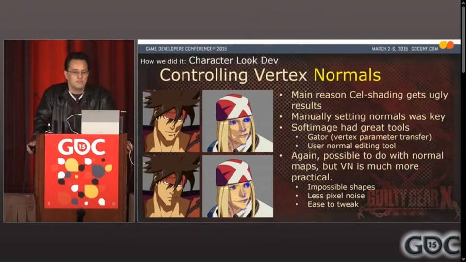 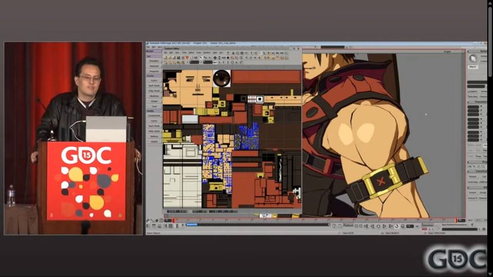 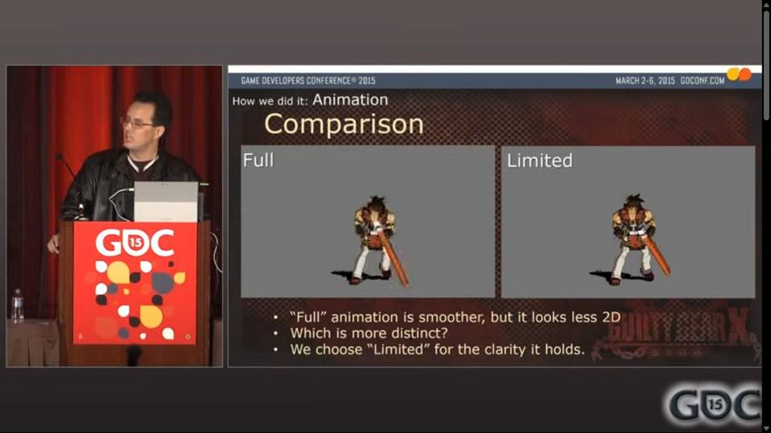

## 22. [3D Toon Rendering in 'Hi-Fi RUSH'](https://youtu.be/gdBACyIOCtc) (GDC 2024)

- **Тень лица — карта порога (SDF):** 36 масок шагом 5° → чистка → слияние полем расстояний. Шейдер сравнивает с картой угол света в пространстве головы / π, другую сторону зеркалит. Карта на UV, мимика тень не ломает.
  У нас, скриптом: плоская UV в пространстве J_Bip_C_Head; «ретушь» морфологией (крупнейшая компонента, Гаусс, вложенность масок); SDF-слияние в 2K; своя ветка шейдера лица.
  Мерить: 1 компонента тени на каждом угле; вложенность 100%; IoU между выражениями ≥ 0.98; периметр / периметр выпуклой оболочки ≤ 1.1.
- **Точка полутона растёт с яркостью; на поверхностях — проекция по доминирующей оси мира,** экранные координаты только для bloom и тумана.
  У нас: такая проекция для декораций. Мерить: при панораме узор не скользит по поверхности (≈ 0 px).
- **Затухание ламп ступенями, свет ограничен коробкой, на персонажей не действует.**
  У нас: шаг-функция в шейдере декорации плюс light linking (EEVEE 4.2+). Мерить: гистограмма в зоне лампы даёт N пиков.
- **Отдельный «только-теневой» свет у героя;** двойное затемнение на пересечении теней убирают. Мерить: на пересечении темнота как у одной тени (±2%).
- **Цвет тени — градиентом по высоте сцены.**

Кадры: 23:00; 47:20; 50:15.

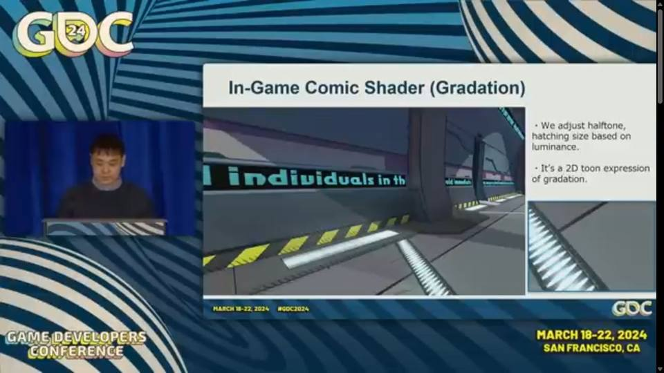 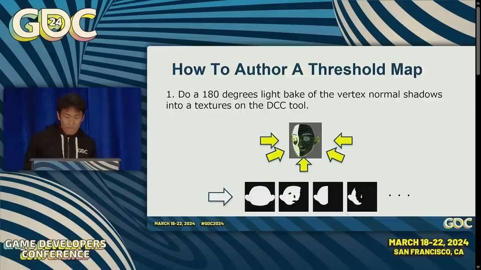 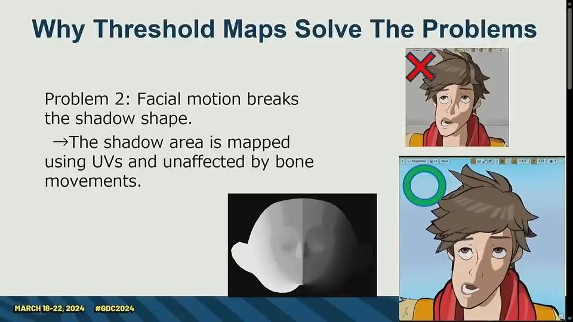

## 23. [Why Guilty Gear's 'Bad' 3D Models Look Perfectly 2D](https://youtu.be/234m7y8D3cE) (Noggi)

- **Корпусный контур на лице отодвигают от камеры** по маске цвета вершин.
  У нас: вернуть Outline VRoid, в геонодах толчок от камеры по весу `face_hull_push` и ширина по `hull_width`; Freestyle — только внутренние линии.
  Мерить: пиксели контура внутри лица ≈ 0; время кадра −30% против нынешних 1.5–2 с.
- **dot(N, L) вместо Diffuse → Shader-to-RGB** (наш `NPR_Light` — второй вариант). Блик и обод — от того же вектора, по маске.
- **Два цвета на материал.** Тень не просто темнее: тон −8…−15° к красному, насыщенность +15%. Брать shade color из MToon.
- **Data Transfer нормалей с непозированного прокси — после арматуры.**
  У нас: прокси-голова на J_Bip_C_Head, последним модификатором на лице и волосах. Мерить: IoU тени по 8 выражениям ≥ 0.97 вне рта и глаз; «до» снять сейчас.
- **Теневые плоскости под чёлкой на костях чёлки.**

Кадры: 02:20; 21:05; 24:45.

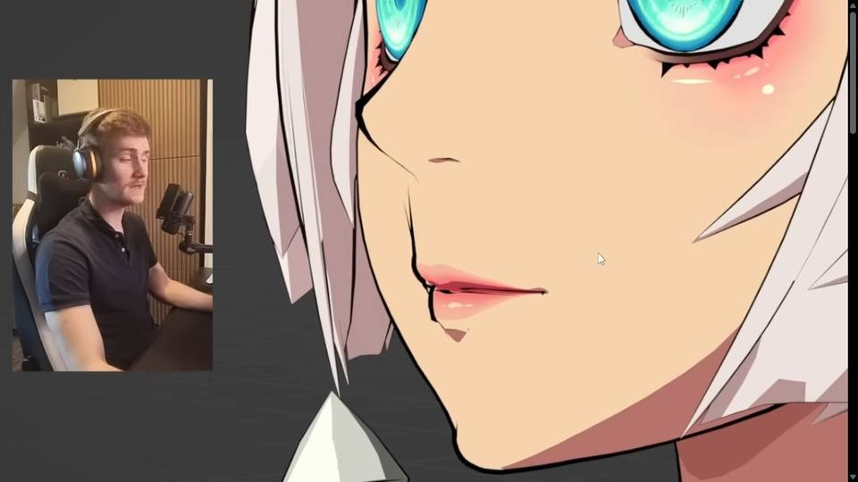 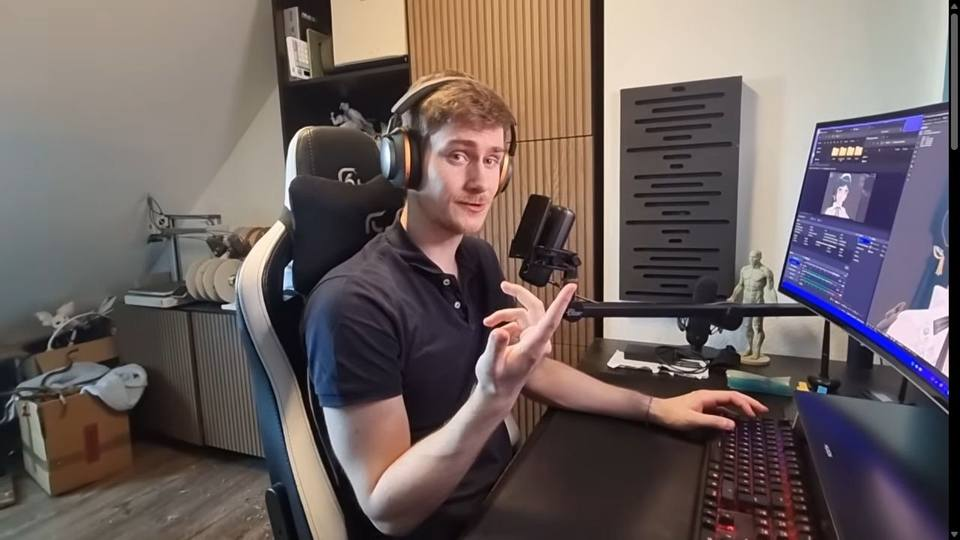 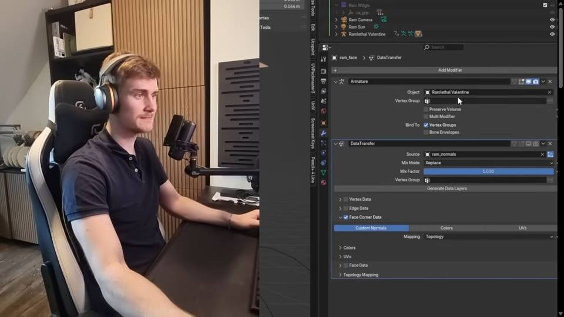

## 24. [How Japanese Studios Use CG to Cheat 2D Animation](https://youtu.be/BuKi3QAsiYA) (Class Creatives)

Обзор с рекламой, почти нечего взять.
- **Мокап с телефона — черновик тайминга** (у нас GEM-X и MediaPipe).
- **2D-слои фона на плоскостях на 3–5 глубинах.** Мерить: сдвиг слоя при панораме ∝ 1/z.

Кадры: 01:20; 02:05; 05:40.

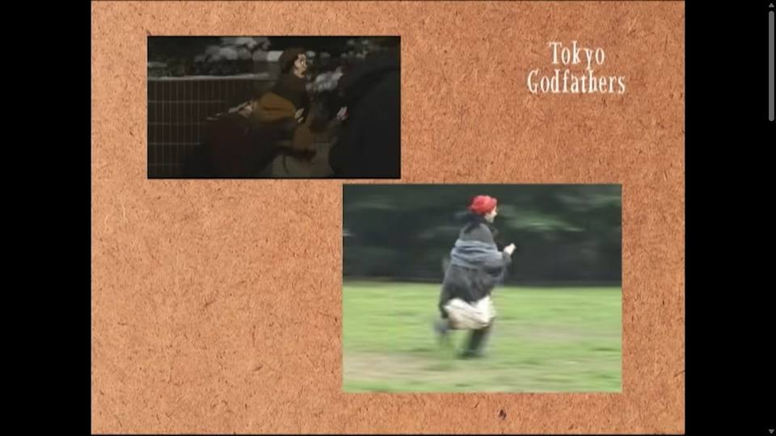 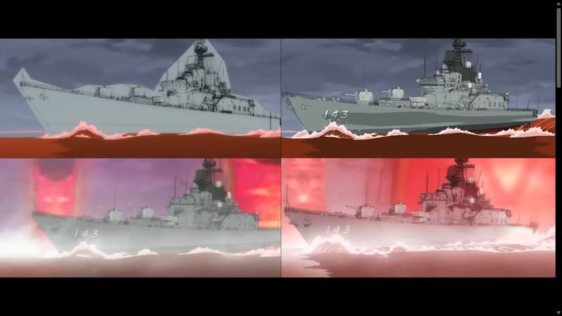 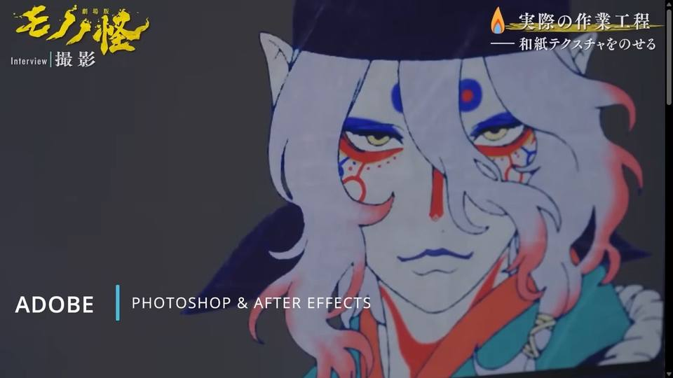

## 25. [How Studio Orange "Cheats" 3D to Look Like 2D Anime](https://youtu.be/W117QR-9OHc) (Class Creatives)

- **Морфы от угла камеры («cameraomatic»).**
  У нас: драйвер рыскания «голова — камера» → корректоры: дальний уголок рта за щёку, профиль носа, сплющивание глаза в 3/4. Мерить: при рыскании > 35° пикселей рта за щекой = 0.
- **«Shape maps» для теней лица** — то же, что карта порога в 22.
- **CG на единицах или двойках, тройки выглядят деревянно.** Мерить: среди движущихся частей нет кадров на 3+.
- **Лицо ретаймят отдельно от тела:** рот и веки на 1–2, тело на 2–3.

Кадры: 02:00; 02:20; 09:50.

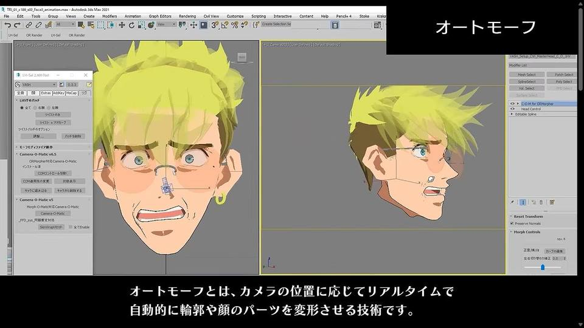 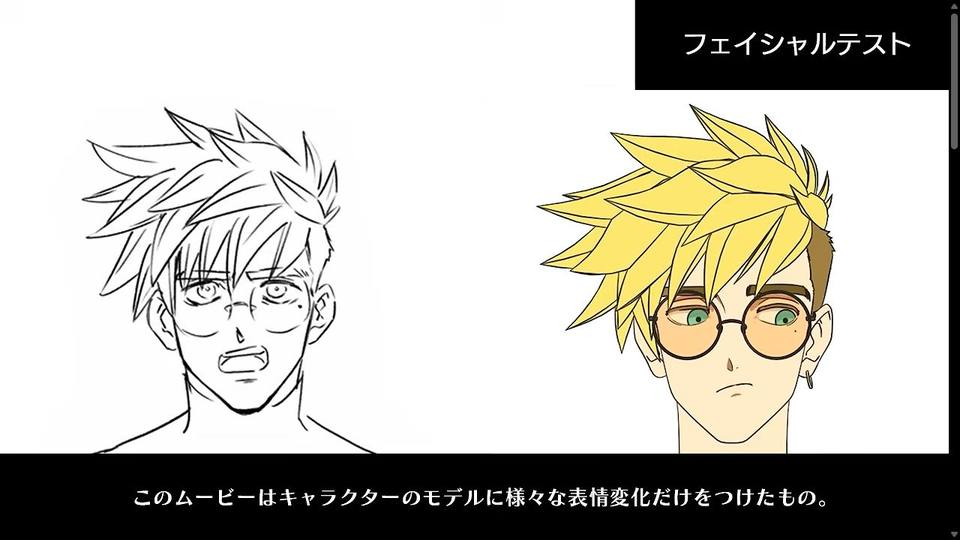 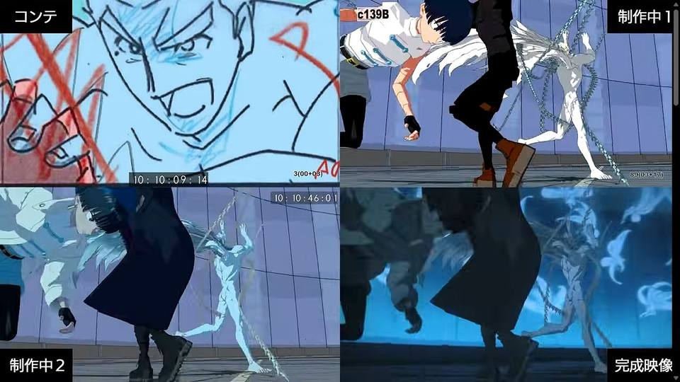

## 26. [Anime and NPR at DillonGoo Studios](https://youtu.be/4Zto6lTAJo0) (Blender)

- **«Комковатость»:** при облёте света ≤ 1–2 компоненты тени на крупную форму.
- **Line Art (Grease Pencil) с линиями пересечений прячет клиппинг;** линии можно запечь и чистить.
  У нас: проба на одном плане, после запекания удалять штрихи < 8 px. Мерить: ms/кадр, число коротких штрихов, линия вдоль известных контактов.
- **Shader Info (Goo Engine) делит свет на 4 прохода.** У нас аналог — dot от пустышки плюс отдельный shadow-only свет.
- **Свет лица отдельно от тела** — light linking EEVEE 4.2+.
- **Кривизна рёбер для декораций** — в EEVEE узла нет, запекать в атрибут.

Кадры: 08:16; 09:22; 12:00.

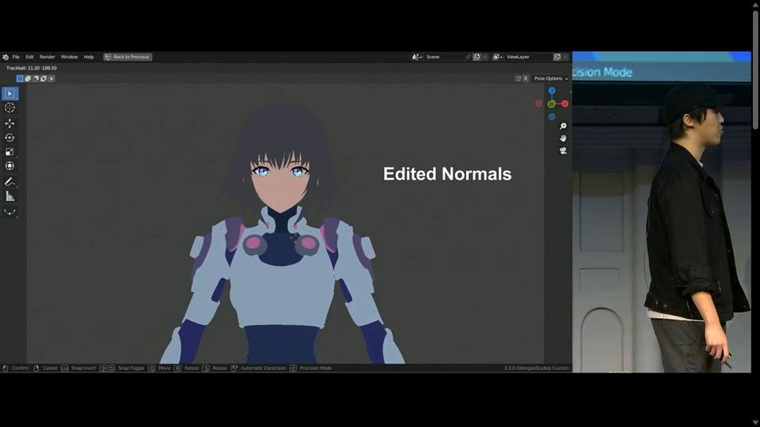 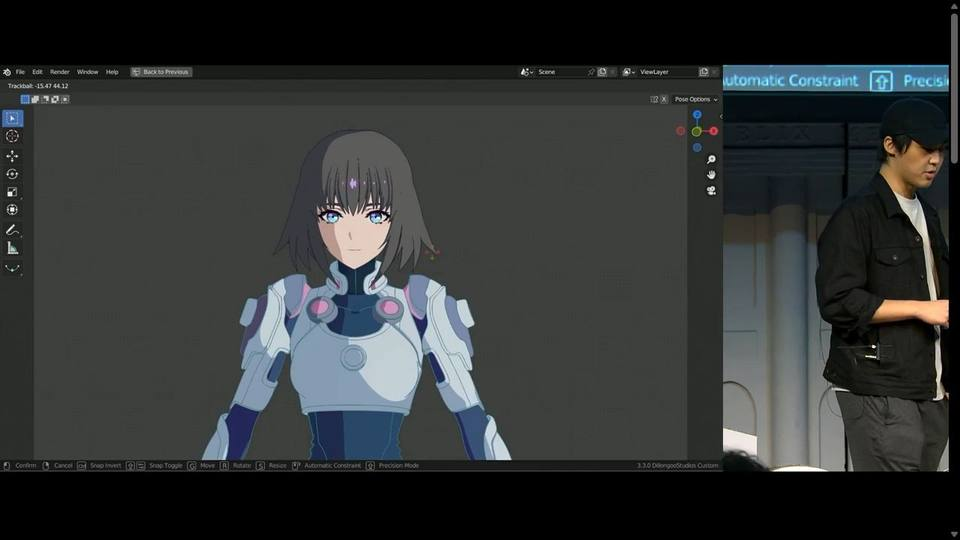 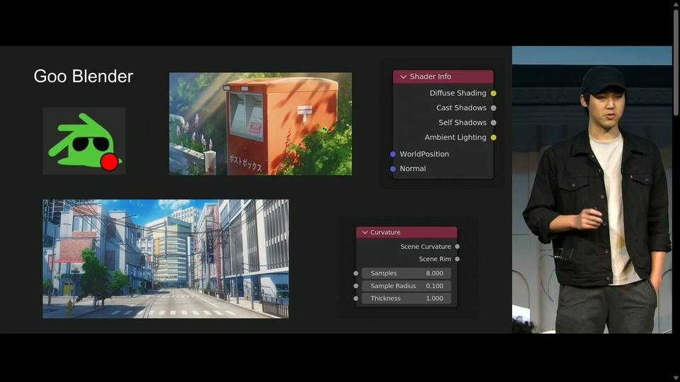

## 27. [2D Comic Style in 3D: Shapes! Lines! Shading! (BCON26)](https://youtu.be/AFmyCt3MR4M) (Blender)

- **Толщина линии: «дистанция отсечки»** (ближе — тоньше, дальше — толще) и группа вершин `line_w`. Мерить: std/mean толщины контура ≤ 0.1 на наезде камеры.
- **Свои штрихи GP на деформируемом меше через rest_position + Sample UV Surface;** торчащие на скосе утапливать. Мерить: расстояние штрих — поверхность < 1 мм на всех кадрах.
- **Плоские детали зеркалить или скрывать по углу к камере,** резко, без плавного перехода.
- **«RGB-свет» как запасные световые группы;** Map Range вместо Color Ramp.
- **Нормали поворачивать по близости к морщинам и по группе вершин уха** — гарантированный обод.

Кадры: 21:40; 37:15; 45:40.

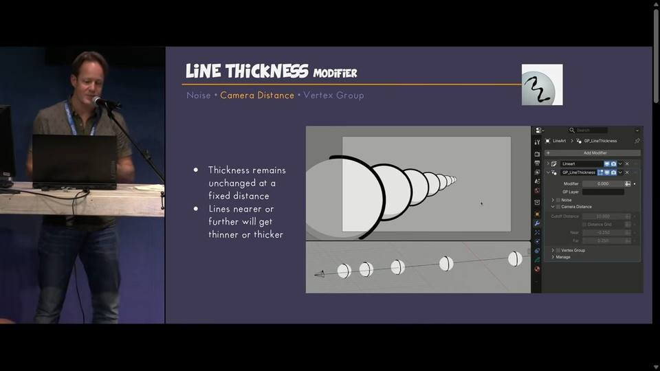 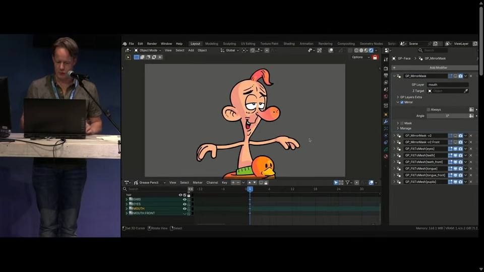 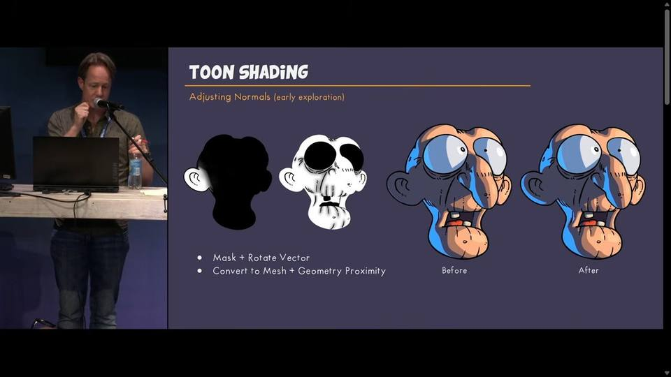

## 28. [Making Stylized Visuals | Lessons from Anime and Short Films (BCON 2024)](https://youtu.be/M4v_hfGF4EM) (Blender)

- **Две прокси-формы нормалей (радиальная и плоская), выбор на шот;** топология идёт по листу желаемых теней. Мерить: IoU с листом-эталоном по 4 углам света ≥ 0.8.
- **Пустышки-эллипсоиды добавляют свет или тень в материал.** Мерить: тень под чёлкой ≥ 0.9 у кромки на всех ракурсах.
- **Нормали от «скелета»** — у нас прямо от оси костей рук и ног. Мерить: 1 компонента тени на рукаве; терминатор почти прямой, отклонение < 3% длины сегмента.
- **Решётка «сплющивания» лица на объективах ≤ 24 мм.** Мерить: пропорции черт ≤ 5% к орто-эталону.
- **Глобальный перевод в двойки теряет ключи.** Мерить: попадание ключей 100%, расхождение ≤ 1°.
- **AOV: маска тени, индекс, обод, тень от других;** скрипт сам добавляет все AOV. У нас: добавить `npr_lit` и `npr_cast`.
- **Без мешка рта: изнанка головы плоским цветом,** если зубы протыкают.

Кадры: 29:10; 31:50; 35:30.

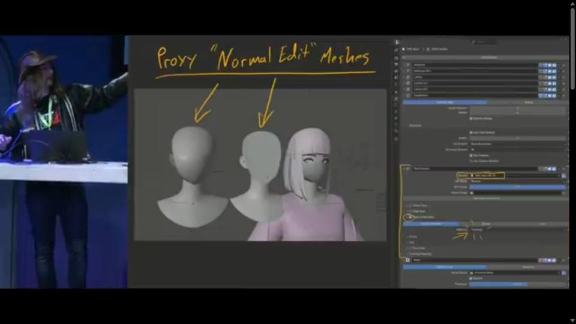 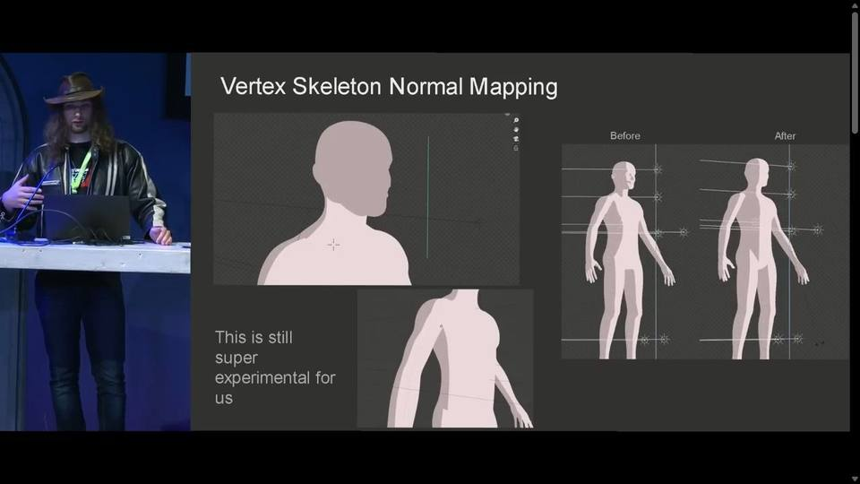 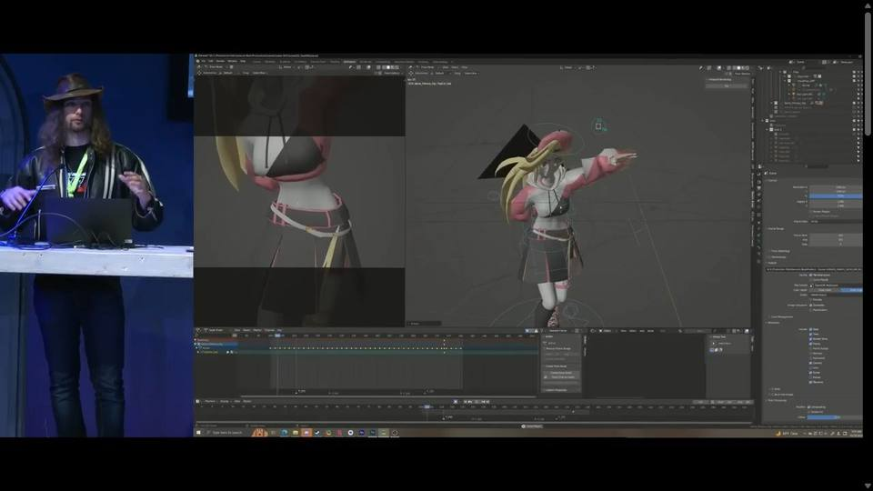

## 29. [The Animation of Guilty Gear Xrd & Dragon Ball FighterZ](https://youtu.be/kZsboyfs-L4) (New Frame Plus)

- **Шаг по группам костей:** тело 2–3, рот и веки 1–2, волосы 2. Мерить: значения каждой группы меняются только на её сетке.
- **Стиль шота — параметр:** «удержание N с, только рот» или «дыхание».
- **Тип смаза:** тянутая форма (GG) или линии скорости (DBZ).

Кадры: 09:20; 10:00; 15:00.

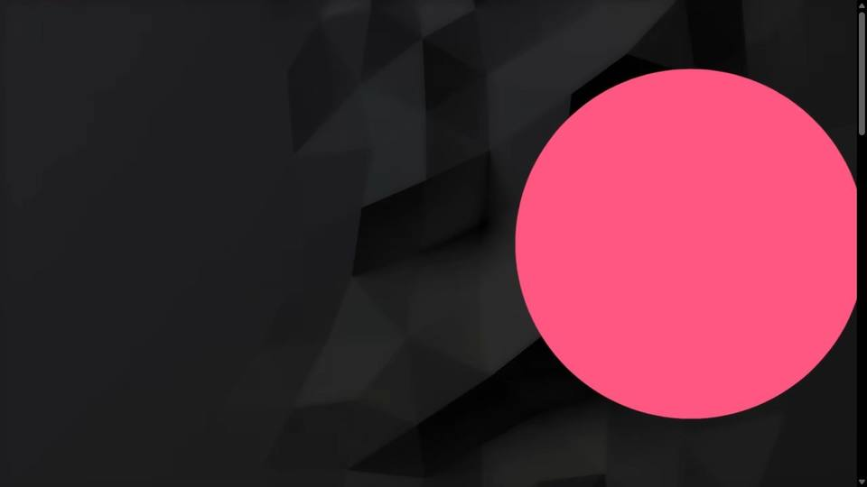 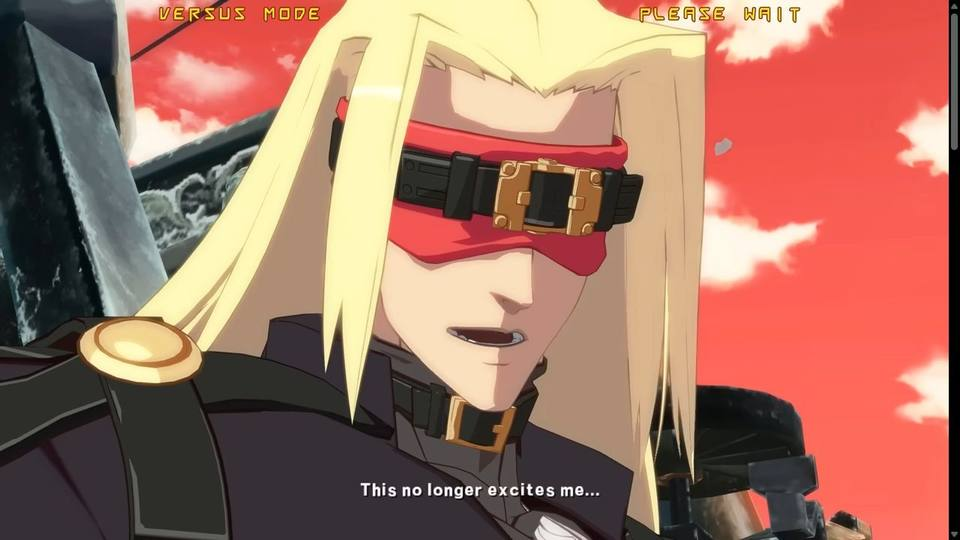 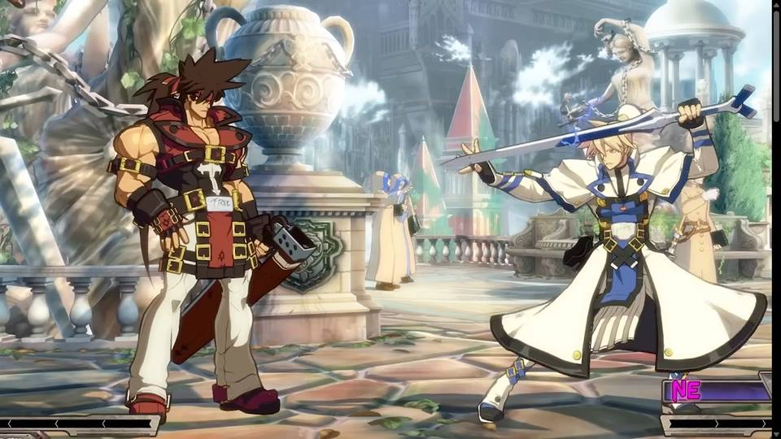

## 30. [The Genius Animation Behind Spider-man: Into the Spider-Verse](https://youtu.be/N21oG99eF3A) (Howard Wimshurst)

- **Смешанный шаг:** полёт и разворот камеры — 1, бой и жест — 2, удержание — 3+.
  Мерить: смещение рисунка за смену > 60 px — единицы или эффект (`auto_fx` в выбор шага).
- **Нарисованный контур копий в `post_fx`.**
- **Тёмные материалы без тени.** Мерить: один уровень в маске `npr_lit`.

Кадры: 01:45; 02:10; 02:50.

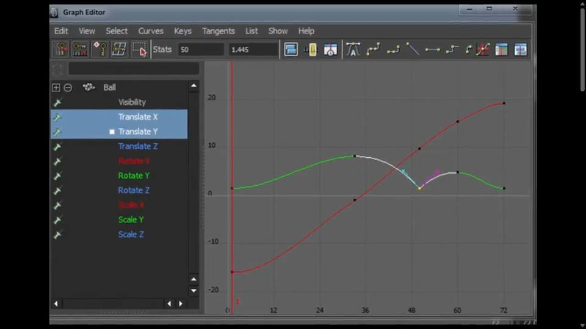 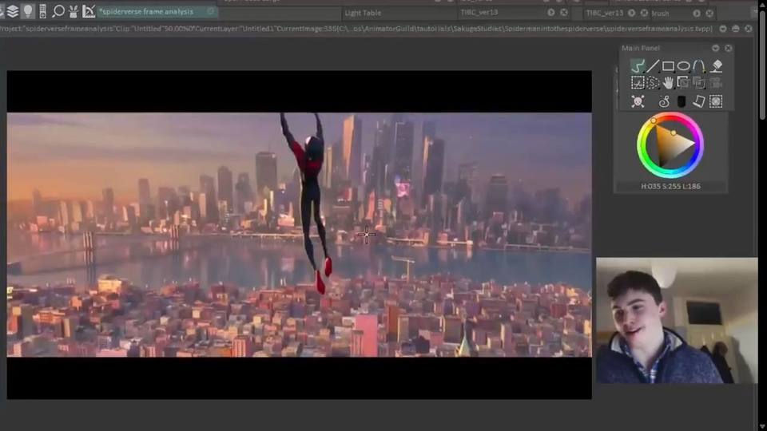 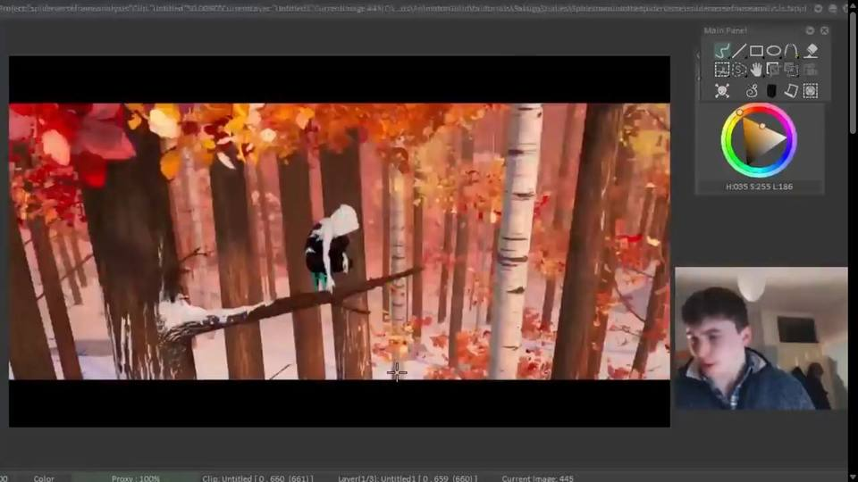

## 31. [How to Animate SPEED - Smears + Duplicate Limbs](https://youtu.be/xNiUO6BwtTc) (Sir Wade Neistadt)

- **Копии там, где была бы конечность при 6–7 кадрах;** доли — из `ease_curve`, а не 0.35/0.65.
  Мерить: отклонение от дуги < 2% длины руки; шаги монотонны; самый большой разрыв ≤ 1/3 пути.
- **Нормальная поза ключуется до и после смаза.** Мерить: вне смаза длины костей = rest ±0.5%.
- **Решётка с хуками для смаза-«капли»** на кисть или стопу.
- **Копии плоским цветом, без тени.**
- **Смазы и копии — в самом конце, после ретайма.**

Кадры: 02:40; 12:00; 13:35.

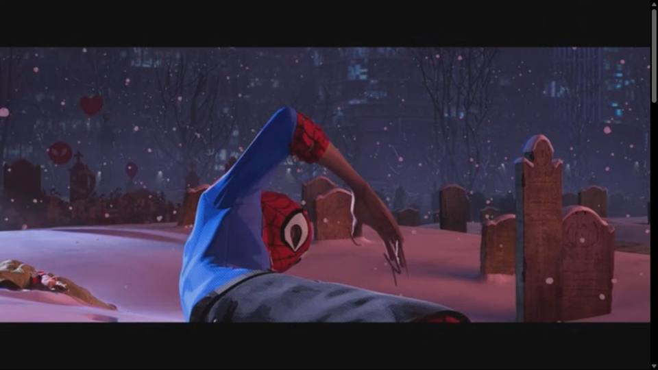 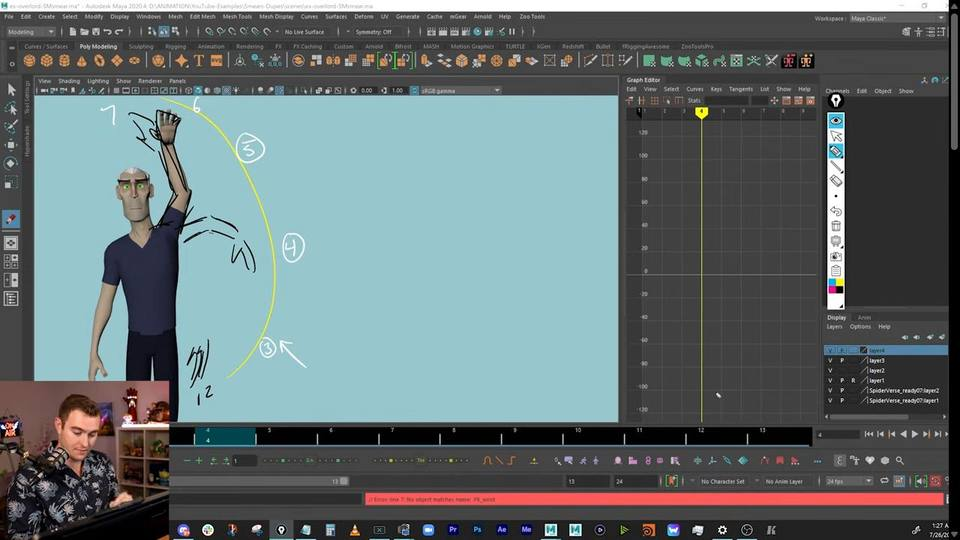 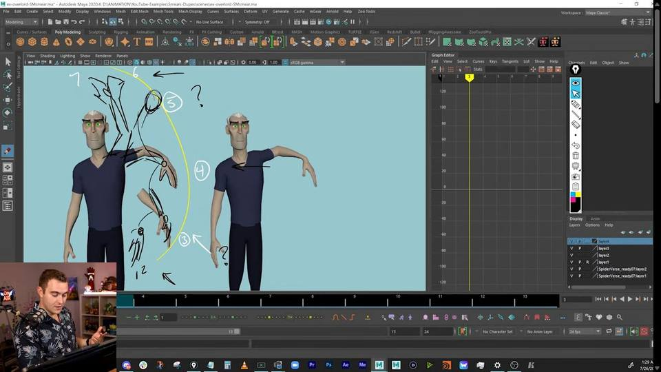

## 32. [Smear Frames in blender have never been this Easy! (4.5+)](https://youtu.be/TgOllr05aCs) (3Dan)

- **Смаз по вершинам:** смещается только задняя сторона (dot(нормаль, движение) > 0); рваный край — шум в 5-й степени; вершины со сдвигом < 0.02 м удаляются; отступ по нормали 0.1 мм против z-fight.
  Мерить: z-fight = 0; длина смаза коррелирует со скоростью ≥ 0.8.
- **Подшаги Эрмита.** У нас дуга костей точнее — оставить.
- **Смаз держится до смены рисунка.** Мерить: утечка удержания = 0.
- **Полупрозрачный смаз GP для painterly.**

Кадры: 04:15; 06:50; 16:30.

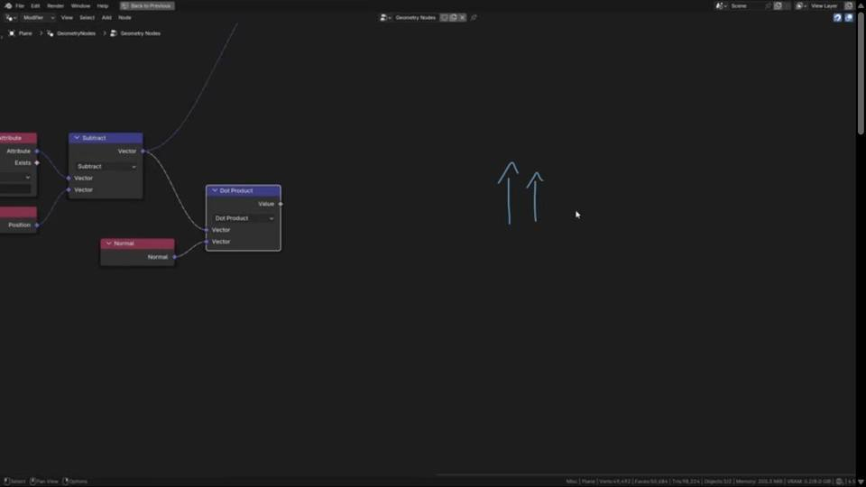 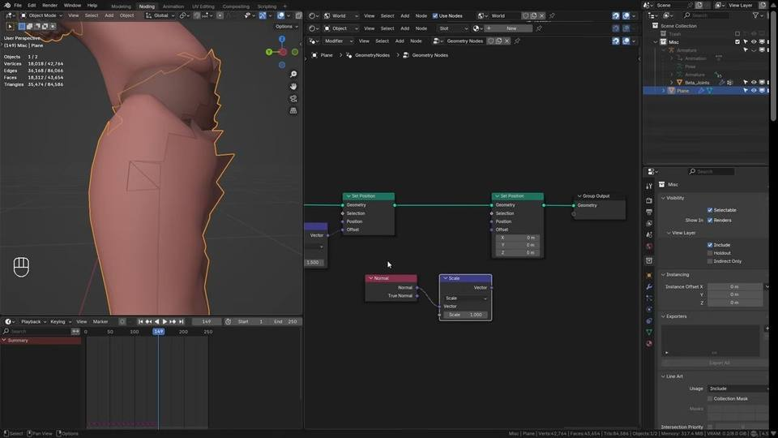 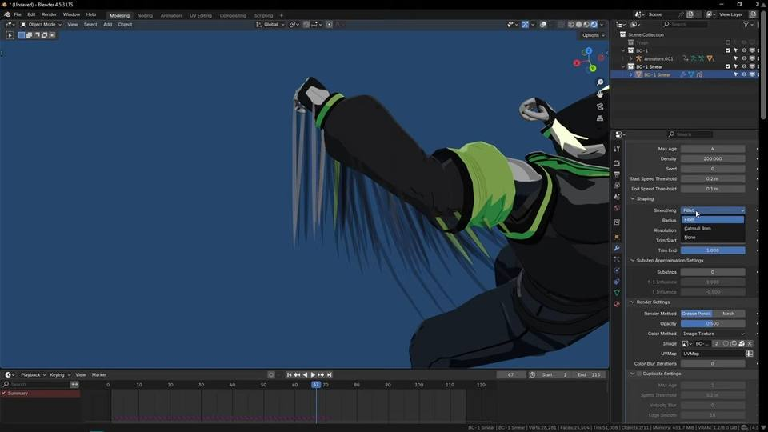

## 33. [7 Ways to Make Lineart in Blender 4.0!](https://youtu.be/-urA3hqzF30) (Vertex Arcade)

- **Корпусный контур Solidify плюс скриптовая группа `hull_width`.** Мерить: покрытие силуэта ≥ 0.98, внутри лица ≈ 0.
- **Складки одежды — полоски-меши, видимость по углу сгиба.** Мерить: при сгибе < 20° складки не видно.
- **Марки рёбер скриптом по углу > 60°** на воротнике и манжетах.
- **Цвет линии по материалу** для painterly.

Кадры: 02:15; 06:20; 15:20.

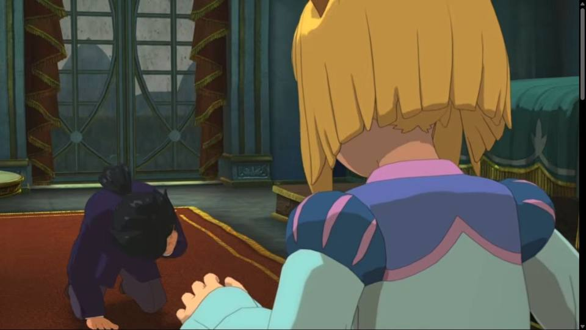 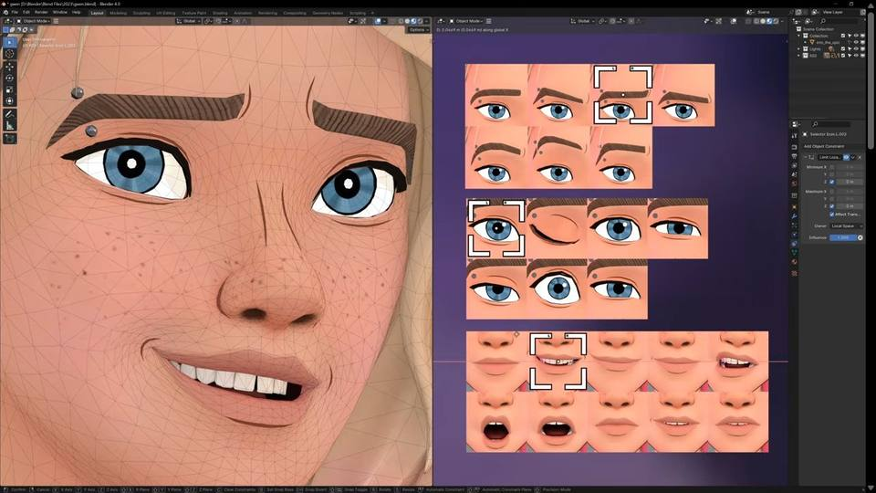 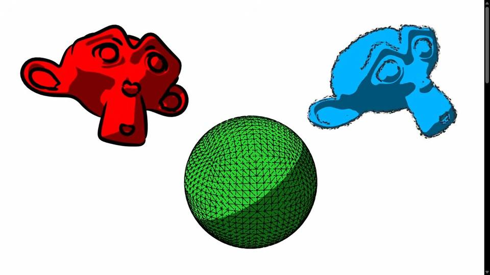
