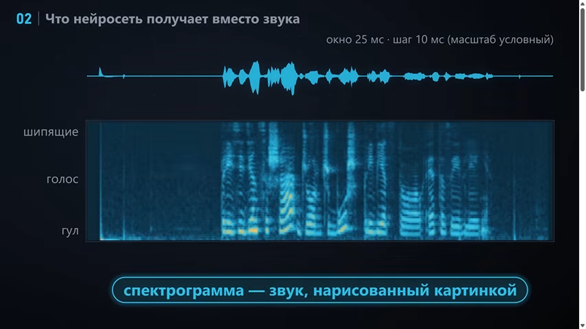
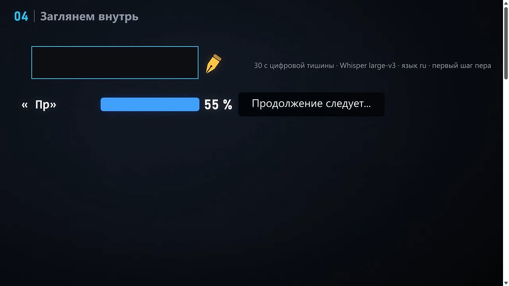
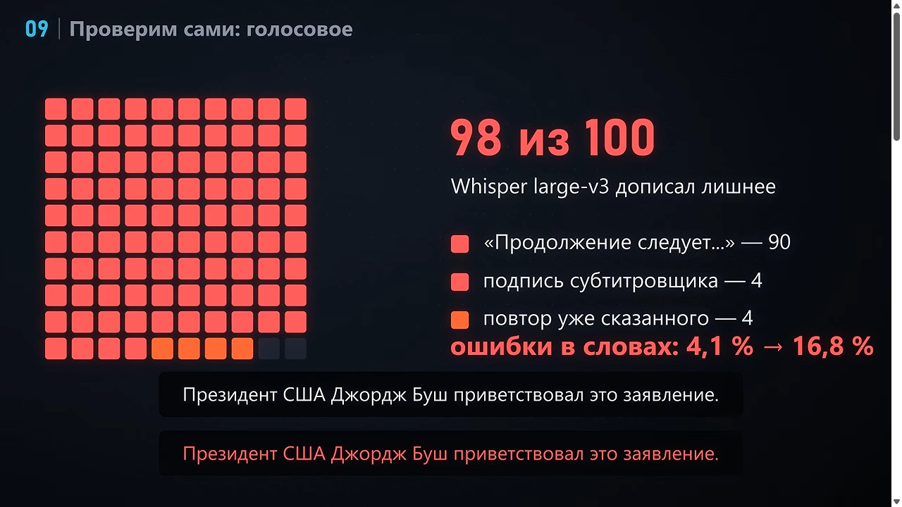
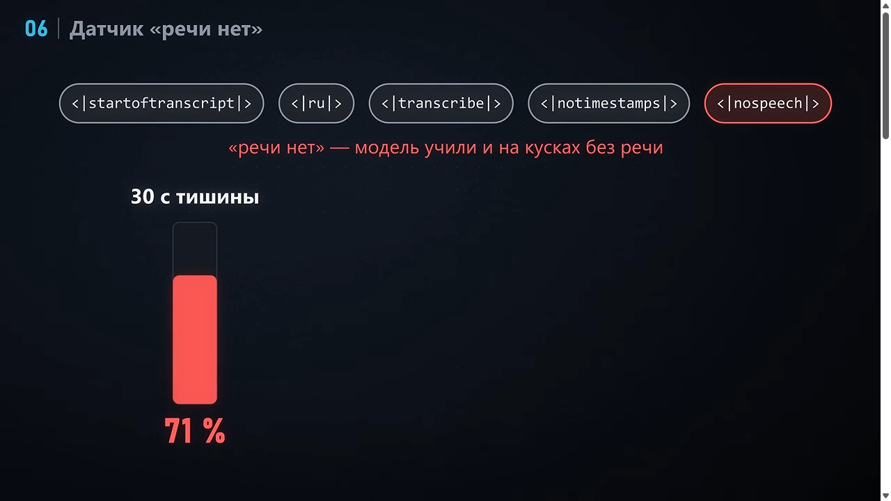
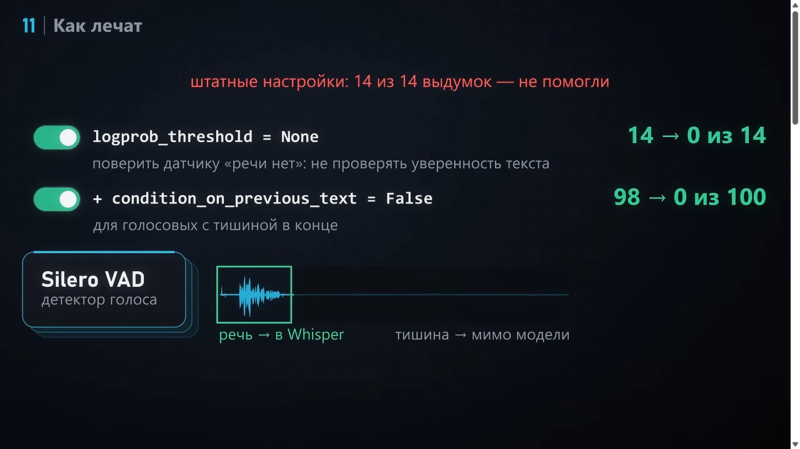
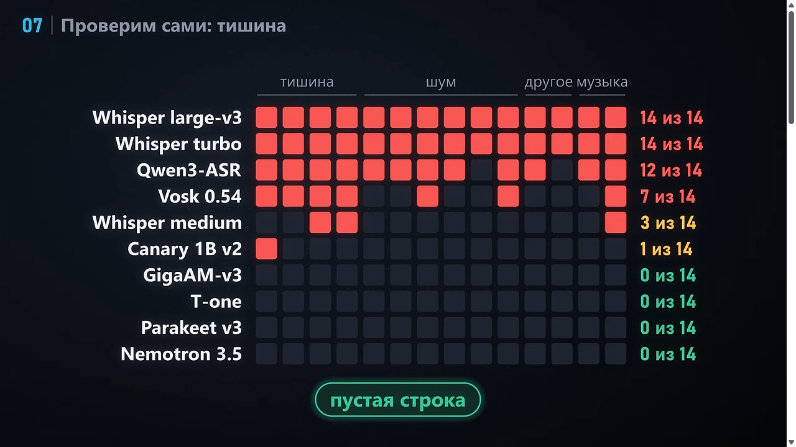

# «Скрытый слой»: почему Whisper пишет текст в тишине и что мы с этим сделали

Ролик: [Дал нейросети минуту тишины — и она её «расшифровала». Как ИИ слышит речь](https://www.youtube.com/watch?v=lEOG53tDYOI) (13:39), канал «Скрытый слой».
Разобран по субтитрам целиком, кадры сняты с плеера (настоящий Chrome через Playwright MCP).

Правило владельца: вписывать только то, что мы сами проверили и запускаем.
Поэтому каждый пункт — приём из ролика и «У нас»: что сделано и сколько намерили на своём стенде.
Цифры автора (10 моделей, 100 фраз FLEURS, RTX 3090 Ti) — только как ориентир, не как наш результат.

## Стенд

`tools/asr_bench` — повторяемый стенд, как у автора, только на наших записях:

- **14 записей без речи** (синтез с фиксированным seed): цифровая тишина 1/5/30/60 с, тихий и громкий белый и розовый шум, гул «вентилятора», гул сети 50 Гц, чистый тон 440 Гц, щелчки клавиатуры, аккорды, кусок CC0-музыки из паков (lofi-beat, sha256 как в `tools/fetch_music.py`).
- **30 фраз с известным текстом**: 24 наши TTS-озвучки (пробы мемов ElevenLabs, переозвучки витубики) и 6 фраз Windows-синтеза с «опасным» текстом: «Спасибо за просмотр, подписывайтесь на канал», «Продолжение следует», «Субтитры сделал мой друг Дима», «Редактор субтитров у нас новый», «Thank you for watching». Это положительный контроль: их резать нельзя.
- Каждая фраза ещё и **с хвостом 30 с почти тишины** (розовый шум −60 дБ) и каждая третья — **под музыкой** (гитара / клавиши CC0, голос на 10 дБ громче).
- **3 куска дубляжа по 2 минуты** (смесь с музыкой, серии из конвейера голоса). Эталона нет, опора — large-v3 по вокальному стему, поэтому WER дубляжа — «сколько слов опоры потеряли», а не точность.
- Метрики: сколько записей без речи получили текст, сколько фраз получили текст в хвосте (и сколько слов), WER на чистой / с хвостом / под музыкой. Числа в WER приводятся к словам («200» = «двести»).

Запуск: `python -m tools.asr_bench.run build`, затем `run --profile <место вызова>` и `report`.
Подбор правил по всем сегментам без порогов: `python -m tools.asr_bench.rules --diag diag_novad__before`.
Записи и результаты: `D:/vvf-offload/asr_bench` (`results/*.json`).

---

## 1. Whisper пишет титры в тишине — и у нас тоже

Автор дал Whisper минуту тишины и получил «Продолжение следует…», на вступлении песни — «Субтитры добавил …».
Первый токен на пустом окне: 55 % «Продолжение следует», по 13 % «Редактор субтитров» и «Субтитры создавал», 4 % «Спасибо за просмотр».
Короткая запись добивается тишиной до 30 с, поэтому даже 1 с тишины даёт то же самое.

**У нас:** повторилось один в один. Whisper «из коробки» (`vanilla_turbo`, large-v3-turbo, русский):
- текст на **14 из 14** записей без речи: «Продолжение следует…», на тоне, аккордах и музыке — «Субтитры создавал DimaTorzok»;
- small (`viewer_ep2`) — на 10 из 14, ещё и «Редактор субтитров Н. Закомолдина», на музыке — «ПОЗИТИВНАЯ МУЗЫКА».

Подписи звуков («ПОЗИТИВНАЯ МУЗЫКА», «СПОКОЙНАЯ МУЗЫКА»), «Субтитры добавил», «Thanks for watching», голое «Thank you» добавлены в стоп-лист `app/subtitles/phantoms.py`.

## 2. Хвост тишины после речи

Голосовое, которое забыли остановить: 100 фраз + 30 с почти тишины. Whisper дописал лишнее в 98 из 100 (90 раз «Продолжение следует…», 4 — подпись субтитровщика, 4 — повтор сказанного).
WER вырос с 4,1 до 16,8 %.

**У нас:** turbo «из коробки» — текст в хвосте у **30 из 30** фраз, WER 2,6 % → **14,4 %**.
Были и повторы («Слава богу.» в конце фразы, которая этим кончалась), и «Спасибо за субтитры Алексею Дубровскому!» дважды.
small: 30 из 30, WER 5,0 → 21,9 %.

Сделано: провайдер (`WhisperSubtitleProvider`) **отрезает хвост почти тишины** длиннее 3 с до распознавания (по громкости, через 1 с после последнего звука; начало не трогаем, время слов не сдвигается) — `speech_evidence.speech_end_cut`.
По громкости, а не по детектору голоса: речь под игрой громкая и не режется.

## 3. Датчик «речи нет» и почему он не спасает

У Whisper есть токен «речи нет»: на 30 с тишины 71 %, на тихом шуме 92 %, на живых фразах ~2 %.
Но правило из кода Whisper выкидывает окно, только если датчик > 60 % **и** текст неуверенный (logprob < −1).
«Продолжение следует» модель пишет уверенно — правило верит перу, а не датчику.
Автор вылечил так: отключить проверку уверенности (поверить датчику) — 14 → 0 из 14.

**У нас, три находки:**

1. **У large-v3-turbo этот датчик мёртвый.** На всех 47 сегментах-выдумках и на всей речи no_speech = 0,0 (и на GPU, и на CPU int8 как в контейнере). «Поверить датчику» на нашей главной модели не делает ничего: 0 из 47 выдумок.
2. У small датчик живой (выдумки 0,60–0,95), но **на дубляже под музыкой он врёт**: 62 сегмента дубляжа (524 слова, по тексту и детектору голоса — настоящие реплики) с no_speech 0,9 и уверенным текстом. Правило «no_speech > 0,6 — выкинуть» срезало бы их все. В конвейере голоса (large-v3 по вокальным стемам) таких реплик 156 из 3090.
3. Что работает на обеих моделях — **улики из звука**, а не из декодера (`app/subtitles/speech_evidence.py`):
   - доля сегмента, где детектор голоса (Silero, строгие настройки) слышит речь;
   - тишина под сегментом по громкости (порог от шума дорожки, `phantoms.is_silent`).

Подбор по всем сегментам turbo без порогов (`tools.asr_bench.rules`):

| правило | выдумок выкинуто | настоящей речи выкинуто |
|---|---|---|
| старое у нас: no_speech&logprob, logprob < −1, стоп-лист всегда | 47 / 47 | 12 сегментов, 83 слова (все контрольные фразы) |
| как у Whisper (no_speech > 0,6 и logprob < −1) | 0 / 47 | 0 |
| «поверить датчику» (no_speech > 0,6) | 0 / 47 (turbo) | 0; у small — 62 сегмента дубляжа |
| тишина по громкости | 38 / 47 | 0 |
| **новое: тишина, или стоп-лист при доле голоса < 0,5, или no_speech > 0,6 при доле голоса < 0,3** | **47 / 47** | **0** |

Так и сделано в провайдере. «Поверить датчику» оставлено только вместе с детектором голоса — для small и других моделей с живым датчиком.

## 4. Стоп-лист фраз — только там, где звук его не подтверждает

Самые частые выдумки — подписи титров и «спасибо за просмотр». Но эти же слова бывают настоящими.

**У нас:** стоп-лист `phantoms.py` резал их **всегда** — и в провайдере, и в `drop_phantoms` после распознавания.
На стенде это стоило: «Субтитры сделал мой друг Дима» и «Редактор субтитров у нас новый» пропадали целиком, «Спасибо за просмотр…» и «Продолжение следует.» — с концом фразы, а под музыкой фраза «Ну вот и всё… спасибо за просмотр» исчезала вся (один сегмент).
Отсюда WER провайдера на чистых фразах 5,8 % против 2,6 % у того же turbo без фильтров.

Сделано: фантомный текст выкидывается, только если **детектор голоса слышит речь меньше чем на половине** сегмента или под ним тишина (`phantoms.phantom_unconfirmed`).
Живое «Спасибо за просмотр» детектор слышит на 0,81–0,87 — остаётся; выдумки на шуме, музыке и хвосте — около 0.
Если звук не прочитался, всё по-старому (стоп-лист без условий).
Фантом, прилипший к живой фразе одним сегментом, режется по словам подряд с той же проверкой.
Проверено тестом на настоящей записи: `tests/test_speech_evidence.py` (фикстура `speech_thanks_ru.ogg`).

## 5. Детектор голоса перед Whisper — и где его нельзя

Автор: детектор голоса (Silero VAD) перед Whisper — 0 из 100 выдумок в голосовых. Но пение он за голос не принимает, а на речи под музыкой ошибок больше (13,3 вместо 10,9 %).

**У нас:**
- провайдер и так с VAD (кроме двух мест), `condition_on_previous_text=False` уже стоял;
- `speech_heard` (сверка субтитров с речью) и `video_meme_ingest` VAD не включаем: на клипах 930–939 он терял речь под игрой. Вместо него — те же улики из пункта 3–4 и обрезка хвоста;
- сырые скрипты `tools/meme3d_voice.py` и `tools/viewer_ep2.py` (VAD был выключен, подсказка прошлым текстом включена) — VAD включён, подсказка выключена;
- **песни** (`app/lyrics_audio.py`, `tools/music_video/analyze.py`): VAD нельзя, сделана своя защита `guard_words` — слово, под которым вокальный стем demucs молчит, выкидывается; подписи титров — только если вокал под ними молчит (спетое «продолжение следует» остаётся). Без стема (полоса из смеси) — стоп-лист как есть.

## Итог по местам вызова

Стенд, turbo на GPU (int8_float16), «до» — код на коммите 534ce59, «после» — эта ветка.
CPU int8 (как в контейнере) проверен выборочно: провайдер «до» и «после» — 0 из 14 без речи, «после» на чистых фразах 2,5 % (как на GPU); turbo без порогов — 14 из 14, no_speech и там 0,0.

| место вызова (профиль стенда) | выдумки без речи | хвост: фраз с текстом | WER чистая | WER с хвостом | WER под музыкой | контрольные фразы |
|---|---|---|---|---|---|---|
| провайдер, VAD, turbo: объяснялки, voice_check/voiceover, истории, s3d, мем-монтаж, цензура, viewer_ep, vtubika (`provider_ru`) | 0 → 0 | 0 → 0 | 5,8 → **2,5 %** | 5,9 → **2,6 %** | 8,5 → **1,6 %** | теряли 2 (и концы ещё 2) → 0 |
| то же на small: render_subs / clip_subtitles по умолчанию (`provider_small_ru`) | 0 → 0 | 0 → 0 | 8,3 → **5,0 %** | 8,6 → **5,3 %** | 9,8 → **4,9 %** | теряли 3 → 0 |
| clip_subtitles: провайдер + drop_phantoms (`clip_subtitles`) | 0 → 0 | 0 → 0 | 5,8 → **2,5 %** | 5,9 → **2,6 %** | 8,5 → **1,6 %** | теряли 2 → 0 |
| speech_heard, без VAD (`speech_heard`) | 0 → 0 | 0 → 0 | 5,9 → **2,6 %** | 5,9 → **2,6 %** | 6,6 → **1,6 %** | теряли 2 → 0 |
| video_meme_ingest, без VAD, язык сам (`meme_ingest`) | **11 → 2** | 2 → 0 | 5,9 → **2,6 %** | 6,1 → **2,6 %** | 6,6 → **1,6 %** | теряли 2 → 0 |
| lyrics_audio на стеме demucs (`lyrics_stem`) | **14 → 3** | — | — | — | 2,0 → 2,0 % | — |
| lyrics_audio, если стема нет (`lyrics`) | 14 → 9 | **30 → 0** | 2,6 → 2,6 % | 11,1 → **2,6 %** | 1,6 → 1,6 % | — |
| tools/meme3d_voice (`meme3d_voice` → `_new`) | **14 → 0** | **30 → 0** | 2,6 → 2,5 % | 14,4 → **2,6 %** | 1,6 → 1,6 % | — |
| tools/viewer_ep2, small (`viewer_ep2` → `_new`) | **10 → 0** | **18 → 0** | 5,0 → 5,0 % | 14,2 → **5,7 %** | 4,6 → 4,9 % | — |

На дубляже (потеря слов опоры) ни одно место не стало хуже: провайдер 4,0 → 4,0 %, без VAD 3,1 → 3,1 %.
Что осталось: meme_ingest — «so» на громком шуме и «Obrigado.» на тихом розовом (язык выбирает сам; не фраза из стоп-листа, детектор голоса без включённого VAD не режет); песни — «Продолжение следует» на трёх записях, где demucs оставил шум в вокале.

## 6. Модели без «пера» не выдумывают: GigaAM

У автора GigaAM, T-one, Parakeet (CTC/трансдьюсер: буква или «пусто» на каждый кусочек звука) — 0 из 14 и 0 из 100. На чистом русском GigaAM почти как Whisper (3,8 против 4,1 %), в гуле голосов лучше (15,1 против 21,2 %), минута речи — за 0,2 с против 5,2 с у Whisper.

**У нас:** проверен GigaAM-v3 (Сбер).
- **Лицензия MIT** — и у кода (github.com/salute-developers/GigaAM, файл LICENSE, pyproject `license = "MIT"`), и у весов (карточка huggingface ai-sage/GigaAM-v3: `license: mit`). Коммерческое использование MIT разрешает.
- Размер: 220–240 млн параметров, файл весов ~440 МБ на ревизию (ctc, rnnt, e2e_ctc, e2e_rnnt).
- Поставлен отдельно: `D:/vvf-offload/tools/gigaam_env` (torch 2.8 CPU, transformers 4.57), .venv сервиса не тронут. Веса — с huggingface: CDN Сбера для пакета `gigaam` 22.11 отдавал просроченный TLS-сертификат. pyannote (нужен только их длинным записям) не ставили: режем окнами по 20 с сами. Запуск: `tools/asr_bench/gigaam_run.py`.

| | выдумки без речи | хвост | WER чистая | WER под музыкой | дубляж к опоре Whisper | скорость, CPU |
|---|---|---|---|---|---|---|
| GigaAM-v3 ctc | **0/14** | **0/30** | 3,7 % | 2,3 % | 5,2 % | 1,8 с на минуту звука |
| GigaAM-v3 e2e_rnnt (с пунктуацией) | **0/14** | **0/30** | 4,3 % | 3,3 % | 6,8 % | 2,2 с на минуту |
| Whisper turbo «из коробки» | 14/14 | 30/30 | 2,6 % | 1,6 % | 3,4 % | — |
| Whisper turbo, провайдер после правок | 0/14 | 0/30 | 2,5 % | 1,6 % | 4,0 % | 21,6 с на минуту (CPU int8, как в контейнере) |

Вывод: на наших TTS-фразах Whisper точнее (2,5 против 3,7 %), опора дубляжа — сама из Whisper, так что там сравнение в его пользу.
GigaAM не выдумывает вообще и на CPU в 12 раз быстрее (оба — 8 потоков; GigaAM без детектора голоса, Whisper с ним).
Предложение (не подключено): **второе мнение** там, где важна честность, а не время слов —
- `speech_heard` / sub_sync: слово, которое услышал Whisper, но нет у GigaAM, — подозрение на выдумку;
- конвейер голоса: CER проб (`final_eval.py`, `asr2.py`) считать ещё и GigaAM — там Whisper без VAD на коротких пробах.
Заменять Whisper в субтитрах не стоит: нужно время слов и пунктуация, а точность на нашей речи у Whisper выше.

## Риски в конвейере голоса (D:/vvf-offload/voice/dub_gandzhaev/scripts, не трогали)

- `final_eval.py` и `asr2.py` считают CER через large-v3 с `vad_filter=False` на коротких пробах и кусках стема: короткая запись добивается тишиной до 30 с — ровно случай пункта 1–2. Выдуманное «Продолжение следует» завысит CER хорошей пробы. `final_eval` перед этим режет тишину (`H.trim`) — риск меньше, `asr2` — нет.
- `asr.py` и `verify.py` — с VAD, это безопасно. `pick_lead.py` уже выкидывает реплики со словами титров регуляркой и `nsp > 0.5` — по пункту 3 второе условие может резать настоящие реплики под музыкой (156 из 3090 с nsp > 0,6).

## Что не вошло и почему

- Сравнение Qwen3-ASR, Vosk, Canary, Parakeet, Nemotron — не ставили: не русские или тяжёлые (Nemotron занял у автора 21,8 ГБ видеопамяти), проверить у себя целиком не можем.
- Исследование 2024 года про вредные выдумки (38 % с насилием и ложными связями) — не наше измерение.
- Совет для Qwen «не задавать язык» — Qwen у нас нет.
