# Нарезки стримов: каналы и монтажёры (видео 43–56)

Разбор 14 роликов: RU-нарезки (Братишкин, Эвелон), EN-подборки (IShowSpeed, Kai Cenat) и 4 урока монтажёров.
Владелец одобрил «вписывай и внедряй». Здесь только то, что конвейер может применить и измерить сам.

Как собиралось: автосубтитры оригинала (`ru-orig` / `en-orig`, ручных нет ни у одного), метаданные `yt-dlp --dump-json`, тепловая карта «самое пересматриваемое» (есть у 47, 49, 50, 52, 53, 55).
Видео не скачивались: раскладку вебки, подписи и частоту склеек на глаз не видели, таймкоды кадров для проверки даны.
Скрипты: `G:\vvf-hot\yt\related\stream-clips\scripts\` — `vtt2txt.py` (VTT в текст с паузами), `heatmap.py` (пики тепловой карты), `peak_features.py` (тепловая карта против признаков субтитров); результаты в `meta\` и `subs\`.

## Что внедрять, по силе

1. **Признак «немая реакция» в отборе моментов:** плотная речь, затем 3–8 с без слов при громком звуке, крике или смехе. Единственное, что измерено на чужих данных: на 47 пересмотры коррелируют с паузой речи (r = +0,49), на пиках 50 и 52 нет ни слова.
   Как: признак из `audio_map.label_spans` плюс паузы `find_pauses`, мягкий вес рядом с чатом в `chat_signal.rerank`. Проверка: на своих VOD сравнить с пиками смеха чата и с тем, что взял владелец.
2. **Бесплатные внешние сигналы моментов** (все — 10-секундные корзины, как в `chat_signal`):
   - клипы зрителей Twitch по VOD через GQL: смещение в VOD и `view_count` (54);
   - тепловая карта YouTube через `yt-dlp --dump-json`, если VOD на YouTube (55), работает без входа;
   - метки `[смех]`/`[laughter]`/`[screaming]` и капс в автосубтитрах YouTube (47, 52).
3. **Стрим-шортс «заявка → опровержение → хвост реакции»:** заявка ≤ 5 с, середина вырезается до первой реакции, хвост 8–15 с. Измерено на паре 45→46 (49 с → 21 с, в 2,3 раза), 51 устроен так же.
   Проверка: время от заявки до опровержения, длина хвоста, нет паузы > 0,7 с вне хвоста.
4. **Split по правилам клипперов (54–56):** вебка сверху и неподвижна, рефрейм только в зоне игры, без чёрных полос; центр лица на фиксированной высоте (разброс ≤ 3%); смена цели рефрейма не чаще раза в 1,5–2 с; подписи на шве и не пересекают бокс лица.
5. **Подписи стрим-шортса:** цвет по говорящему (стример жёлтый) через «голоса»; выделение слов-эмоций по громкости; fade-in фразы; медленный рост слоя 1,00→1,05; ВСЕ ЗАГЛАВНЫЕ, жирный, тень. Проверка пересечения с лицом — новая.
6. **Звук по меткам:** переход → whoosh, глитч → глитч-звук; «крик»/«громко» → boom или «динь» со вспышкой; неловкая пауза > 1,5 с → awkward; нарастающий звук в крючке. Только записи пака freesound, плотность ограничена.
   Замер: у каждого перехода звук в пределах ±50 мс, звуков не больше N в минуту.
7. **Пресет зума «дыхание»:** ступени 100→120% с ease-out, сброс на склейке, финал 115% (54). Замер: зум 1,0–1,2, без рывков внутри куска.
8. **Правила компиляции** (`compilation.py`): 20–30 с на кусок, около 2 кусков в минуту (49, 52); самый сильный кусок первым, второй по силе — последним (финал 49 пересматривают, 1,00); открывать и закрывать одной темой (50); режим «один гэг × много повторов» по повторяющейся фразе (50, 2,2 млн); в конце без аутро, ≤ 1 с после последнего слова.
9. **Метаданные по формулам:**
   - RU: «<НИК> СМОТРИТ: <название оригинала>» + «оригинал — ссылка» первой строкой (43, 47); «<НИК> <ГЛАГОЛ-провал> <ЧТО> В <ИГРА>» (45);
   - EN: «<Streamer>'s Most LEGENDARY Moments of <год>», строчное «clips that made X famous»;
   - шортсы: КАПС + 2 хэштега ника (кир. + лат.), «Весь ролик — ссылка», призыв на 30–40% длительности (44);
   - генератор тегов из вариантов ника: транслит, э/е, ник с цифрами, «X реакция» / «реакция X» (47, 48).
10. **Темп по типу ролика** (разные пресеты `cut_points` с автопроверкой): горизонтальная реакция — режем только паузы > 3–8 с и не больше 10% (43, 45); шортс — паузы > 0,7 с; объяснялка — кадр ≤ 5 с, пауза голоса ≤ 0,3 с (53).

**Что у нас уже есть (по тексту разбора):** «Связанное видео» у шортса; GQL Twitch без регистрации (пилот GTA 6); караоке по словам; сверка со сказанным `sub_sync`; инструмент «голоса в субтитрах»; split `cam_pos=top`, `split_geometry`, бокс лица `facecam_from_faces`; динамический рефрейм point-of-interest x(t); `chat_signal` (пики, донаты, rerank); `audio_map` (паузы, метки громкости); пак звуков freesound.

**Не измерено, нужно по кадрам:** реальная частота склеек, раскладка вебки на 43/45/47/48/51, стиль подписей на 44/46/51, холодное открытие 49.

## Замеры

| № | Длит. | Просмотры | Лайки/просм. | Слов/мин | Пауз речи >3 с |
|---|---|---|---|---|---|
| 43 | 40:09 | 38 тыс. | 1,3 % | 165 | 7 |
| 44 (шортс) | 1:08 | 9 тыс. | 1,9 % | 178 | 0 |
| 45 | 12:44 | 32 тыс. | 1,3 % | 101 | 49 |
| 46 (шортс) | 0:21 | 8 тыс. | 1,1 % | 95 | 2 |
| 47 | 21:32 | 106 тыс. | 1,2 % | 109 | 48 |
| 48 | 18:48 | 119 тыс. | 1,6 % | 106 | 55 |
| 49 | 12:25 | 245 тыс. | 1,4 % | 131 | 38 |
| 50 | 10:01 | 2,2 млн | 1,6 % | 148 | 31 |
| 51 (шортс) | 0:42 | 13 тыс. | 1,4 % | 208 | 0 |
| 52 | 12:44 | 15,9 млн | 1,4 % | 97 | 43 |

- **Доля лайков** 1,1–1,9% при любых просмотрах (от 8 тыс. до 15,9 млн): как метрика качества клипа ничего не различает.
- **Пики пересмотров — на кадрах без речи.** На 47 корреляция пересмотров с самой длинной паузой в отрезке r = +0,49, с плотностью слов r = −0,43; на 50 — +0,22 и −0,28; на пиках 50 (06:43) и 52 (04:57) в 6–8-секундном отрезке ни одного слова. Пересматривают немую реакцию или гэг сразу после реплики. В уроках (53, 55) r ≈ 0: там всё на голосе.
- **Автосубтитры YouTube на английском** пишут крик капсом (52: 27% слов) и ставят `[screaming]`, `[laughter]`, `[applause]`. На русском — метка `[смех]` (в 47 таких 13), капса нет.

---

## 43. [Братишкин смотрит: ВСË ПО ЗАКОНУ - СТРЕЛЬБА ДЖИГАНА / ДИПЛОМАТИЯ ДАВИДЫЧА / ФУТБОЛКА ЗОЛО](https://youtu.be/dC_WPNoYMNA) (BG, 40:09)

- **Название реакции = «<Стример> смотрит: » + название оригинала дословно.** Перечень через « / » — сюжеты оригинала в том же порядке (Джиган около 03:00, футболка Золо около 16:16, Давидыч дальше). Первая реплика стримера — он читает это название. Ссылка на оригинал — первой строкой описания.
  У нас: в ✨publish-мета для типа «реакция» название из `title` оригинала с префиксом «<НИК> СМОТРИТ:», ссылка на оригинал первой строкой. Проверка: совпадение с оригиналом по нормализованной строке.
- **Почти без монтажа:** 165 слов в минуту, всего 7 пауз > 3 с за 40 минут. Режут только тишину, а не «скучные» куски.
  У нас: горизонтальный тип «полная реакция» — срезать только паузы > 3 с (`find_pauses`/`cut_points` из `audio_map`) и рекламные интеграции. Замер: вырезано ≤ 10%, после монтажа нет паузы > 3 с.
- **Шаблонный блок ссылок:** стример (twitch/tg), канал нарезчика, «третий канал», дисклеймер «не несёт цели оскорбить», один хэштег #братишкин. У нас: шаблон описания на проект с автоподстановкой.

Кадры: 00:10 — раскладка, вебка стримера и окно видео; 03:00 — первый сюжет списка; 16:16 — сюжет «футболка».

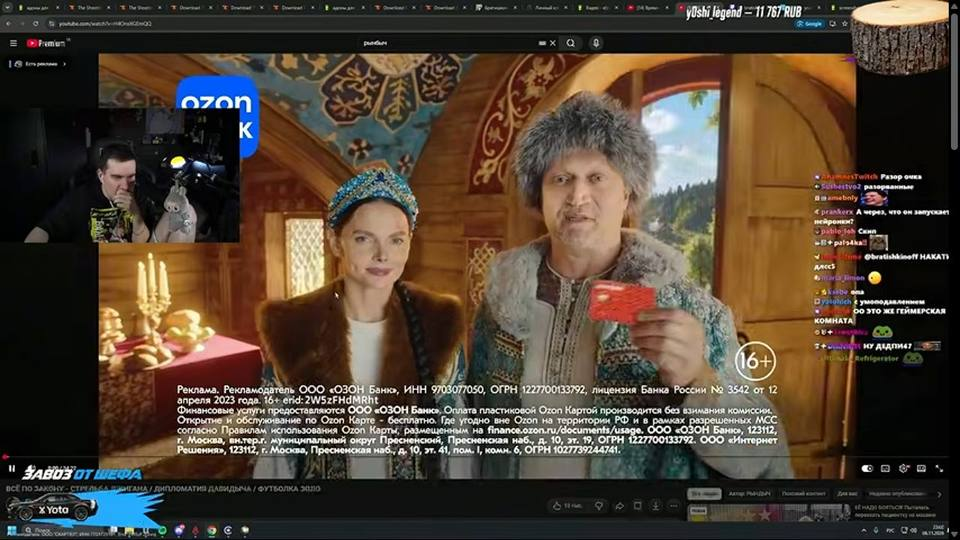 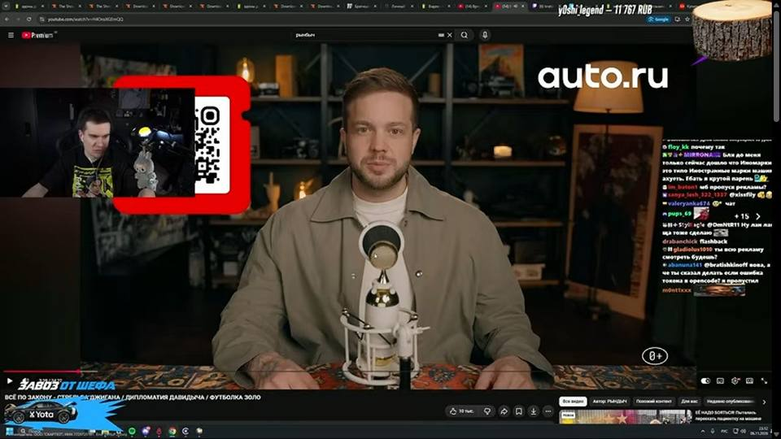 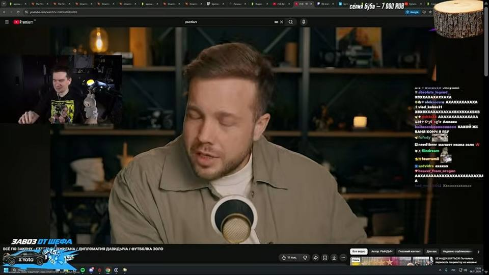

## 44. [НАРЕЗЧИК БРАТИШКИНА СТАЛ ДОКСЕРОМ ИЗ ЗА БАНА В ЧАТЕ](https://youtu.be/tIIiRcErRG4) (BG, шортс 1:08)

- **Шортс как трейлер длинного ролика.** На трети (00:22–00:30) голосовой призыв «полную версию ролика ты можешь посмотреть на канале БГ»; в описании одна строка «Весь ролик — <ссылка>».
  У нас: при нарезке шортса из выложенного лонга ставить «Связанное видео» и строку «Весь ролик — …»; призыв голосом или плашкой около 30–40% длительности, не в конце.
- **Крючок — история с конфликтом с первой секунды** («История о том, как …»): стример читает сообщение зрителя и тут же реагирует.
  У нас: в ✨pick поднимать моменты «прочитал донат или сообщение → эмоциональный звук»: всплеск донатов в `chat_signal` (`is_donation`) плюс звук после чтения.
- **Название капсом, имя стримера, в конце 2 хэштега кириллицей и латиницей** (`#братишкин #bratishkin`). У нас: правило шаблона шортса «КАПС + 2 хэштега ника».

Кадры: 00:01 — первый кадр и крючок; 00:22 — как подан призыв (плашка или только голос); 00:45.

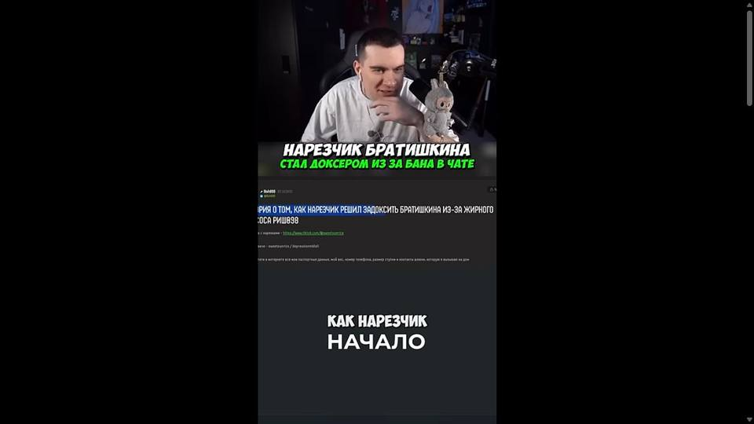 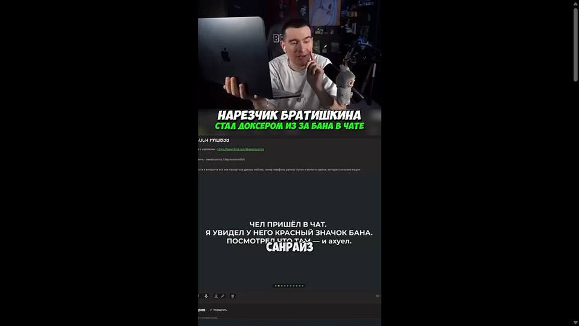 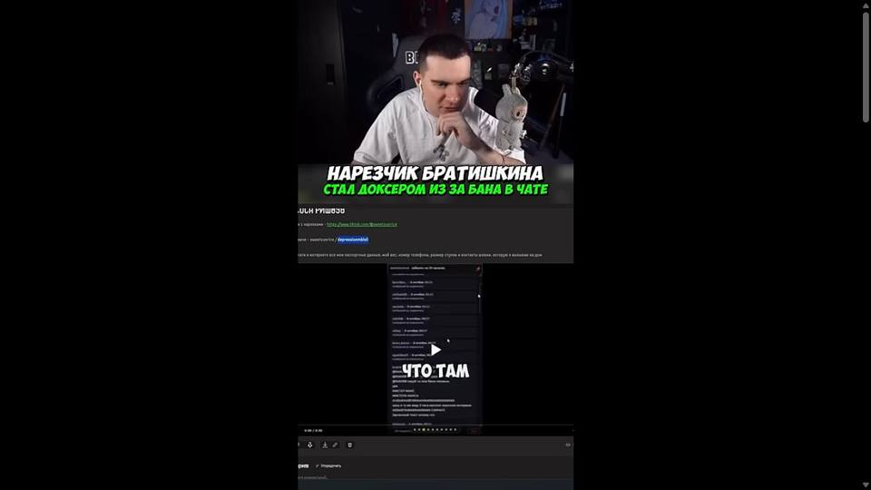

## 45. [ЭВЕЛОН СЛИЛ ВСЕ ДЕНЬГИ В СТРИП-КЛУБЕ GTA 6](https://youtu.be/jNRbBTQAaAc) (Evelone Rofls, 12:44)

- **Название «<СТРИМЕР> <глагол-провал в прошедшем> <объект> В <МЕСТО> <ИГРА>».** Сессия сведена к одному итогу, и он звучит в финале («мы по сути стрип-клуба купили»).
  У нас: в ✨publish-мета для игровой нарезки просить итог сессии в этой форме; проверять, что итог есть в транскрипте последних 60 с.
- **Паузы остаются:** 49 пауз > 3 с за 12 минут, геймплей без слов целиком не вырезают — в горизонталке темп мягче, чем в шортсе.
  У нас: порог тишины для горизонталки 6–8 с, для шортса около 0,7 с, разные пресеты `cut_points`.
- **Шортс 46 вырезан отсюда:** нарезчик берёт из лонга самый плотный кусок. У нас: после горизонталки автоматически предлагать 1–3 шортса из её пиков (`chat_signal.peaks` плюс реакция без слов).
- Реклама на 04:58 (около 40% ролика, после первого пика) — не наш случай, рекламу не вставляем.

Кадры: 00:05 — вебка поверх игры в 16:9; 03:16 — «держать», пик сюжета; 12:00 — финальная фраза-итог.

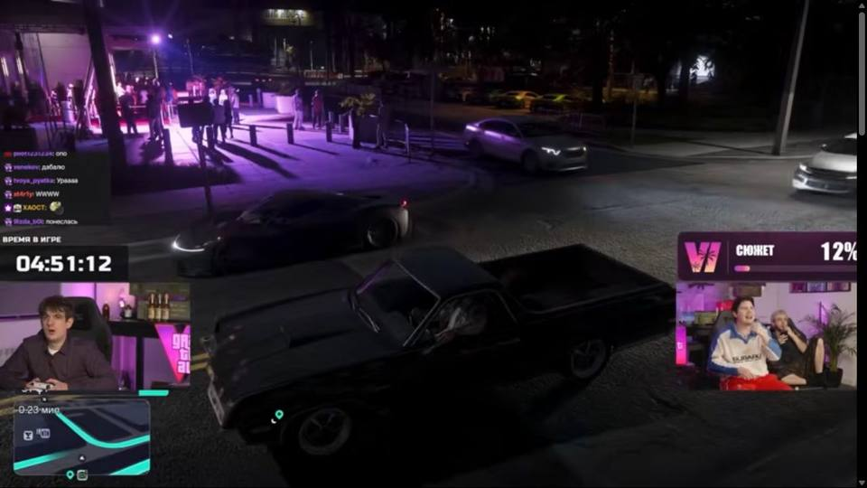 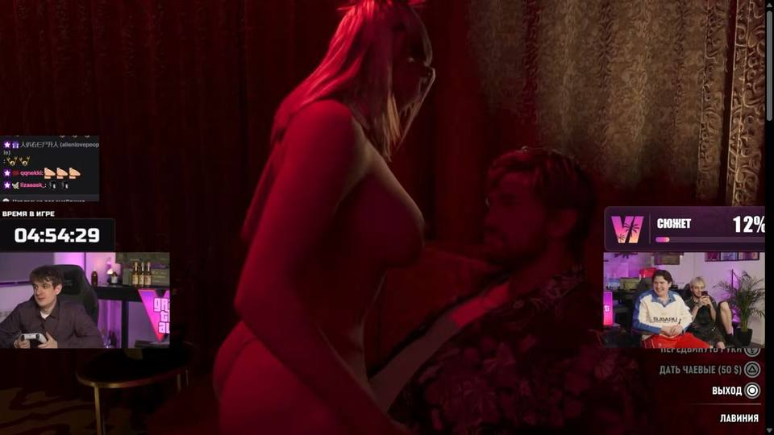 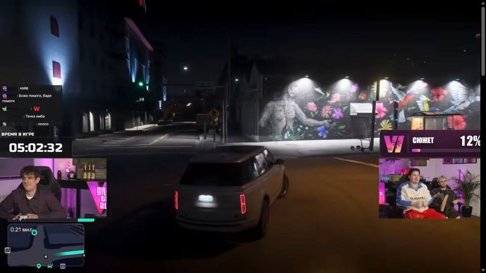

## 46. [twitch:evelone2004 #evelone](https://youtu.be/jqanHqDdG3E) (Evelone Rofls, шортс 0:21, 1080×1700)

- **Кусок 45 с 02:52 по 03:41 (49 с) ужат в 21 с, в 2,3 раза.** 0–5 с — заявка «я бы никогда в жизни не заплатил»; на 0:05 прыжок к опровержению «держать, нажми держать» (в лонге между ними 24 с); затем около 12 с смеха до конца.
  У нас: правило сборки — фраза-заявка из окна момента («никогда», «точно не», «спорим») ставится первой, середина режется до первой реакции, хвост реакции 8–15 с. Замер: от заявки до опровержения ≤ 5 с.
- **Название без смысла:** только `twitch:<канал> #<ник>`, ставка на первый кадр и ленту. У нас: запасной шаблон для TikTok/Shorts, не основной — данных мало.
- Кадр 1080×1700 вместо 1920 похож на случайный экспорт, не берём.

Кадры: 00:00 — первый кадр; 00:05 — склейка к опровержению; 00:15 — подписи на смехе.

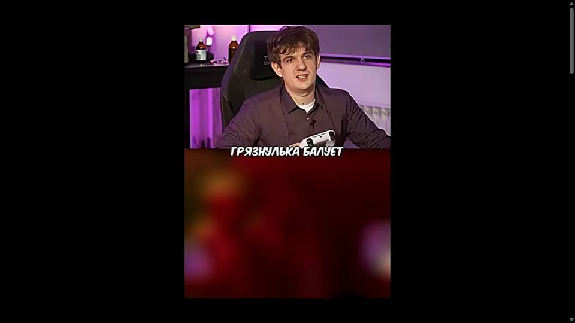 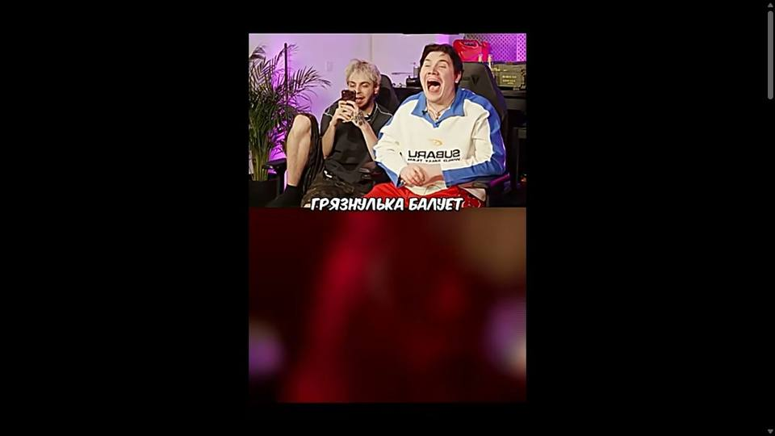 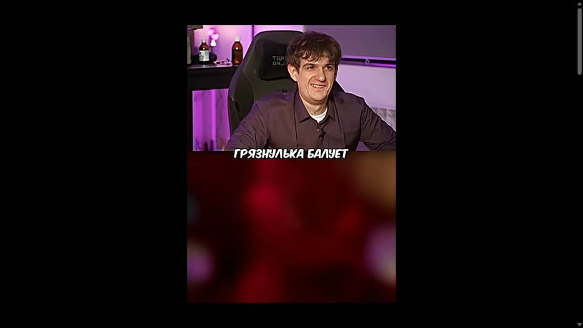

## 47. [ЭВЕЛОН СМОТРИТ: Топ Моменты с Twitch | Технические Неполадки](https://youtu.be/8oI892wZc6k) (Evelone Rofls, 21:32)

- **Пики пересмотров (05:23, 07:32, 17:40, 01:43) — испуги и визуальные гэги:** мало слов, длинная пауза (r = +0,49).
  У нас: признак момента «реакция без слов» — плотная речь, затем 3–8 с без слов с громким звуком (метки `громко`/`крик`/`смех?` в `audio_map.label_spans`), вес рядом с чатом в `chat_signal.rerank`. Проверка: против пиков смеха в чате на VOD Муры и Апекса.
- **Метка `[смех]` в автосубтитрах YouTube** (13 раз) — бесплатный детектор смеха. У нас: для YouTube-источника тянуть `ru-orig.vtt`, считать `[смех]`/`[laughter]`/`[screaming]` по 10-секундным корзинам, как чат.
- **Тематическая подборка:** одна тема в названии, ссылка «оригинал — …», бренд через « / EVELONE ROFLS». У нас: формула «<НИК> СМОТРИТ: <тема> / <БРЕНД>».
- **25 тегов-вариантов имени** (ЭВЕЛОН, ЕВЕЛОН, ЕВЕЛОНЕ, EVELON, EVELONE192, «ЭВЕЛОН РЕАКЦИЯ», «РЕАКЦИЯ ЭВЕЛОНА»…). У нас: детерминированный генератор тегов без модели — транслит, опечатки (э/е, лишняя «е»), ник с цифрами, «X реакция» / «реакция X».

Кадры: 00:05 — раскладка реакции; 05:23 — главный пик; 07:32 — второй пик.

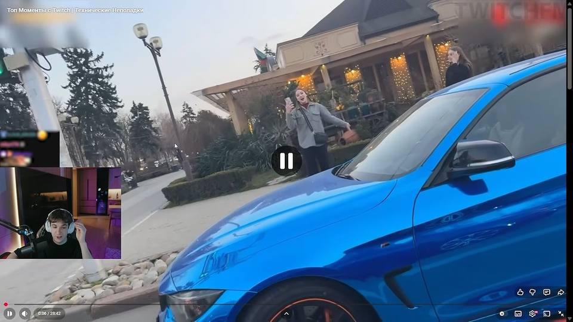 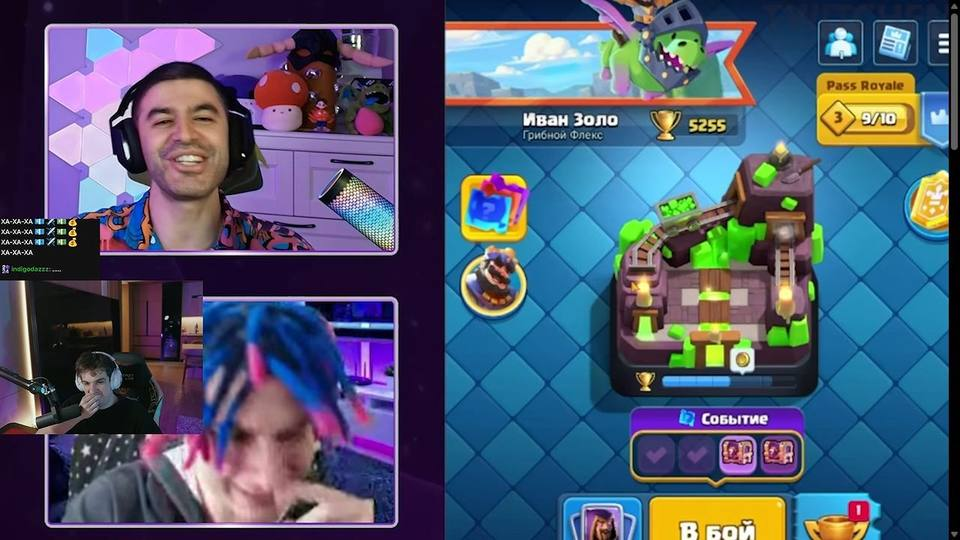 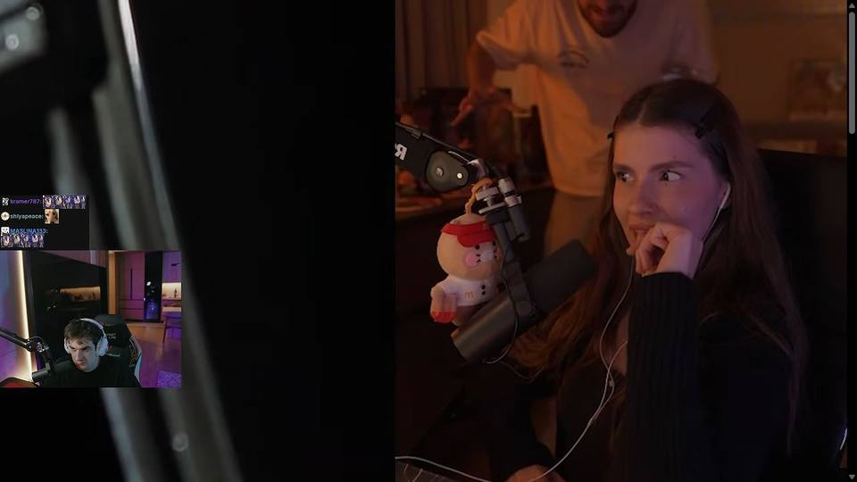

## 48. [БРАТИШКИН СМОТРИТ ФИЛЬМ БОРАТ | ЛУЧШЕЕ С ПРОСМОТРА | Нарезка со стрима](https://youtu.be/8iNtuzOPrpk) (Bratishkin Records, 18:48)

- **Совместный просмотр сжат до 19 минут:** в начале вводная стримера (зачем смотрим, чего ждать), дальше куски фильма вперемешку с комментариями, 55 пауз > 3 с.
  У нас: тип «лучшее с просмотра» — первые 30–60 с вводная (по транскрипту, до первого звука фильма), дальше отбор по `chat_signal`, порядок хронологический.
- **Описание = название, в тегах 25 вариантов** («борат реакция братишкина», «топ моменты твича»…): у канала со 119 подписчиками 119 тыс. просмотров. У нас: тот же генератор тегов — «<ник> смотрит <объект>», «<объект> <ник>», «реакция <ника>».

Кадры: 00:10 — раскладка, фильм и вебка; 01:00; 04:31.

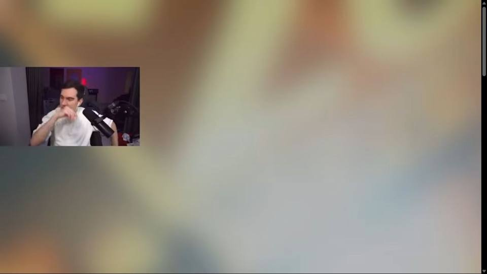 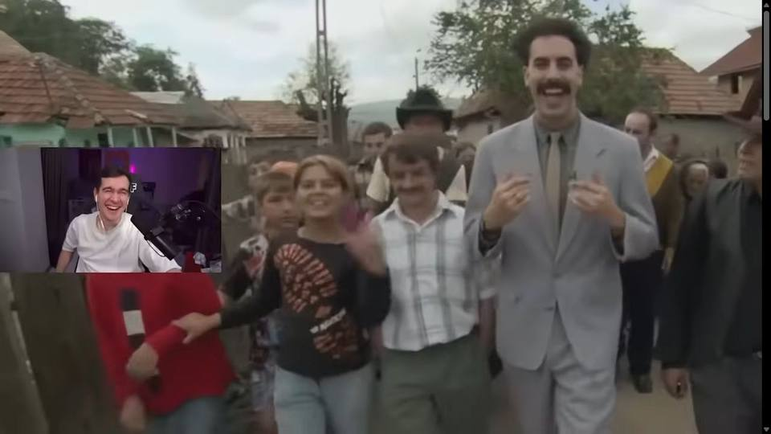 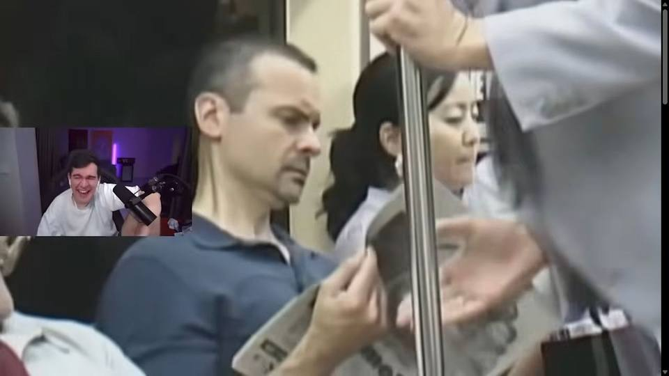

## 49. [IShowSpeed's Most LEGENDARY Moments of 2026](https://youtu.be/M7hMLuQviAA) (SpeedEditsHD, 12:25)

- **Около 30 клипов за 12 минут, 20–30 с на клип; первые 10 с без речи** (холодное открытие под музыку или монтаж).
  У нас: в `compilation.py` для «лучшее за год / месяц» 20–30 с на кусок, карточка номера 1,6 с; первые 5–10 с — тизер из 3–4 сильнейших кусков без слов. Проверить по кадрам.
- **Финал пересматривают:** начало 0,99, последний отрезок 1,00. У нас: сортировка компиляции — сильнейший кусок первым, второй по силе последним.
- **Описание:** плейлист «Hall of Fame», оригинальный автор, ко-фи, дисклеймер фан-канала. У нас: шаблон описания подборки со ссылкой на плейлист серии.

Кадры: 00:03 — холодное открытие; 03:50 — пик пересмотров («кто пописал в бассейн»); 12:17 — финальный пик.

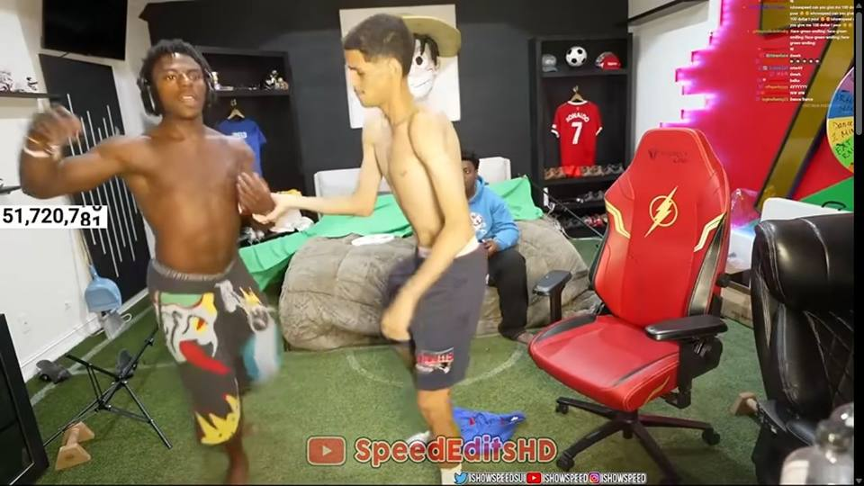 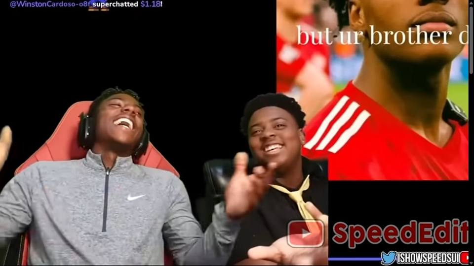 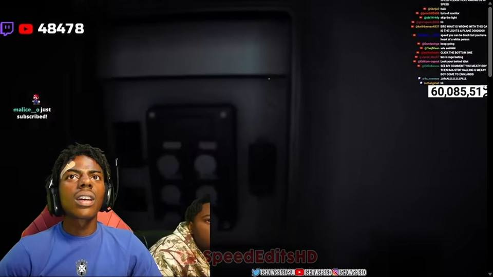

## 50. [Kai Cenat Spawning Out of Nowhere Streamer University 2026](https://youtu.be/-N24wiDrzYQ) (ClipNeverStop, 10:01, 2,2 млн)

- **Один гэг × около 25 повторов за 10 минут;** открывается и закрывается одной темой (00:00 «you here for the party?», 09:46 «You want to party?»).
  У нас: режим подборки «один гэг» — искать в транскрипте VOD повторы фразы или ситуации (ключевое слово плюс похожая реакция чата), первый и последний кусок с одной темой. Замер: число найденных повторов на источник.
- **Главный пик 06:40–06:50:** колкость «I could have sworn you've been working for 25 years», затем 6–8 с без слов. У нас: тот же признак «реакция без слов».
- **Главы с общими названиями,** похоже, от YouTube автоматически. У нас: в описание длинной подборки свои главы по кускам компиляции (таймкоды и названия кусков есть).
- **Название «<Стример> <гэг в -ing> <событие> <год>»,** описание — 4 хэштега участников. У нас: шаблон EN-названия.

Кадры: 00:05 — открытие; 06:43 — пик; 09:46 — закрывающая тема.

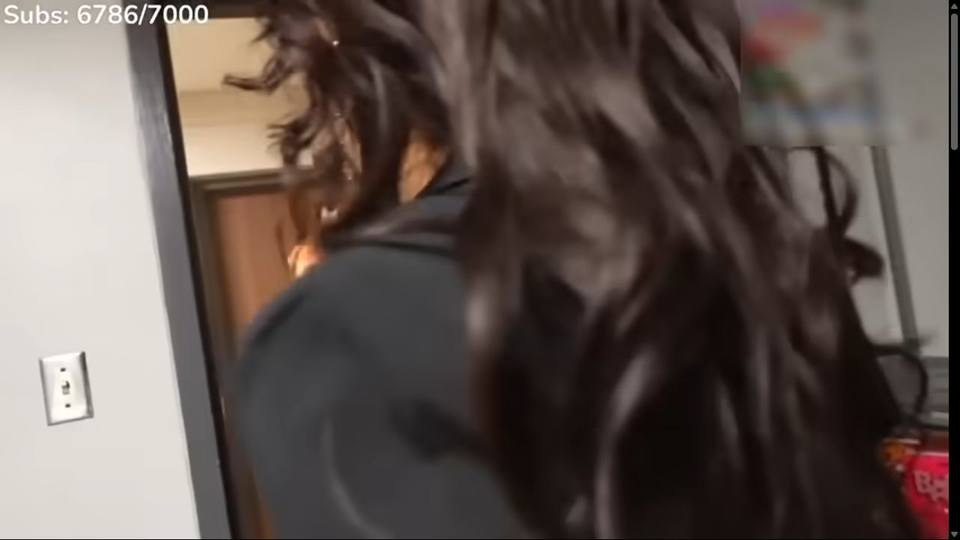 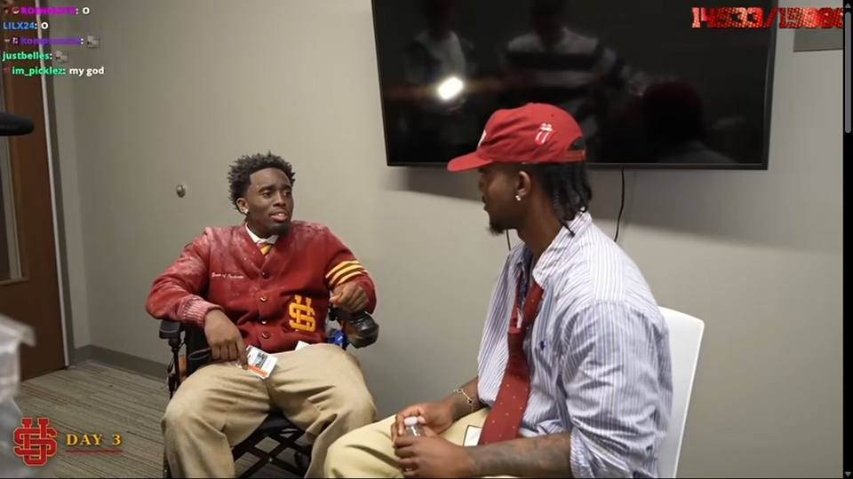 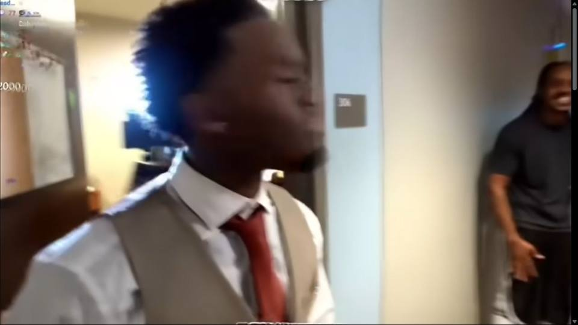

## 51. [This girl made Kai Cenat hold A RAT](https://youtu.be/rqsXApXTOZk) (Kai Cenat Shorts, шортс 0:42)

- **Заявка «you have rats, I got roaches» (0–5 с) → «Wait, I have a rat right here» (0:05) → 35 с паники.** Хвост реакции — 80% шортса. У нас: правило из 46 — заявка ≤ 5 с, длинный хвост; для стрим-шортса без закадрового голоса это норма.
- **Капсом только неожиданный объект** («A RAT»). У нас: в ✨publish-мета для EN выделять капсом 1–2 слова объекта, не всё название.
- 25 тегов с чужими коллабами — мусор, не берём.

Кадры: 00:00 — раскладка вебки и подписи; 00:06 — крыса в кадре; 00:20.

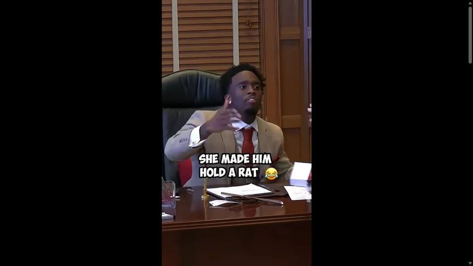 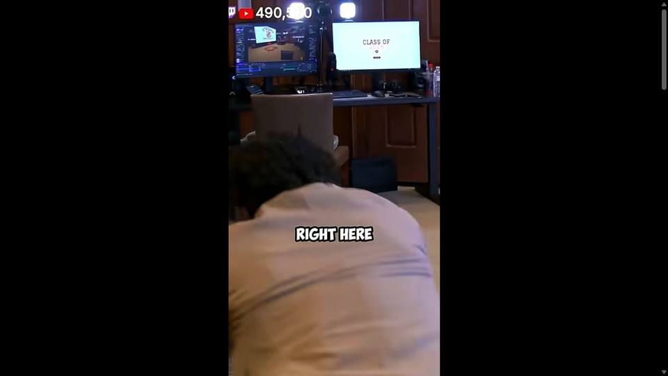 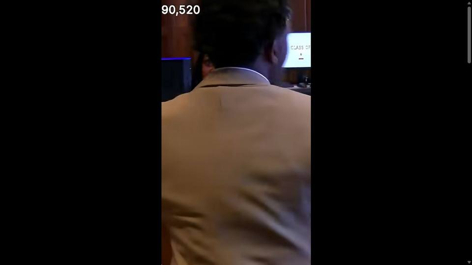

## 52. [clips that made Kai Cenat famous](https://youtu.be/yeSbUxW2M-4) (Kai Cenat Live, 12:44, 15,9 млн)

- **Около 25 клипов за 12,7 минуты, примерно 30 с на клип.** Пики 04:19–05:05: крик капсом, 7,6 с без слов (визуальный гэг), затем `[screaming]`/`[laughter]`. У нас: для EN-источников с YouTube капс и метки в автосубтитрах — готовый сигнал крика и смеха.
- **Название строчными, без капса и эмодзи;** формат держится с 2022 года. У нас: вариант названия для «лучшее за всё время».
- **Финал — обрыв** («It's too BIG TO FIT ON THE SCREEN»), без концовки и призыва. У нас: компиляция кончается последним куском без аутро. Замер: после последнего слова ≤ 1 с.

Кадры: 04:57 — главный пик; 00:00 — первый клип; 10:41 — «Drake in the building», гость как поворот.

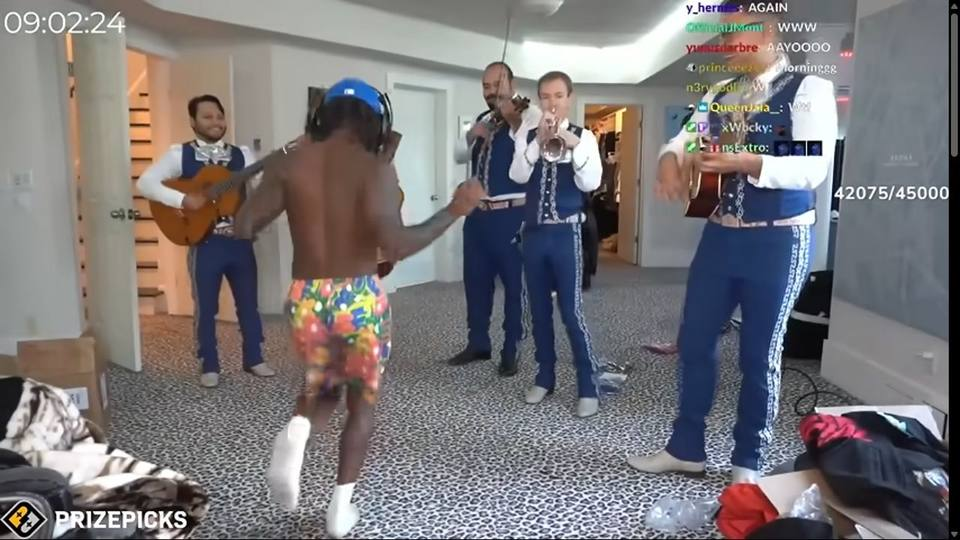 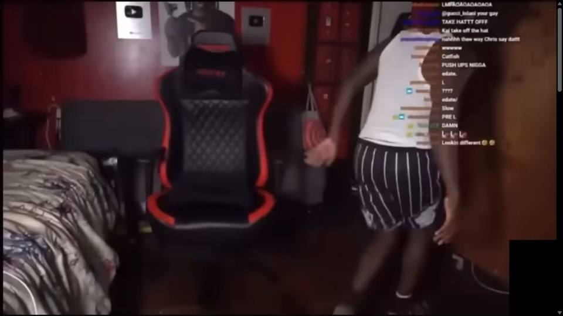 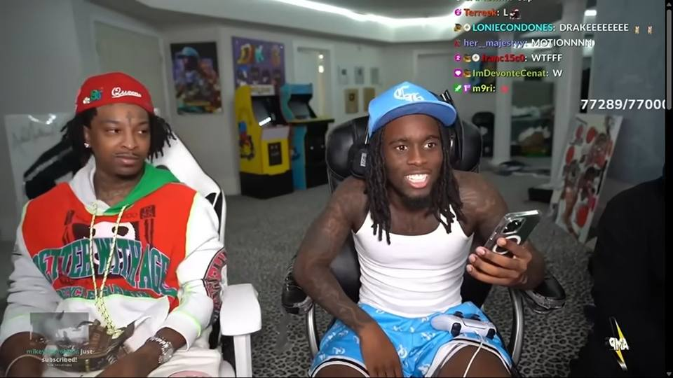

---

## Монтажёры объясняют

## 53. [How I Edit Youtube Shorts That Go Viral Everytime](https://youtu.be/tIHBCPINP2k) (Hals, 23:06)

Про шортсы с голосом за кадром, не про стримы.
- **Монтаж из многих клипов:** кадр 2–5 с, не дольше 5; картинка всегда про то, что говорит голос; голос без пауз; конец сразу, без «мёртвого» хвоста.
  У нас: `clip_check` для типа «объяснялка» — кадр ≤ 5 с, пауза голоса ≤ 0,3 с, после последнего слова ≤ 0,5 с.
- **Звуки по местам:** в крючке — нарастающий (suspense riser); на первой склейке — щелчок затвора и блик; дальше whoosh с наездом (pull-in zoom); глитч-переход с глитч-звуком; стрелка или кружок с «поп», привязанные трекингом к объекту.
  У нас: каждый переход моушна берёт парный звук из пака freesound (whoosh/glitch/pop/shutter). Замер: у каждой склейки с переходом звук в пределах ±50 мс.
- **Подписи:** Montserrat Bold, белые, ВСЕ ЗАГЛАВНЫЕ, анимация «color bounce»; водяной знак `@канал` мелко по центру с низкой непрозрачностью на всё видео.
  У нас: стиль «caps bold white + bounce» в default_pack, если его нет; водяной знак — моушн-слой с непрозрачностью около 0,3.
- Цвет и звук (экспозиция −2, контраст +2, резкость +5, голос около −1 дБ от пика) — вкусовые ползунки CapCut, сверх нашего нечего брать.

Кадры: 07:45 — вступление с whoosh; 13:50 — стрелка с трекингом; 18:10 — стиль подписей color bounce.

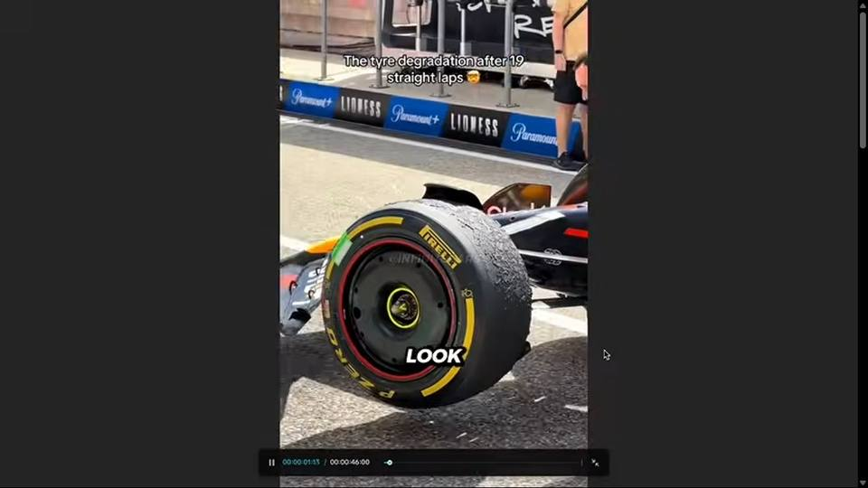 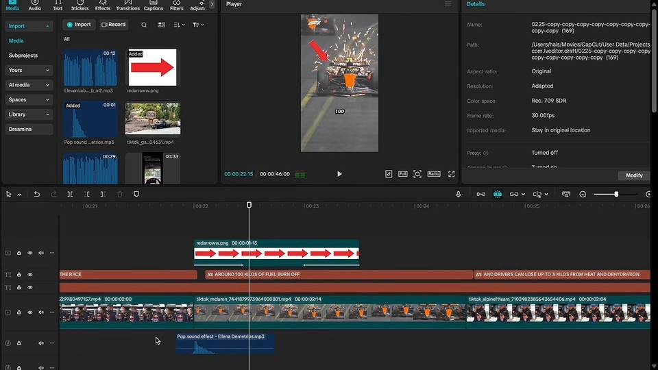 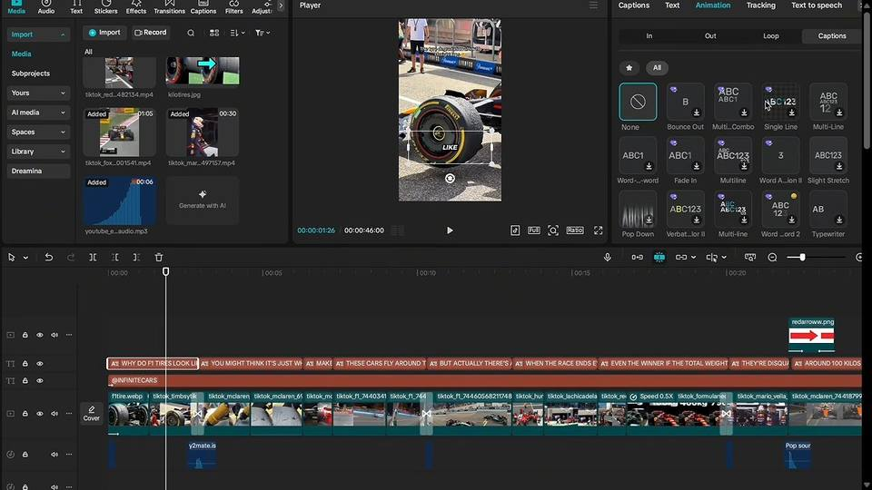

## 54. [How to Go Viral Clipping Streamers (Step-by-Step Guide)](https://youtu.be/1TmvyfIwGcA) (PhoenixyClips, 10:35)

- **Моменты — из клипов канала на Twitch за 7 дней,** зрители уже отметили; иначе мотать VOD шагами по 15 с.
  У нас: тянуть через GQL клипы зрителей с этого VOD (смещение и `view_count`) как внешний сигнал рядом с чатом в `chat_signal.rerank`. Замер: совпадение пиков чата с клипами зрителей.
- **Кадр 9:16 на том, кто говорит;** когда оба говорят быстро — держать на одном, чтобы камера не металась.
  У нас: в рефрейме переключаться на говорящего по диаризации, не чаще раза в 1,5–2 с (гистерезис). Замер: число смен цели в минуту.
- **Зум по ключам:** на склейке 100%; через несколько склеек 120% с ease-out; на следующей склейке снова 100%; в самом конце 115%.
  У нас: пресет «дыхание зума» в моушне. Замер: зум от 1,0 до 1,2, ни одного рывка внутри куска.
- **Подписи вручную** (звук стрима грязный, автосубтитры ошибаются), выше или ниже лица, каждому говорящему свой цвет, стример жёлтый.
  У нас: цвет по голосу через «голоса в субтитрах»; подпись не пересекает бокс лица из `facecam_from_faces` (пересечение 0); сверку делает `sub_sync`.
- **Финиш:** sharpen 40 + unsharp mask 20 / радиус 5, насыщенность около 150%, 60 кадров/с; музыка тише речи; «awkward moment» на неловкой паузе, «boom» на растерянности.
  У нас: опциональный «стрим-лук» в ffmpeg (`unsharp` плюс `eq=saturation≈1.3–1.5`), замер по SSIM до и после; звуки по меткам `audio_map`: тишина после реплики > 1,5 с → awkward, «крик» → boom.

Кадры: 03:45 — кадр перемещается к говорящему; 05:40 — ключи зума; 07:30 — цвет подписей по говорящему.

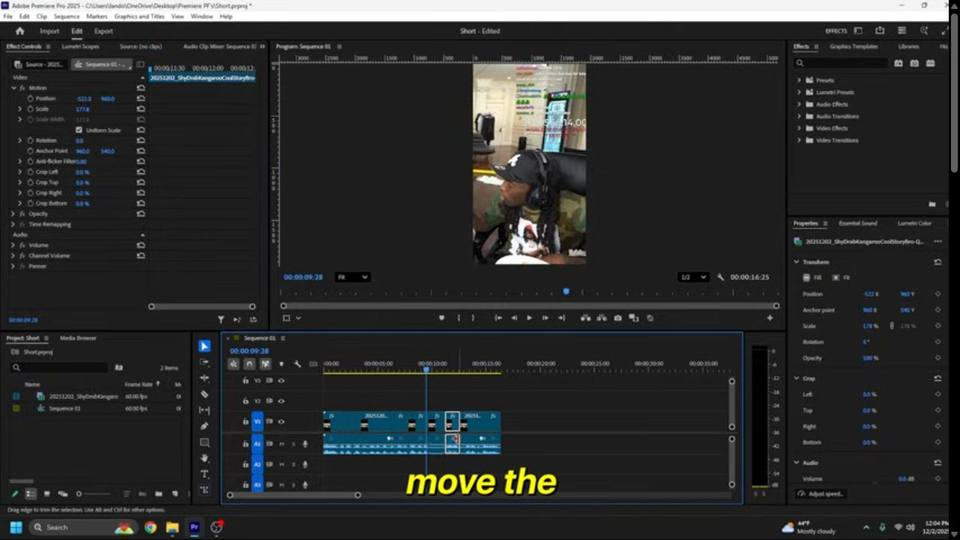 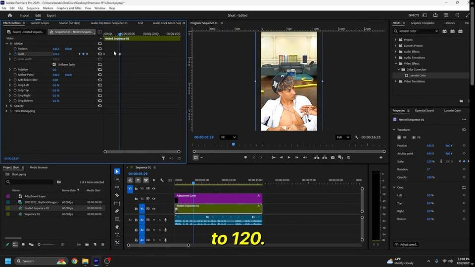 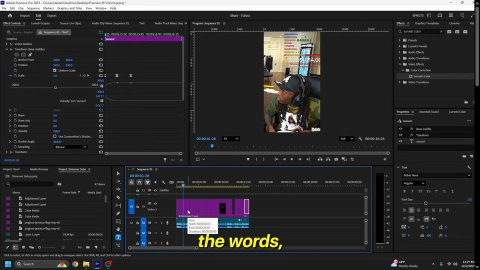

## 55. [How to Edit Viral iShowSpeed Shorts in CapCut](https://youtu.be/4veS2sXMYrA) (Sevqra, 4:48)

- **Моменты — по «самому пересматриваемому» на полосе VOD на YouTube;** не брать то, что выложили «сто раз».
  У нас: `heatmap` через `yt-dlp --dump-json` без входа (проверено) как внешний сигнал; повторы ловить по похожему транскрипту с уже выложенными роликами.
- **Лицо всегда на одной горизонтали:** направляющая, позиция и масштаб по ключам с easing.
  У нас: в рефрейме центр лица на фиксированной высоте (например, 0,3 от верха зоны) со сглаживанием. Замер: разброс y лица ≤ 3% высоты.
- **Подписи по словам вручную в такт:** Lemon Milk Bold (свободный, dafont), тень; фраза появляется коротким fade-in; эмоциональные слова цветом; весь слой медленно растёт к концу; glow. Это самый пересматриваемый момент урока (02:01–02:07).
  У нас: караоке по словам уже есть; добавить fade-in фразы, рост слоя 1,00→1,05 за клип, окраску слов-эмоций по списку и по громкости слова (`audio_map`).
- **На пике действия** (сальто) вспышка или оверлей с ключами непрозрачности и звук «динь», под всем фоновая музыка.
  У нас: на метке «громко»/«крик» вспышка и «динь» из пака (настоящие записи) с ограничением плотности.
- **Концовка:** фильтр, размытие и тряска 2–3 раза, эмодзи и текст-развязка со свечением, motion blur по всему ролику.
  У нас: пресет «blur + shake + payoff-текст» на последние 1–1,5 с (не аутро-карточка); развязка не перекрывает лицо.

Кадры: 01:10 — направляющие и лицо на линии; 02:01 — настройка подписей, пик пересмотров; 03:20 — концовка с размытием и тряской.

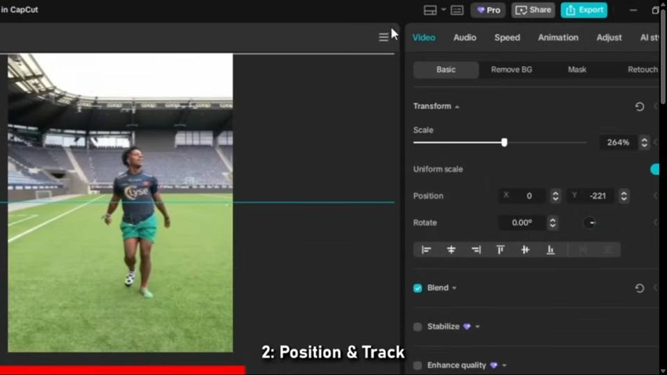 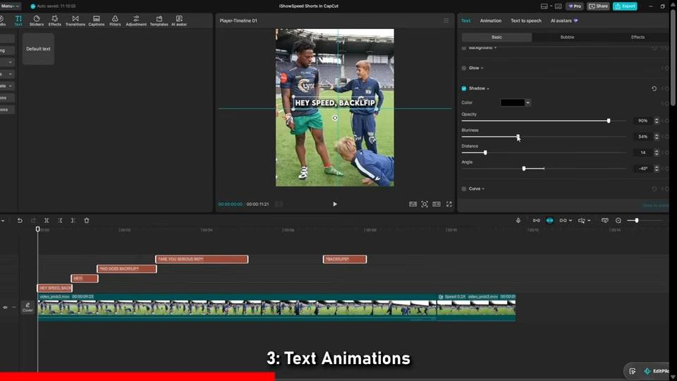 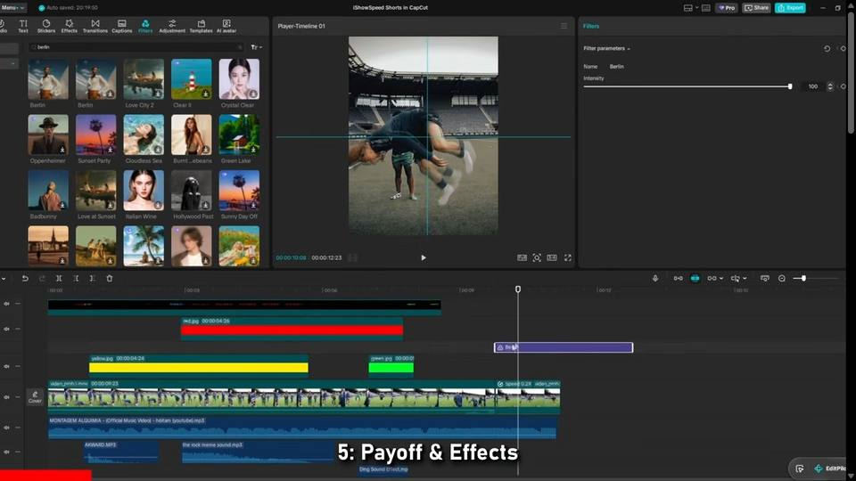

## 56. [КАК МОНТИРОВАТЬ НАРЕЗКИ СТРИМЕРОВ В ТИК ТОК?](https://youtu.be/MtD0SIM2RP4) (ТИМОХА ХАПАРИК 2006, 9:56)

- **Одно видео дважды:** сверху увеличенная вебка, снизу игра на всю ширину без чёрных полос; вебка сверху, потому что низ в TikTok закрыт описанием и тегами; звук у одной копии.
  У нас: это наш split `cam_pos=top`. Добавить проверку, что в нижней зоне нет чёрных полос (доля пикселей ярче порога в каждой строке); ключевой текст не ниже ~80% высоты (интерфейс TikTok).
- **Вебка закреплена, двигается только кадр игры** — резать и сдвигать, когда действие уходит вбок. У нас: рефрейм point-of-interest только в зоне геймплея, рамка вебки неподвижна.
- **Подписи на шве между вебкой и игрой,** пресет «чёрно-жёлтый». У нас: позиция по умолчанию для split — y шва из `split_geometry`. Замер: бокс подписи не пересекает лицо и центр интереса в игре.
- Тихая фоновая музыка, вырезать запинки — сверх названного нечего брать.

Кадры: 02:00 — сборка split из двух копий; 04:10 — сдвиг кадра игры при переходе действия; 07:30 — подписи на шве.

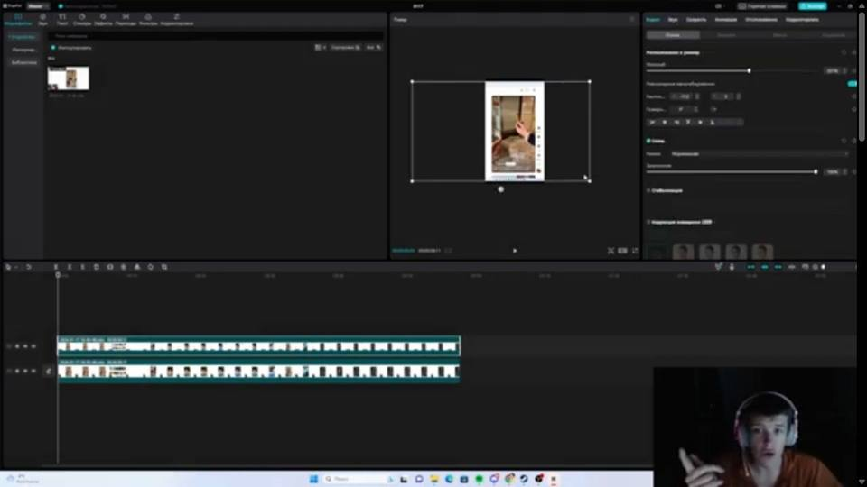 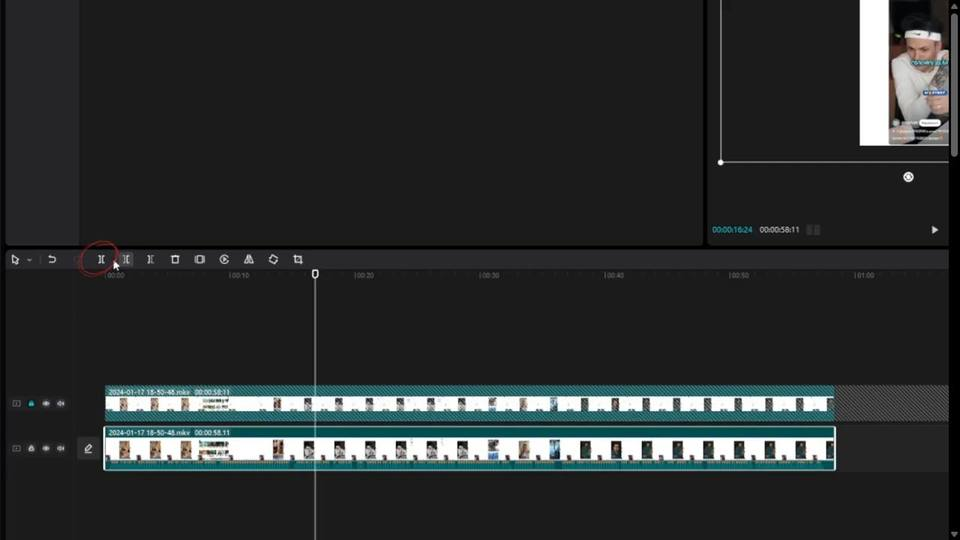 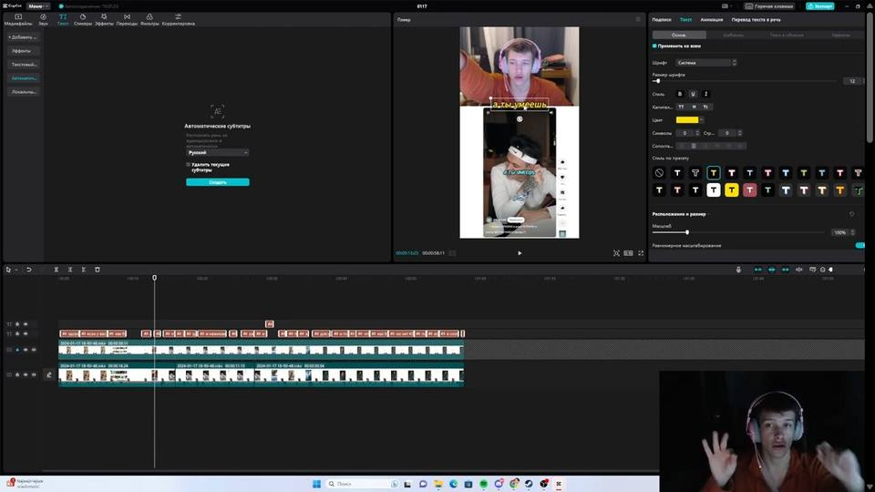
