# «Студия Игор» (@studioigor): что взять себе

На канале нейронки делают игры целиком: 3D собирают скриптами в Blender, движок Unity/Phaser.
Разобраны 2 видео из 5 последних (выбор владельца, 21.11.2026):

- [Нейронки сделали GTA 6! GPT 6.2 Astra vs Gemini 4 Neon vs Fable 5.2](https://www.youtube.com/watch?v=xPNjhouJ6ko) (49:32), кусок про 3D-анимацию 06:03–14:45;
- [Gemini 4 Carbon лучше Opus и Fable? Игра в стиле СТАЛКЕР](https://www.youtube.com/watch?v=cuwveBzMLjE) (58:58), риги и анимации 07:53–16:42.

Владелец сказал вписывать **только то, что мы сами можем проверить и запустить без человека**.
Поэтому здесь нет цифр расходов, сравнения моделей и мнений о плагинах.
Каждый пункт — приём из ролика, а под ним «у нас»: что сделать в наших инструментах.

Как снимались кадры: [`tools/yt_frames/grab.cjs`](../../../tools/yt_frames/grab.cjs) (настоящий Chrome, кадр прямо с плеера).

---

## 1. Проверка рывков в анимации

Fable сам написал скрипт: он проходит по всем анимациям и по всем точкам модели и ищет скачки между соседними кадрами.
Скрипт нашёл 7 плохих клипов, в одном бедро на один кадр прыгало на 17 см.
Если листать отдельные кадры, всё выглядит нормально: рывок виден только в движении.

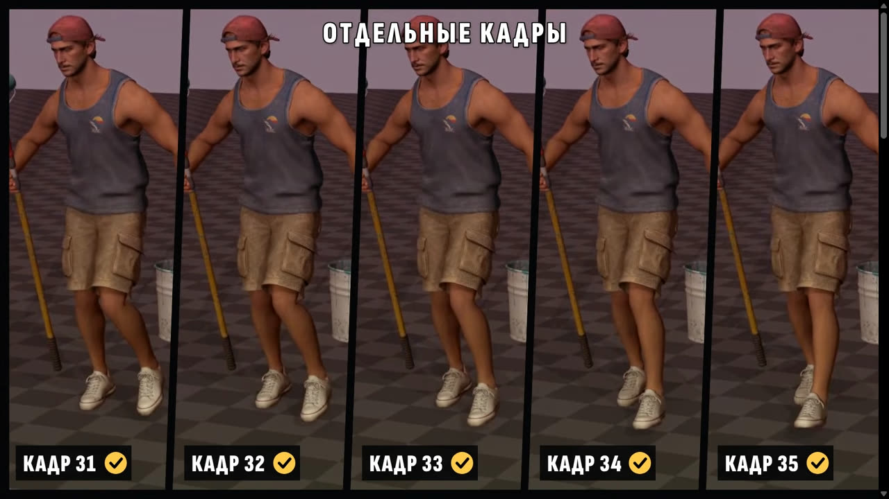
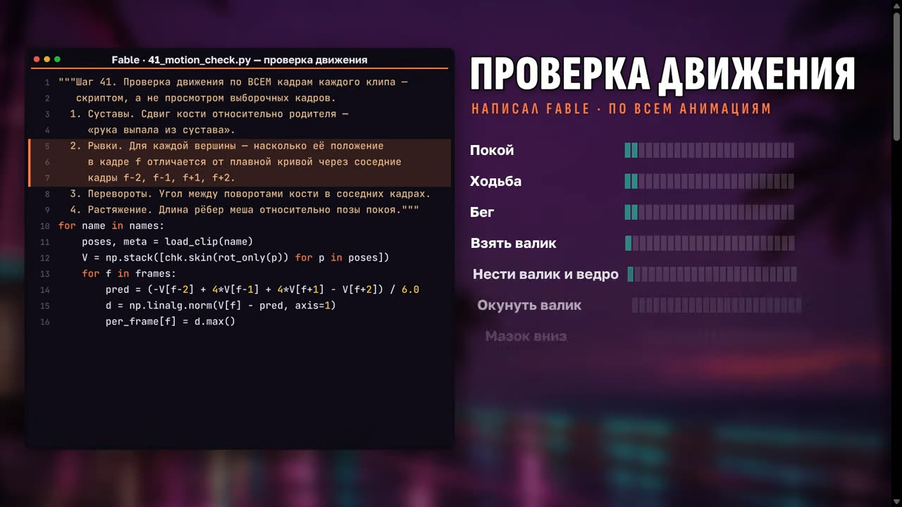
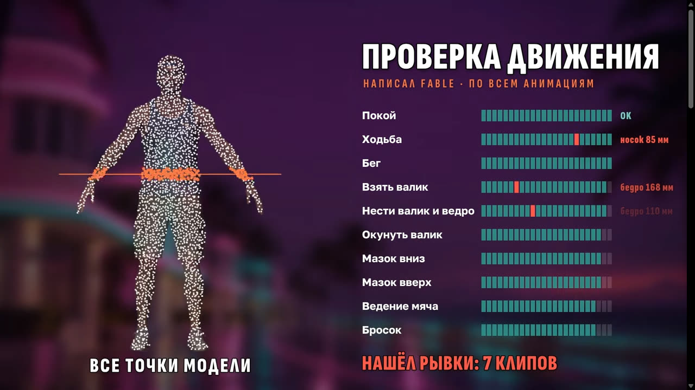

**У нас:** в `tools/model_check` есть только позы без движения.
Нужен режим проверки анимации:
- скачок вершины или кости между кадрами больше порога (с поправкой на скорость движения);
- отдельно — скачки поворота стопы и кисти.

Это ровно то, что ломало ноги в пилоте «Невезучего»: в v2–v3 стопа крутилась до 174° за кадр.
Запускать на каждом клипе до показа.

## 2. Направление сгиба суставов, пол, контакт с предметом

Одни и те же ошибки повторялись у всех трёх моделей в обоих роликах:
- колено гнётся вбок;
- локоть гнётся внутрь, из-за этого заламывается кисть;
- рука проходит сквозь гитару или тело;
- колени уходят под пол;
- в позе сидя выворачивается таз.

Автор их не починил, только написал «надо тюнить».

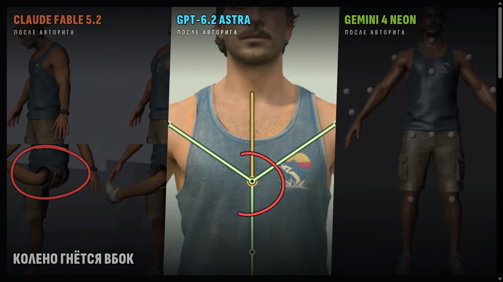
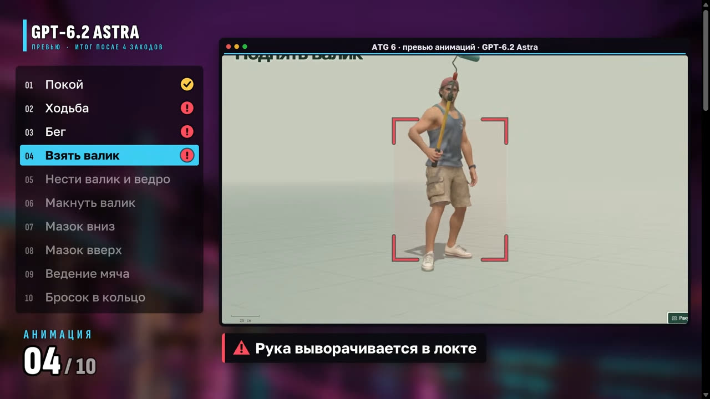
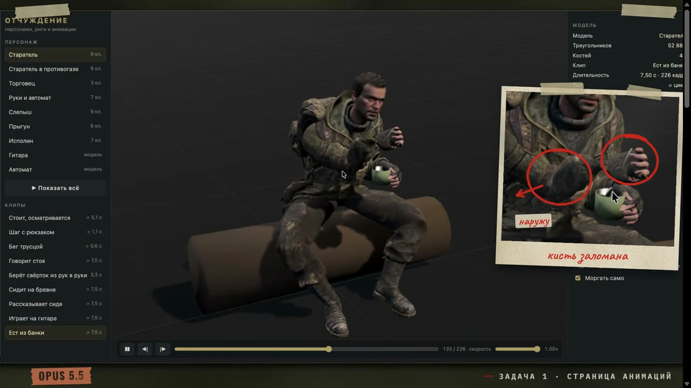

**У нас:** добавить в проверку анимаций три автоматических правила:
1. Колено и локоть сгибаются только в плоскости «бедро–стопа» или «плечо–кисть», в свою сторону.
2. Ни одна точка стопы или колена не ниже пола или ступеньки.
3. Кисть, которая держит предмет, касается его, но не проходит внутрь (через `clip_check.py` из `D:/vvf-offload/series_unlucky/clip_fix/`).

Лестница v4 уже держит колено в плоскости ноги. Сделать это общей проверкой, а не правкой одной сцены.

## 3. Проверять кости до анимации

Главная беда в GTA-ролике — кривой авториг, а не нейронки:
- шея начинается посередине груди;
- кисть висит в воздухе;
- нет костей пальцев.

Помог один отдельный промпт «найди и исправь скелет сам», без подсказок, что не так.

**У нас:** `tools/model_check` уже ставит кости VRoid по направлению на следующий сустав.
Перед любой анимацией прогонять проверку расстановки костей:
- шея и голова над плечами;
- кисть на конце руки;
- пальцы есть и смотрят вдоль кисти.

Если проверка падает — сначала чинить скелет, потом анимировать.

## 4. «Готово, когда»: точный список проверок

Astra через 22 минуты доложила «без пересечений», хотя проверила только ведро, а руки героя проваливались в тело.
Понадобилось 4 захода:
1. убрать пересечения;
2. переделать скелет;
3. осмотреть все анимации с 4 сторон;
4. поправить.

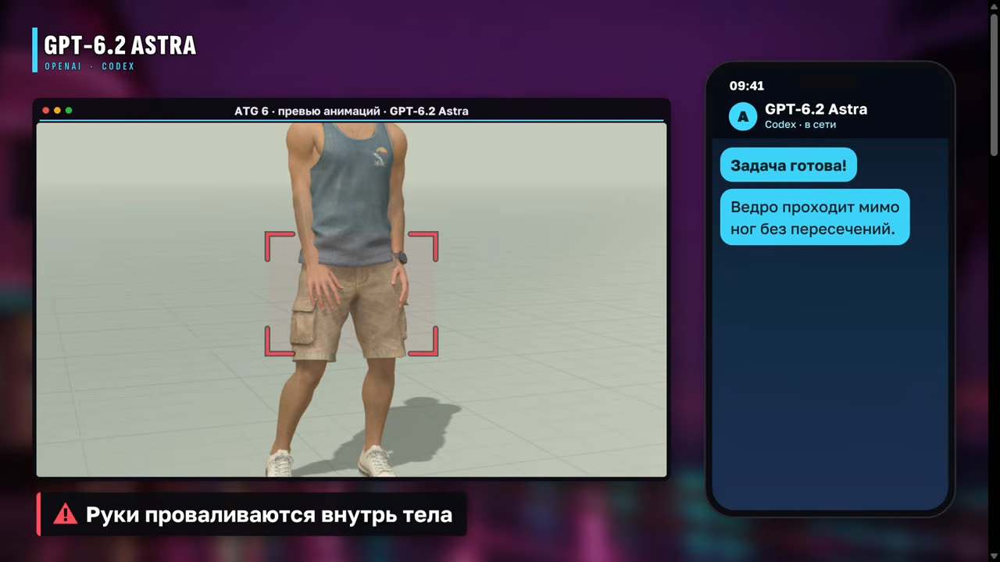
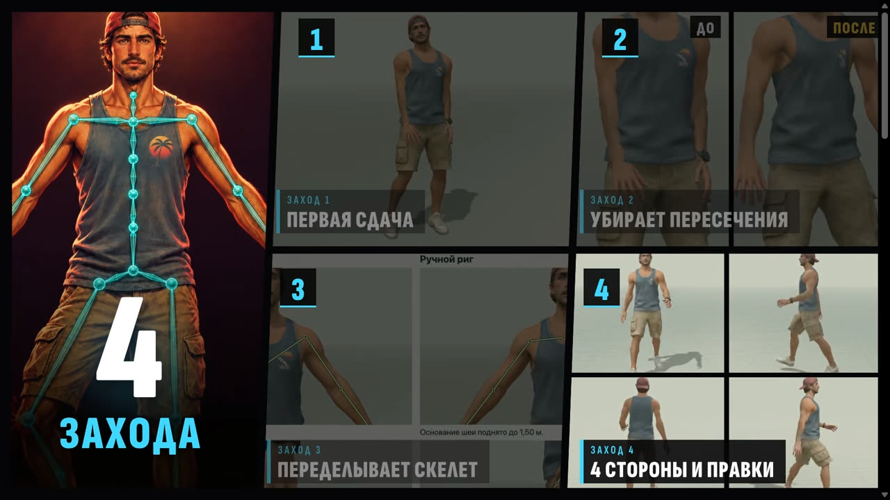

Задание он кладёт файлом в папку проекта. Разделы:
- «Игра и место этой задачи»;
- «Герой и предметы»;
- «Десять анимаций» (чеклист);
- «Страница превью»;
- «Что передать»;
- «Готово, когда».

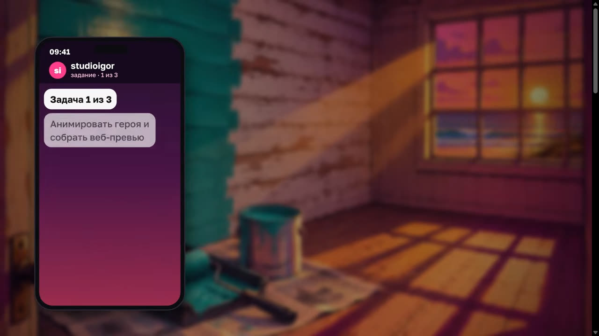
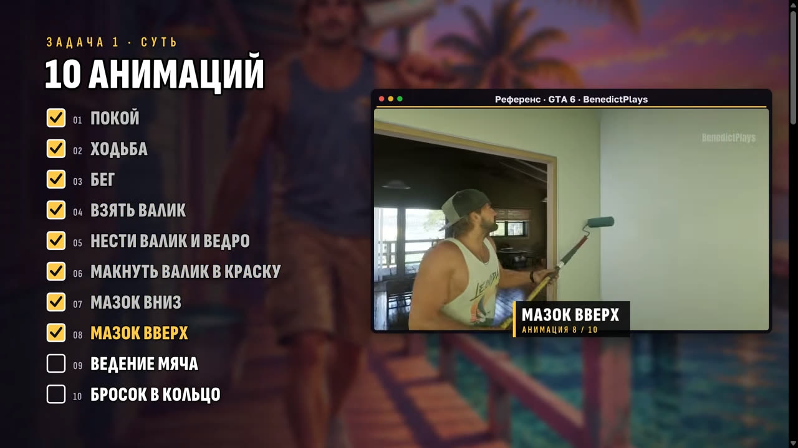
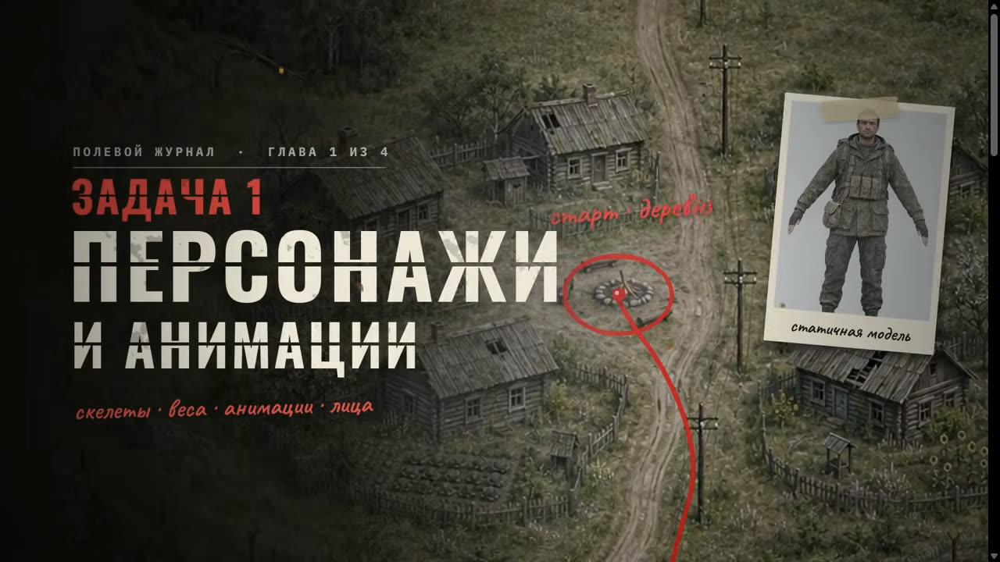

**У нас:** в брифах сабагентам на 3D писать раздел «Готово, когда» с конкретными проверками:
- `clip_check` чист;
- проверка рывков (пункт 1) чиста;
- облёт каждого клипа с 4 сторон приложен.

Сабагент не пишет «готово», пока не приложил отчёт по каждой из них.

## 5. Второй проход по референсу и рендер рядом с ним

- **Грузовик (Сталкер, задача 2):** вторым промптом было «Ещё раз посмотри на референсы и улучши». У всех трёх моделей после второго захода стало заметно лучше.
- **Сдача:** рендер в тех же ракурсах, что референсы, и рядом с ними; облёт; сетка отдельно.
- **В GTA:** модели сами клеили сравнение «концепт слева, кадр из Unity справа».

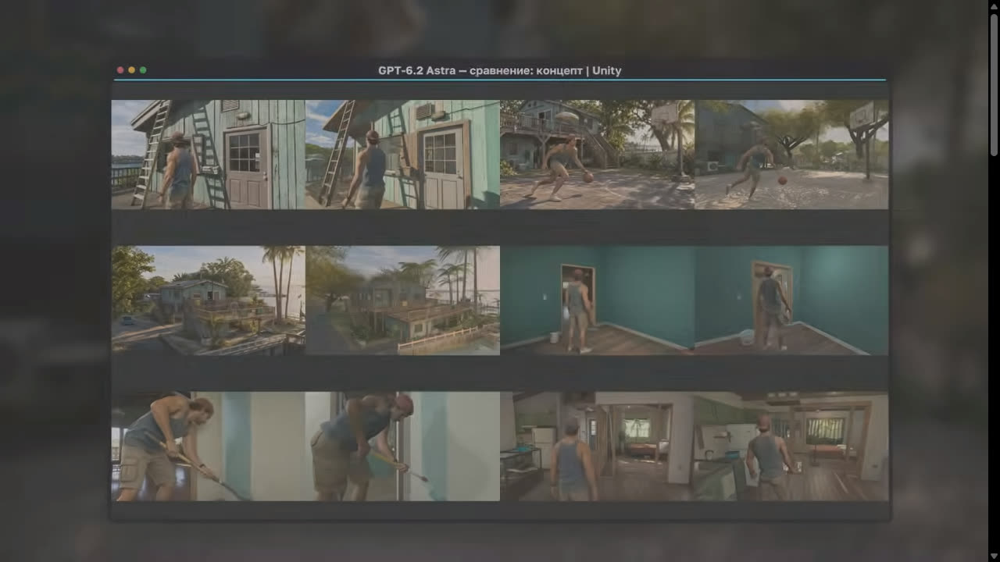

**У нас:** для пропов (TripoSG), сцен series3d и персонажей обязательно:
- картинка «референс | наш рендер» в том же ракурсе;
- затем отдельный проход «сравни и исправь».

Оба шага агент делает сам, без человека.

## 6. Страница «все персонажи × все клипы»

Приёмка задачи 1 — одна веб-страница: слева список персонажей, у каждого все клипы с плеером, камеру можно крутить.

**У нас:** такую же страницу генерировать после `model_check`.
- Все персонажи сериала и все их клипы в одном месте.
- Рядом — результаты проверок 1–3.
- Владелец смотрит одну ссылку вместо десятка роликов.

## 7. Очередь агентов по загрузке ПК

12 агентов на одном ПК машина не потянула. Помогло правило: перед новой тяжёлой подзадачей агент смотрит загрузку и решает, ждать или работать.
Каждый агент работает только в своей папке и ведёт дневник с багами «до/после».

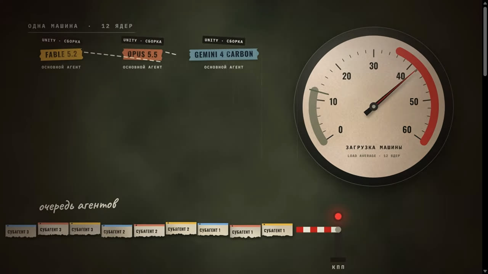

**У нас:** у нас то же самое с памятью (31 ГБ на несколько проектов).
Общий скрипт-гейт для тяжёлых шагов: Blender, обучение, ffmpeg-рендер.
- Ждать, пока свободной памяти не станет больше порога.
- Писать в лог, что ждёт и почему.

Голосовая цепочка уже так делает: ждёт 7.5 ГБ свободного commit. Вынести это в общий инструмент.

## 8. Сверка слов песни и голоса распознаванием

«Слушать не могу, буду проверять цифрами»: песни, голоса и липсинг модели проверяли распознаванием речи и графиками волны.
В одном припеве распознавание услышало «налей коньяку» вместо «налей-ка чаю». Строчку переписали и сгенерировали заново.

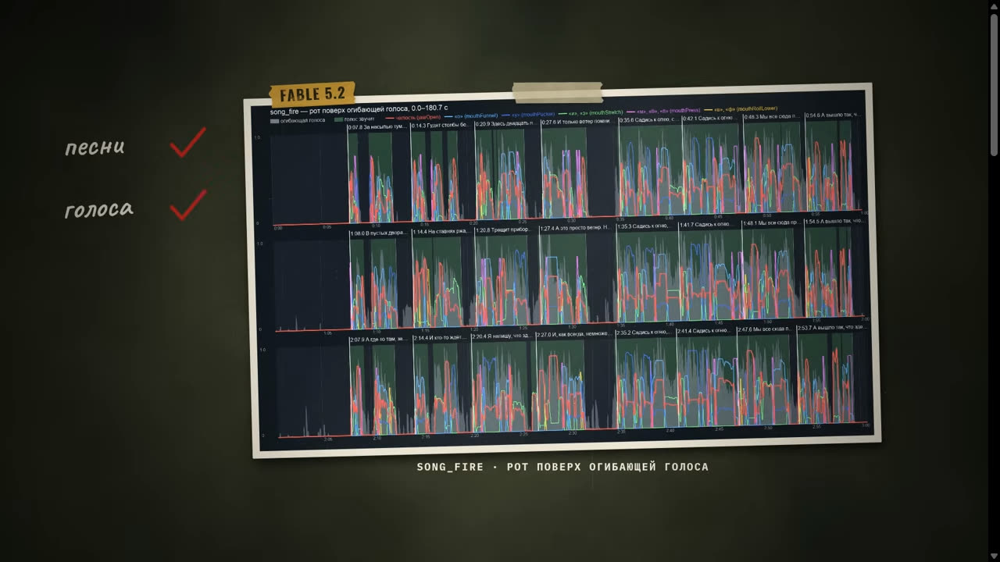
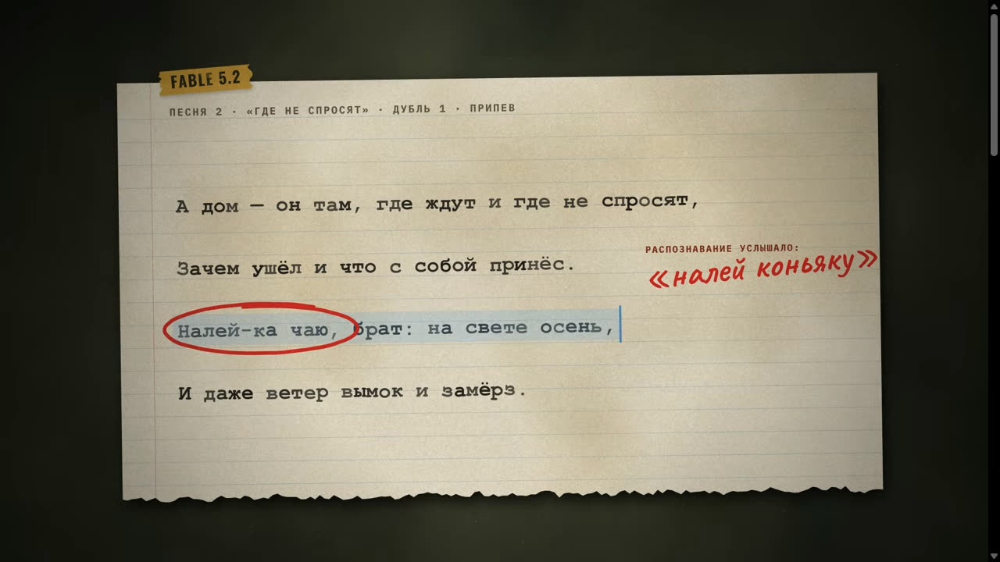

**У нас:** сверка субтитров с речью уже есть (`sub_sync`).
Добавить такой же прогон для готовой озвучки «Невезучего» и для песен в клипах: распознать и сравнить с текстом.
Строки с расхождением, где слышится другое слово, — переделать.

## 9. Чек-лист багов 3D-сцен

Что ломалось в сценах (Сталкер, задача 3):
- забор лежит лицом в землю;
- трава, которую просили сделать гуще, становилась только реже;
- вместо холмов вокруг деревни отвесная стена;
- текстура аптечки на берёзах, кострище и телегах — перепутаны материалы.

**У нас:** для series3d после сборки сцены:
- рендер сверху и с 4 сторон;
- проверка нормалей и поворотов объектов (лицом вниз, вверх ногами);
- проверка «у каждого объекта свой материал, а не один на всех»;
- сравнение плотности растительности с заданием.

---

## Что не вошло и почему

Модели и цены, режим «делай до утра», плагины Faceit, Smart Material Painter и SimpleBake, подача ролика плашками.
Это либо мнения, либо требует решения человека, а не автоматической проверки.
